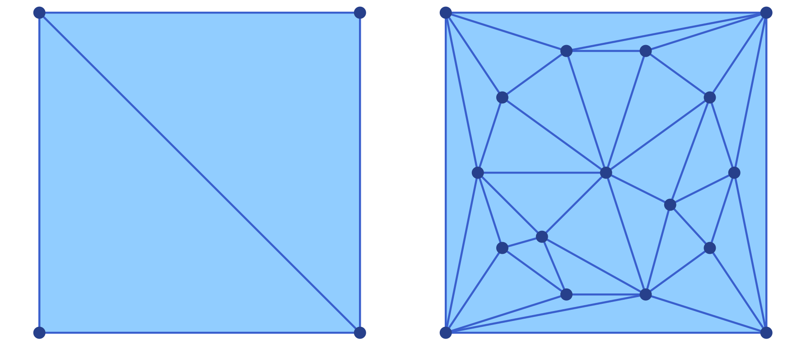
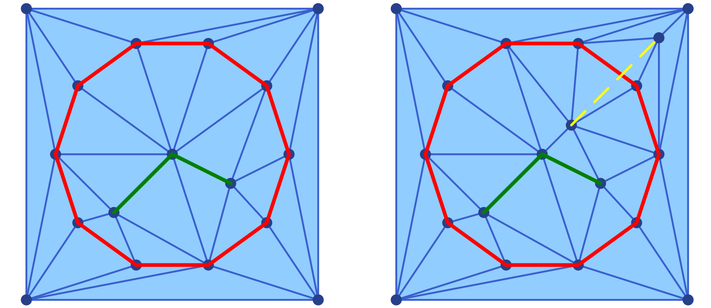
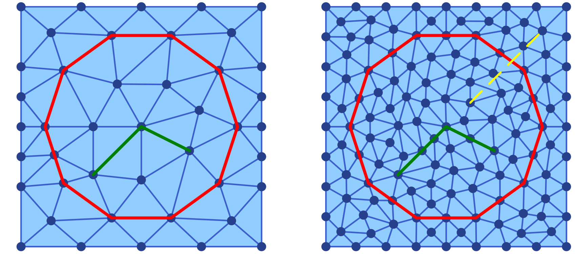
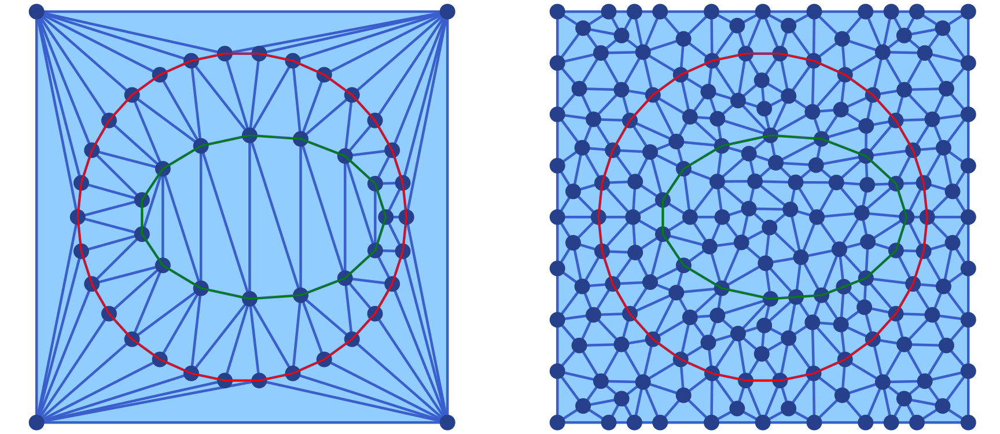
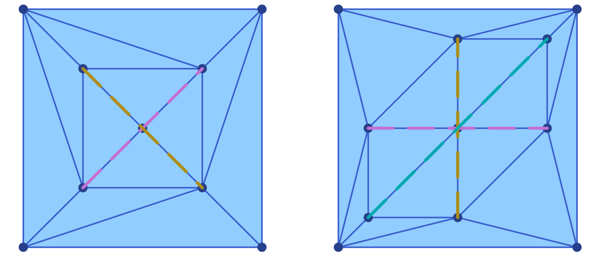

# Extensions

[ConleyDynamics.jl](https://almost6heads.github.io/ConleyDynamics.jl)
exposes optional functionality through *weak dependencies* — packages that
are loaded on demand and extend the library's capabilities without becoming
hard dependencies. This chapter documents the functions that become
available through these extensions. At present, the following backends
are provided:

* `DelaunayTriangulation.jl` for constructing constrained planar
  triangulations and converting them to simplicial complexes,
* `TetGen.jl` for constructing constrained quality tetrahedral meshes of
  three-dimensional domains,
* `Gmsh.jl` for meshing curved CAD geometry and domains with intersecting
  constraint surfaces, and
* `Plots.jl` and `Makie.jl` for the visualization of Lefschetz complexes
  and their dynamics in two and three dimensions.

The first three are described in this chapter, together with a number of
core functions for three-dimensional geometry which do not need any
extension. The plotting backends are described in the
[Visualization](@ref) chapter.

## DelaunayTriangulation.jl

The
[DelaunayTriangulation.jl](https://github.com/JuliaGeometry/DelaunayTriangulation.jl)
package computes Delaunay triangulations of planar point sets, optionally with
constrained edges and boundary curves.
Loading it alongside `ConleyDynamics.jl` activates three functions:

* [`delaunay_points_bnd_rectangle`](@ref) — initialise a point list and
  outer boundary for a rectangular domain,
* [`delaunay_points_add_segment`](@ref) — append constraint curves (closed
  or open) to that point list, and
* [`delaunay_to_simplicial`](@ref) — convert the finished triangulation into
  a [`EuclideanComplex`](@ref).

The typical workflow is to assemble the geometry with the first two functions,
call `triangulate` (and optionally `refine!`) from `DelaunayTriangulation.jl`,
and then convert the result with `delaunay_to_simplicial`.

### Defining the Bounding Domain

[`delaunay_points_bnd_rectangle`](@ref) creates a four-vertex rectangular
outer boundary. Its two arguments are vectors `bmin = [xmin, ymin]` and
`bmax = [xmax, ymax]` giving the lower-left and upper-right corners. It
returns a point list and a `bndcurve` in the format expected by the
`boundary_nodes` keyword of `triangulate`:

```julia
using DelaunayTriangulation
using ConleyDynamics

points, bndcurve = delaunay_points_bnd_rectangle([-5, -5], [5, 5])
tri1 = triangulate(points; boundary_nodes = bndcurve)
sc1  = delaunay_to_simplicial(tri1)
```

This already produces a valid `EuclideanComplex` — a triangulated filled
rectangle without any internal constraints. It is shown in the left panel
of the associated figure.



### Adding Interior Nodes

A finer triangulation of the underlying rectangle can be achieved by
adding interior nodes to the list of points describing the boundary.
This can be achieved with the function `delaunay_points_add_nodes`.
For example, we can add twelve interior nodes to the above square
using the following commands:

```julia
newpoints = [-4 .+ 8 .* rand(2) for k in 1:12]   # 12 random points
points    = delaunay_points_add_nodes(points, newpoints)

tri2 = triangulate(points; boundary_nodes = bndcurve)
sc2  = delaunay_to_simplicial(tri2)
```

This leads to the triangulation shown in the right panel of the above
figure. Note that the new triangulation makes use of all new interior
nodes, as well as the corners of the squares. The figure was created
using the commands

```julia
using Plots
p1 = plot_simplicial(sc1)
p2 = plot_simplicial(sc2)
pcombined = plot(p1, p2, layout=(1,2))
plot!(pcombined, dpi=300)
savefig(pcombined, "delaunayext1.png")
```

### Adding Constraint Curves

In many applications it is desirable to include certain polygonal curves
inside the domain as *constraint curves*, i.e., their edges have to
be part of the created Delaunay triangulation and any of its refinements.
Such constraint curves can be added to the initial mesh generation by
adding the vertices of the polygons to the point list, and specifying
the constraint edges in an argument `segments`, which has to be of
type `Set{Tuple{Int,Int}}`.

Such constraint curves can be generated as follows.
[`delaunay_points_add_segment`](@ref) appends a polygonal curve to the
point list and records successive point pairs as constrained edges. A curve
is passed as a `Vector{Vector{<:Real}}` of `[x, y]` coordinates. If the
first and last entries coincide (within a tolerance of `1e-9`), the curve is
treated as *closed* and no duplicate endpoint is stored; otherwise it is
treated as *open*.

The function has two calling forms. The two-argument form initialises a
fresh segment set and is convenient for the first constraint curve; the
three-argument form extends an existing `segments::Set{Tuple{Int,Int}}`:

```julia
using DelaunayTriangulation
using ConleyDynamics

points, bndcurve = delaunay_points_bnd_rectangle([-5, -5], [5, 5])

# Closed circular constraint (n+1 points with repeated first/last)
n      = 10
theta  = range(0, 2*pi, length = n+1)
circle = [[4.0 * cos(t), 4.0 * sin(t)] for t in theta]

# Open polygonal cut inside the domain
cut = [[-2.0, -2.0], [0.0, 0.0], [2.0, -1.0]]

points, segments = delaunay_points_add_segment(points, circle)          # 2-arg form
points, segments = delaunay_points_add_segment(points, segments, cut)   # 3-arg form

tri1 = triangulate(points; boundary_nodes = bndcurve, segments = segments)
sc1  = delaunay_to_simplicial(tri1)
```



The resulting Delaunay triangulation is shown in the left panel of the
figure. In addition to the generated mesh, it also shows the two contraint 
curves in red and green. This plot was generated using the following
commands:

```julia
using Plots

cirx = [pt[1] for pt in circle]
ciry = [pt[2] for pt in circle]
cutx = [pt[1] for pt in cut]
cuty = [pt[2] for pt in cut]

p1 = plot_simplicial(sc1)
plot!(p1, cirx, ciry, linewidth=3, color=:red)
plot!(p1, cutx, cuty, linewidth=3, color=:green)
```

We would like to point out that adding constraint curves to a triangulation
has to be done with care. More precisely, it is up to the user to ensure
that the **curves do not intersect each other** and that each curve is
**without interior self-intersections**. If these assumptions are not
satisfied, then
[DelaunayTriangulation.jl](https://github.com/JuliaGeometry/DelaunayTriangulation.jl)
will automatically remove some of the constraints. Consider for the
example the following additional commands:

```julia
# Open polygonal cut inside the domain
badcut = [[1.0, 1.0], [4.0, 4.0]]
points, segments = delaunay_points_add_segment(points, segments, badcut)

tri2 = triangulate(points; boundary_nodes = bndcurve, segments = segments)
sc2  = delaunay_to_simplicial(tri2)

badx = [pt[1] for pt in badcut]
bady = [pt[2] for pt in badcut]

p2 = plot_simplicial(sc2)
plot!(p2, cirx, ciry, linewidth=3, color=:red)
plot!(p2, cutx, cuty, linewidth=3, color=:green)
plot!(p2, badx, bady, linewidth=2, color=:yellow, linestyle=:dash)

pcombined12 = plot(p1, p2, layout=(1,2))
plot!(pcombined12, dpi=300)
savefig(pcombined12, "delaunayext2.png")
```

Clearly the added cut `badcut` intersects the circular constraint `circle`
from before. The mesh generated by `DelaunayTriangulation.jl` is shown in
the right panel of the above figure. Notice that the third constraint is
not respected by the triangulation, even though the two vertices from
the constraint have been added to the interior nodes.

### Mesh Refinement

After `triangulate`, `DelaunayTriangulation.jl` provides the function
`refine!` to improve the quality of the triangulation. Passing `max_area`
as a fraction of the total domain area and `min_angle` in degrees is a
practical starting point:

```julia
triarea1 = get_area(tri1)
refine!(tri1; max_area = 0.03 * triarea1, min_angle = 30.0)
sc3 = delaunay_to_simplicial(tri1)
```

The refined triangulation is then converted to a `EuclideanComplex` in the
same way as before. The optional argument `min_angle` has to be chosen with
care. If one chooses an angle larger than `30` then it is no longer certain
that an appropriate triangulation can be generated. The resulting triangulation
is shown in the left panel of the next figure.



We can also refine the second mesh from above, the one with the 
bad constraint curve `badcut`:

```julia
triarea2 = get_area(tri2)
refine!(tri2; max_area = 0.007 * triarea2, min_angle = 25.0)
sc4 = delaunay_to_simplicial(tri2)
```

The resulting triangulation is shown in the right panel of the above figure.
Notice that while the nodes determining `badcut` are still part of the
triangulation, the edge is not -- just as before. The above figure
was created using the following commands:

```julia
p3 = plot_simplicial(sc3)
plot!(p3, cirx, ciry, linewidth=3, color=:red)
plot!(p3, cutx, cuty, linewidth=3, color=:green)

p4 = plot_simplicial(sc4)
plot!(p4, cirx, ciry, linewidth=3, color=:red)
plot!(p4, cutx, cuty, linewidth=3, color=:green)
plot!(p4, badx, bady, linewidth=2, color=:yellow, linestyle=:dash)

pcombined34 = plot(p3, p4, layout=(1,2))
plot!(pcombined34, dpi=300)
savefig(pcombined34, "delaunayext3.png")
```

### Complete Example

The following self-contained snippet combines all three steps — bounding
rectangle, two circular constraints, mesh refinement, and conversion:

```julia
using Plots
using DelaunayTriangulation
using ConleyDynamics

# Bounding box
points, bndcurve = delaunay_points_bnd_rectangle([-5, -5], [5, 5])

# Outer ring (closed, 30 segments)
n1    = 30
th1   = range(0, 2*pi, length = n1+1)
ring  = [[4.0 * cos(t), 4.0 * sin(t)] for t in th1]
ringx = [pt[1] for pt in ring]
ringy = [pt[2] for pt in ring]
points, segments = delaunay_points_add_segment(points, ring)

# Inner elliptical disc (closed, 15 segments)
n2    = 15
th2   = range(0, 2*pi, length = n2+1)
disc  = [[0.5 + 3.0 * cos(t), 2.0 * sin(t)] for t in th2]
discx = [pt[1] for pt in disc]
discy = [pt[2] for pt in disc]
points, segments = delaunay_points_add_segment(points, segments, disc)

# Triangulate, refine, and convert
tri = triangulate(points; boundary_nodes = bndcurve, segments = segments)
sc1 = delaunay_to_simplicial(tri)

triarea = get_area(tri)
refine!(tri; max_area = 0.005 * triarea, min_angle = 27.0)
sc2 = delaunay_to_simplicial(tri)

# Plot the triangulations
p1 = plot_simplicial(sc1)
plot!(p1, ringx, ringy, color=:red)
plot!(p1, discx, discy, color=:green)

p2 = plot_simplicial(sc2)
plot!(p2, ringx, ringy, color=:red)
plot!(p2, discx, discy, color=:green)

pcombined = plot(p1, p2, layout=(1,2))
plot!(pcombined, dpi=300)
savefig(pcombined, "delaunayext4.png")
```

The resulting Delaunay triangulations are shown in the next figure.



### Adding Intersecting Constraint Segments

As noted above, `delaunay_points_add_segment` requires the caller to ensure
that constraint curves do not intersect each other. When this condition
cannot be guaranteed -- for example when the curves are computed
programmatically and may share crossings or collinear overlaps --
`delaunay_points_add_split_segs` provides a safe alternative.

Internally it calls [`split_segments`](@ref), which computes the planar
straight-line arrangement of the given segments: All crossings and collinear
overlaps are resolved and the input segments are split at every intersection
point, yielding a non-crossing set of sub-segments. These vertices and
sub-segments are then appended to the existing point list and constraint-edge
set exactly as `delaunay_points_add_segment` would.

The function signature mirrors that of `delaunay_points_add_segment`: The
two-argument form initialises a fresh segment set, and the three-argument
form extends an existing one. An optional keyword argument `verbose=true`
prints a brief summary of the splitting process.

!!! warning "Three-argument form: Overlaps with existing segments are not checked"
    When calling the three-argument form,
    [`split_segments`](@ref) resolves crossings and overlaps **within
    `newsegments` only**. No check is performed for intersections or overlaps
    between the newly added sub-segments and the segments already present in
    `segments`. It is the caller's responsibility to ensure that the two sets
    are compatible. Incorrect use can produce an invalid constraint-edge set
    that silently causes `DelaunayTriangulation.jl` to drop constraints.
    Only use the three-argument form if you know that the new segments do not
    intersect the existing ones.

The basic usage of [`delaunay_points_add_segment`](@ref) is illustrated in the
following code segment:

```julia
using DelaunayTriangulation
using ConleyDynamics

points1, bndcurve1 = delaunay_points_bnd_rectangle([-2, -2], [2, 2])

# Two crossing diagonals - they would violate the no-intersection requirement
# of delaunay_points_add_segment, but split_segments resolves the crossing.
segs1 = [[[-1.0, -1.0], [1.0,  1.0]],
         [[-1.0,  1.0], [1.0, -1.0]]]

points1, segments1 = delaunay_points_add_split_segs(points1, segs1; verbose=true)
# Output:
#   split_segments: 2 input segment(s)
#     intersection points created : 1
#     output vertices             : 5
#     output edges                : 4

tri1 = triangulate(points1; boundary_nodes = bndcurve1, segments = segments1)
sc1  = delaunay_to_simplicial(tri1)
```



The resulting triangulation is shown in the left panel of the figure.
The five vertices (four original endpoints plus the crossing at the origin)
and the four sub-segments are all included as constraints in the triangulation.
The result is a valid `EuclideanComplex` whose constraint edges are respected
by the mesh.

The following more complex example with three mutually intersecting segments
demonstrates that the function [`delaunay_points_add_split_segs`](@ref) also
handles multiple simultaneous crossings correctly:

```julia
using DelaunayTriangulation
using ConleyDynamics

points2, bndcurve2 = delaunay_points_bnd_rectangle([-4, -4], [4, 4])

# Three segments that all cross each other
segs2 = [[[-3.0,  0.0], [3.0,  0.0]],   # horizontal
         [[ 0.0, -3.0], [0.0,  3.0]],   # vertical
         [[-3.0, -3.0], [3.0,  3.0]]]   # diagonal

points2, segments2 = delaunay_points_add_split_segs(points2, segs2; verbose=true)
# Output:
#   split_segments: 3 input segment(s)
#     intersection points created : 3
#     output vertices             : 9
#     output edges                : 6

tri2 = triangulate(points2; boundary_nodes = bndcurve2, segments = segments2)
sc2  = delaunay_to_simplicial(tri2)
```

For the produced triangulation, see the right panel of the above figure.
The three intersection points (origin, and the two axis crossings with the
diagonal) are automatically detected, and each input segment is split into
two sub-segments at its crossings. The figure was created using the following
commands:

```julia
using Plots

p1 = plot_simplicial(sc1)
for p1seg in segs1
    pt1, pt2 = p1seg
    plot!(p1, [pt1[1],pt2[1]], [pt1[2],pt2[2]], linewidth=3, linestyle=:dash)
end

p2 = plot_simplicial(sc2)
for p2seg in segs2
    pt1, pt2 = p2seg
    plot!(p2, [pt1[1],pt2[1]], [pt1[2],pt2[2]], linewidth=3, linestyle=:dash)
end

pcombined = plot(p1, p2, layout=(1,2))
plot!(pcombined, dpi=300)
savefig(pcombined, "delaunayext5.png")
```

## Three-Dimensional Geometry

The remaining sections of this chapter are concerned with complexes in
three dimensions. The analysis functions of
[ConleyDynamics.jl](https://almost6heads.github.io/ConleyDynamics.jl)
do not depend on the dimension of the underlying space. In particular,
[`create_spatial_mvf`](@ref) accepts tetrahedral meshes, and homology,
Morse decompositions, and connection matrices can be computed for any
[`EuclideanComplex`](@ref). What is needed in addition is a way to
*create* tetrahedral meshes of interesting domains, and a way to *look*
at them. The package provides three layers of functionality for the
first task:

* Core functions, which are available without loading any other package.
  They import meshes from arbitrary sources, create random point samples,
  and create triangulated surfaces such as spheres, cylinders, and tori,
  which can serve as building blocks of more complicated domains.
* The `TetGen.jl` extension, which creates quality tetrahedral meshes of
  domains bounded by triangulated surfaces, possibly with embedded
  constraint surfaces and curves, holes, and regions with different mesh
  sizes. It is the three-dimensional analogue of the
  `DelaunayTriangulation.jl` extension described above.
* The `Gmsh.jl` extension, which is the tool of choice for curved CAD
  geometry and, above all, for constraint surfaces which intersect each
  other.

The following table lists all functions involved, together with the
package that has to be loaded for them.

| Function | Package | Description |
|----------|---------|-------------|
| [`tetmesh_to_euclidean`](@ref) | core | Convert points and simplices into a complex |
| [`poisson_points_box`](@ref) | core | Random points with a minimum distance |
| [`trisurface_sphere`](@ref), [`trisurface_ellipsoid`](@ref) | core | Triangulated spheres and ellipsoids |
| [`trisurface_cylinder`](@ref), [`trisurface_torus`](@ref) | core | Triangulated cylinders and tori |
| [`trisurface_plane_patch`](@ref), [`trisurface_parametric`](@ref) | core | Planar and general parametric surfaces |
| [`TetDomain`](@ref), `tetgen_domain_*` | core | Description of a domain for `TetGen` |
| [`tetgen_to_simplicial`](@ref) | core | Convert a `TetGen` mesh into a complex |
| [`tetgen_marker_cells`](@ref), [`tetgen_region_cells`](@ref) | core | Cells on constraints and in regions |
| [`tetgen_mesh`](@ref) | TetGen | Create a constrained quality mesh |
| [`create_simplicial_delaunay3d`](@ref) | TetGen | Delaunay triangulation of random points |
| [`gmsh_to_simplicial`](@ref) | Gmsh | Convert the current `Gmsh` mesh |
| [`gmsh_file_to_simplicial`](@ref) | Gmsh | Read and convert a mesh or geometry file |
| [`gmsh_marker_cells`](@ref) | Gmsh | Cells of physical groups and entities |

The domain builders of `TetGen` and the conversion functions are part of
the core package, so that domains can be prepared and stored without
loading `TetGen.jl`. Only the actual mesh generation requires it. For the
visualization of three-dimensional complexes, see the section
[Three-Dimensional Plotting with Makie](@ref) in the
[Visualization](@ref) chapter. All figures in the remainder of this
chapter were created with the functions described there, and the script
which creates them can be found in the file `docs/imgsrc/meshing3d.jl`
of the package repository.

### Importing Meshes

Every mesh generator describes a simplicial mesh in essentially the same
way: by a list of vertex coordinates and a list of maximal simplices,
each given by the indices of its vertices. The function
[`tetmesh_to_euclidean`](@ref) turns such a description into an
[`EuclideanComplex`](@ref), and it automatically adds all faces of the
given simplices. As a first example, consider two tetrahedra which share
a common triangle:

```julia
using ConleyDynamics

points = [[0.0,0.0,0.0], [1.0,0.0,0.0], [0.0,1.0,0.0],
          [0.0,0.0,1.0], [1.0,1.0,1.0]]
tets   = [[1,2,3,4], [2,3,4,5]]
ec     = tetmesh_to_euclidean(points, tets)

lefschetz_cell_count(ec)    # [5, 9, 7, 2]
homology(ec)                # [1, 0, 0, 0]
ec.labels
# 23-element Vector{String}:
#  "1", "2", "3", "4", "5", "12", "13", "14", "23", "24", "25", "34",
#  "35", "45", "123", "124", "134", "234", "235", "245", "345", "1234",
#  "2345"
```

The vertices are labeled by zero-padded decimal numbers, whose width
depends on the number of vertices. For example, a mesh with 532 vertices
uses the labels `"001"` through `"532"`. The label of a simplex is the
concatenation of the labels of its vertices, in increasing order. This is
the same convention as in [`create_simplicial_delaunay`](@ref) and
[`delaunay_to_simplicial`](@ref), so that all simplicial complexes created
from meshes look alike.

The coordinates can be given as vectors or tuples, and the dimension of
the space is arbitrary. Moreover, simplices of different dimensions can be
mixed. The following complex consists of a triangle, an edge attached to
one of its vertices, and an edge attached to another vertex:

```julia
mixed = tetmesh_to_euclidean([[0,0,0], [1,0,0], [0,1,0], [0,0,1], [2,0,0]],
                             [[1,2,3], [1,4], [2,5]])
lefschetz_cell_count(mixed)    # [5, 5, 1]
homology(mixed)                # [1, 0, 0]
```

In particular, [`tetmesh_to_euclidean`](@ref) can also be used for
triangulated surfaces in three dimensions, which leads to two-dimensional
complexes embedded in three-dimensional space. Examples of this can be
found in the next section.

Many mesh generators store the mesh in matrix form instead, with one
column per vertex and one column per simplex. This form is accepted as
well:

```julia
P = [0.0 1.0 0.0 0.0 1.0;
     0.0 0.0 1.0 0.0 1.0;
     0.0 0.0 0.0 1.0 1.0]
C = [1 2;
     2 3;
     3 4;
     4 5]
ec2 = tetmesh_to_euclidean(P, C)
ec2.labels == ec.labels        # true
```

Mesh generators frequently return vertices which do not belong to any
simplex, for example geometry points outside of the meshed region or
duplicate points. By default, such *orphaned* vertices are removed, and
the remaining vertices are renumbered in their original order. If the
optional argument `droporphans=false` is passed, they are kept as
isolated vertices instead:

```julia
pts6 = vcat(points, [[5.0,5.0,5.0]])                    # unused vertex
tetmesh_to_euclidean(pts6, tets).ncells                 # 23
ec6 = tetmesh_to_euclidean(pts6, tets; droporphans=false)
ec6.ncells                                              # 24
homology(ec6)                                           # [2, 0, 0, 0]
```

Finally, as for all complex creation functions in
[ConleyDynamics.jl](https://almost6heads.github.io/ConleyDynamics.jl),
the optional argument `p` determines the coefficient field. The default
`p=2` gives `GF(2)`, any other prime `p` gives `GF(p)`, and `p=0` gives
the rationals:

```julia
ecq = tetmesh_to_euclidean(points, tets; p=0)
lefschetz_field(ecq)           # "QQ"
```

### Random Point Samples

The planar function [`create_simplicial_delaunay`](@ref) is based on a
random sample of points with a prescribed minimum distance, a so-called
*Poisson-disk sample*. Such samples are useful in any dimension, and they
can be created with [`poisson_points_box`](@ref). Its first two arguments
are the lower and upper corners of a box, and the third argument is the
minimum distance between the points:

```julia
using Random

pts2 = poisson_points_box([0,0], [2,1], 0.1; rng=Xoshiro(1234))
length(pts2)                   # 132

pts3 = poisson_points_box([0,0,0], [2,1,1], 0.1; rng=Xoshiro(1234))
length(pts3)                   # 1265
```

The function uses Bridson's algorithm. Starting from a random point, it
repeatedly tries to place new points at distances between `pdist` and
`2*pdist` from already accepted points, and it gives up on an accepted
point after `attempts` unsuccessful tries. The default `attempts=20`
gives a good compromise between speed and density. Larger values fill
the box more densely:

```julia
pts3 = poisson_points_box([0,0,0], [2,1,1], 0.1; attempts=50, rng=Xoshiro(1234))
length(pts3)                   # 1353
```

In each case, all pairwise distances are at least `pdist`. The runtime is
proportional to the number of generated points, so even samples with
hundreds of thousands of points take only a few seconds. If the optional
argument `rng` is omitted, Julia's default random number generator is
used, and the result changes from call to call. Passing a seeded
generator as above makes the sample reproducible, which is recommended
for any computation which is to be published.

Poisson-disk samples are used by [`create_simplicial_delaunay3d`](@ref),
and they can be added as interior nodes to a `TetGen` domain, see
[Adding Interior Nodes](@ref tetgen_nodes) below.

### Triangulated Surfaces

Three-dimensional domains are usually described by their boundary
surfaces, and the constraints inside a domain are surfaces and curves.
The package therefore contains six functions which create triangulated
surfaces. Each of them returns a pair `(V, T)`, where `V` is a vector of
vertex coordinates and `T` is a vector of triangles, each given by three
indices into `V`. All surfaces are consistently oriented, closed surfaces
have outward normals, and vertices are never duplicated, even along the
seams of a parametrization. These properties are required by the mesh
generators. The following figure shows one example for each function.


**Spheres and ellipsoids.** The function [`trisurface_sphere`](@ref)
creates an *icosphere*: An icosahedron whose triangles are subdivided `n`
times, with all new vertices projected onto the sphere. This gives
`10*4^n+2` vertices and `20*4^n` triangles of nearly equal size and
shape, which is much better than a triangulation based on spherical
coordinates with its crowded poles. The function
[`trisurface_ellipsoid`](@ref) scales such an icosphere along the
coordinate axes:

```julia
V, T = trisurface_sphere([0,0,0], 1.0, 2)           # center, radius, n
length(V), length(T)                                # (162, 320)

V, T = trisurface_ellipsoid([0,0,0], [2.0,1.0,0.5], 2)   # center, semi-axes, n
```

**Cylinders.** The function [`trisurface_cylinder`](@ref) creates a
cylinder of radius `r` around the segment from `p0` to `p1`, which can
have any direction. The lateral surface is divided into `ntheta` parts
around the axis and `nz` parts along it. By default, both ends are closed
by triangle fans, which gives a closed surface. With `capped=false`, the
result is an open tube, as in the figure:

```julia
V, T = trisurface_cylinder([0,0,-1], [0,0,1], 0.5, 24, 6)                 # closed
V, T = trisurface_cylinder([0,0,-1], [0,0,1], 0.5, 24, 6; capped=false)   # tube
```

**Tori.** The function [`trisurface_torus`](@ref) expects the center, the
major radius `R` (the distance from the center to the center of the
tube), the minor radius `r` (the radius of the tube), and the numbers of
subdivisions `nu` around the axis and `nv` around the tube. The axis of
rotational symmetry is the `z`-axis by default, but it can be changed
with the optional argument `axis`. The torus in the figure was created
with a tilted axis:

```julia
V, T = trisurface_torus([0,0,0], 2.0, 0.6, 32, 12; axis=[1,0,1])
```

**Plane patches.** The function [`trisurface_plane_patch`](@ref) creates
the parallelogram of all points `origin + s*u + t*v` with `s` and `t` in
the unit interval, subdivided into `nu` times `nv` small parallelograms,
each of which is split into two triangles. Its normal vector points in
the direction of the cross product of `u` and `v`. The following command
creates the patch in the figure, which is not parallel to any
coordinate plane:

```julia
V, T = trisurface_plane_patch([-1,-1,0], [2,0,0], [0.5,2,0.5], 8, 8)
```

**General parametric surfaces.** The function
[`trisurface_parametric`](@ref) triangulates the image of an arbitrary
function `f(u,v)` over a parameter rectangle. The rectangle
`urange x vrange` is divided into `nu` times `nv` subrectangles, each
of which is split into two triangles. Periodic parametrizations are
handled with the optional arguments `uperiodic` and `vperiodic`, which
glue the corresponding edges of the parameter rectangle together. In
addition, all vertices which are closer than `tol` (default `1e-10`) are
merged, and triangles which become degenerate are removed. As an example,
the following commands create a unit sphere in spherical coordinates:

```julia
fsph(u,v) = [cos(u)*sin(v), sin(u)*sin(v), cos(v)]
V, T = trisurface_parametric(fsph, (0,2*pi), (pi,0), 24, 12; uperiodic=true)
length(V), length(T)                  # (266, 528)
```

Here, `uperiodic=true` glues the seam at `u=0` and `u=2*pi`, and all
vertices at the two poles are merged automatically. The triangles are
oriented by the cross product of the partial derivatives of `f` with
respect to `u` and `v`, so the range `(pi,0)` for `v`, which runs from
the south pole to the north pole, gives outward normals. Merging close
vertices also handles orientation-reversing gluings. The Möbius strip
in the figure was created with the commands

```julia
fmoebius(u,v) = [(1+v/2*cos(u/2))*cos(u), (1+v/2*cos(u/2))*sin(u), v/2*sin(u/2)]
V, T = trisurface_parametric(fmoebius, (0,2*pi), (-1,1), 40, 4)
```

Since `fmoebius(2*pi,v) == fmoebius(0,-v)`, the two ends of the strip are
glued with a twist, even though `uperiodic` is not set.

!!! warning "Parametrizations have to be injective away from the seams"
    Since close vertices are merged, any self-intersection of the surface
    which passes through grid vertices is turned into an identification.
    For example, the usual figure-eight immersion of the Klein bottle in
    three dimensions intersects itself along a circle, and the resulting
    complex is *not* a Klein bottle. Moreover, a non-orientable surface
    such as the Möbius strip cannot be consistently oriented, so it
    cannot be used as a constraint surface for the mesh generators.

**Surfaces as complexes.** Every triangulated surface can be turned into
a two-dimensional simplicial complex embedded in three dimensions with
[`tetmesh_to_euclidean`](@ref). This is a convenient way to check the
topology of a surface:

```julia
homology(tetmesh_to_euclidean(trisurface_sphere([0,0,0], 1.0, 2)...))
# [1, 0, 1]
homology(tetmesh_to_euclidean(trisurface_torus([0,0,0], 2.0, 0.6, 32, 12)...))
# [1, 2, 1]
homology(tetmesh_to_euclidean(trisurface_cylinder([0,0,-1], [0,0,1], 0.5, 16, 4)...))
# [1, 0, 1]
homology(tetmesh_to_euclidean(trisurface_cylinder([0,0,-1], [0,0,1], 0.5, 16, 4;
                                                  capped=false)...))
# [1, 1, 0]
homology(tetmesh_to_euclidean(trisurface_plane_patch([-1,-1,0], [2,0,0],
                                                     [0,2,0], 8, 8)...))
# [1, 0, 0]
homology(tetmesh_to_euclidean(trisurface_parametric(fmoebius, (0,2*pi),
                                                    (-1,1), 40, 4)...))
# [1, 1, 0]
```

## TetGen.jl: Tetrahedral Meshes

The [TetGen.jl](https://github.com/JuliaGeometry/TetGen.jl) package is a
Julia interface to Hang Si's mesh generator
[TetGen](https://wias-berlin.de/software/tetgen/). It creates
constrained Delaunay tetrahedralizations and quality tetrahedral meshes
of three-dimensional domains. A domain is described as a *piecewise
linear complex*: A collection of points, together with planar polygons,
segments, and single points (the *facets*) which have to be contained in
the final mesh. The outer facets bound the domain, and facets inside the
domain are constraints. In addition, holes and regions can be specified
by points inside them. This data model maps directly onto the
`DelaunayTriangulation.jl` workflow in the plane, and the extension
follows the same pattern:

1. Describe the domain with a [`TetDomain`](@ref), which is created with
   [`tetgen_domain_box`](@ref) or [`tetgen_domain_from_surface`](@ref) and
   extended with the other `tetgen_domain_*` functions.
2. Create the mesh with [`tetgen_mesh`](@ref), which returns a
   [`TetGenResult`](@ref).
3. Convert the mesh with [`tetgen_to_simplicial`](@ref), and find the
   cells on constraint surfaces and curves, or in regions, with
   [`tetgen_marker_cells`](@ref) and [`tetgen_region_cells`](@ref).

`TetGen.jl` is a weak dependency. Only [`tetgen_mesh`](@ref) and
[`create_simplicial_delaunay3d`](@ref) require it, and they become
available once both packages are loaded:

```julia
using TetGen
using ConleyDynamics
```

Note that `TetGen` is distributed under the GNU Affero General Public
License, see [Licences of the Meshing Backends](@ref) below.

### Describing a Domain

A [`TetDomain`](@ref) is a plain Julia struct with five fields:

* `points`: the vertices of the domain description, as tuples of three
  numbers,
* `facets`: the facets, each given by a vector of indices into `points`.
  A facet with at least three vertices is a planar polygon, a facet with
  two vertices is a segment, and a facet with one vertex is a single
  point,
* `markers`: an integer marker for every facet,
* `holes`: one point inside every hole, and
* `regions`: for every region, a point inside it, an integer attribute,
  and a maximal tetrahedron volume.

The markers identify the different parts of the domain description after
meshing. By convention, the outer boundary has marker `0`, and the
constraint surfaces and curves are numbered `1, 2, 3, ...` in the order
in which they are added. The `tetgen_domain_*` functions never change
their argument, but return a new `TetDomain`. A domain can therefore be
extended step by step, and intermediate versions can be reused.

The simplest domain is a box. The function [`tetgen_domain_box`](@ref)
expects the lower and upper corners, and it creates the eight corners and
the six faces of the box as quadrilateral facets with outward
orientation:

```julia
dom = tetgen_domain_box([-1.5,-1,-1], [1.5,1,1])
# TetDomain with 8 points, 6 facets, markers [0], 0 holes, 0 regions

dom.facets
# [[1, 4, 3, 2], [5, 6, 7, 8], [1, 2, 6, 5], [2, 3, 7, 6], [3, 4, 8, 7], [4, 1, 5, 8]]
dom.markers
# [0, 0, 0, 0, 0, 0]
```

The one-line summary shown above is printed whenever a `TetDomain` is
displayed in the REPL. It is a quick way to check that every added
constraint received the intended marker.

### Meshing a Box

The domain is meshed with [`tetgen_mesh`](@ref). Without any further
arguments, `TetGen` only performs a mild quality refinement, and since
the box contains no constraints, the result is the coarsest possible
tetrahedralization:

```julia
res = tetgen_mesh(dom)
length(res.points), length(res.tetrahedra)     # (8, 6)
```

The optional argument `maxvolume` bounds the volume of the tetrahedra,
and it is the main way of controlling the size of the mesh. The volume of
the box is `12`, so the following mesh has about two thousand tetrahedra:

```julia
res = tetgen_mesh(dom; maxvolume=0.01)
length(res.points), length(res.tetrahedra)     # (532, 2207)

ec = tetgen_to_simplicial(res)
lefschetz_cell_count(ec)                       # [532, 3051, 4727, 2207]
homology(ec)                                   # [1, 0, 0, 0]
```

The function [`tetgen_to_simplicial`](@ref) converts the mesh into an
[`EuclideanComplex`](@ref), using the labeling scheme of
[`tetmesh_to_euclidean`](@ref). As usual, the optional argument `p`
selects the coefficient field. The resulting mesh is shown in the
following figure, both as a whole and clipped at the plane `y = 0`, which
reveals the tetrahedra in the interior.


The returned [`TetGenResult`](@ref) contains the raw mesh in its fields
`points` (the vertex coordinates, including all points inserted by
`TetGen`), `tetrahedra` (vectors of four indices into `points`),
`trifaces` and `trifacemarkers` (the triangles on all facets of the
domain, together with their markers), `tetattributes` (the region
attributes of the tetrahedra), and `curvesegments` (the constraint
curves). These fields are usually only accessed through the functions
described below, but they can be useful for exporting a mesh to other
software.

!!! note "Volume constraints are approximate"
    `TetGen` treats volume bounds as targets rather than strict limits.
    In typical meshes, about one percent of the tetrahedra exceed
    `maxvolume`, by up to about fifty percent. For the box mesh above, the
    largest tetrahedron has volume `0.0129`. If a strict bound is
    required, pass a correspondingly smaller value.

### Mesh Size and Quality

Besides `maxvolume`, the function [`tetgen_mesh`](@ref) accepts the
following optional arguments:

* `minratio`: an upper bound for the ratio of the circumradius of a
  tetrahedron to its shortest edge. This *radius-edge ratio* is the
  standard quality measure of `TetGen`, and well-shaped tetrahedra have
  small ratios. The default value `1.414` is the standard value of
  `TetGen`. Smaller values lead to more refinement, but `TetGen` may
  fail to terminate if the bound is close to `1` or below.
* `mindihedral`: a lower bound for the dihedral angles of the
  tetrahedra, in degrees. It is used in addition to `minratio`.
* `steiner_on_boundary`: whether `TetGen` may insert additional points,
  so-called Steiner points, on the boundary and on constraint facets.
  This is `true` by default.
* `quiet`: whether the output of `TetGen` is suppressed. Passing
  `quiet=false` prints the statistics of the mesh generation.
* `switches`: a complete `TetGen` command line switch string, which
  overrides all other optional arguments.

Passing `minratio=nothing` without `mindihedral` switches the quality
refinement off. The following table shows the effect of these options on
the box mesh from above, always with `maxvolume=0.01`. The last column
contains the smallest dihedral angle in the mesh:

| Optional arguments | Points | Tetrahedra | Smallest angle |
|--------------------|--------|------------|----------------|
| `minratio=nothing` | 511 | 2159 | 5.86° |
| (defaults) | 532 | 2207 | 1.86° |
| `minratio=1.2` | 547 | 2243 | 4.61° |
| `mindihedral=15` | 608 | 2528 | 2.33° |
| `steiner_on_boundary=false` | 8 | 6 | 25.24° |

The table illustrates two points which are important in practice. First,
the quality bounds of `TetGen` remove most badly shaped tetrahedra, but
they do not guarantee the absence of *slivers*: Flat tetrahedra with four
nearly coplanar vertices, whose radius-edge ratio can be small even
though their dihedral angles are close to `0°` or `180°`. A few such
tetrahedra are harmless for the construction of multivector fields.
Second, `steiner_on_boundary=false` is a strong restriction. Since no
boundary triangle may be split, `TetGen` cannot insert any point whose
neighborhood reaches the boundary. In a coarse box, every tetrahedron
touches the boundary, and therefore *no* refinement takes place at all,
and even the volume constraint is ignored. This option is only useful if
the boundary is already fine, or together with interior nodes as in the
next section.

The switch string gives access to all options of `TetGen`. The default
optional arguments correspond to the switches `pq1.414a0.01Q`, where `p`
tells `TetGen` to respect the facets, `q` sets the quality bound, `a`
the volume bound, and `Q` suppresses the output. The command

```julia
res = tetgen_mesh(dom; switches="pq1.2a0.01Q")
```

gives the same mesh as `minratio=1.2`. The switch string should always
contain `p`, and it should never contain `f`, since otherwise interior
triangles are reported with marker `0`, which breaks
[`tetgen_marker_cells`](@ref). See the `TetGen` manual for a description
of all switches.

### [Adding Interior Nodes](@id tetgen_nodes)

The function [`tetgen_domain_add_nodes`](@ref) adds points which become
vertices of the final mesh. This gives direct control over the vertex
distribution. For example, a Poisson-disk sample gives a mesh whose
vertices are evenly spread throughout the domain:

```julia
using Random

nodes = poisson_points_box([-1.4,-0.9,-0.9], [1.4,0.9,0.9], 0.3;
                           rng=Xoshiro(1234))
length(nodes)                                  # 223
domn = tetgen_domain_add_nodes(dom, nodes)
# TetDomain with 231 points, 6 facets, markers [0], 0 holes, 0 regions

res = tetgen_mesh(domn; minratio=nothing)
length(res.points), length(res.tetrahedra)     # (231, 1374)
res = tetgen_mesh(domn)
length(res.points), length(res.tetrahedra)     # (409, 2129)
```

Without quality refinement, the mesh is the constrained Delaunay
tetrahedralization of exactly the given points. With the default quality
bound, `TetGen` adds further points, mostly close to the boundary, where
the sample is less regular. Note that the sample was taken in a slightly
smaller box, so that no node lies too close to the boundary. Nodes
outside of the domain or inside holes are ignored, and nodes which
coincide with existing vertices are merged with them. Combined with
`steiner_on_boundary=false`, interior nodes do allow refinement, while
the boundary stays as coarse as it is:

```julia
res = tetgen_mesh(domn; steiner_on_boundary=false, maxvolume=0.01)
length(res.points), length(res.tetrahedra)     # (672, 3913)
length(res.trifaces)                           # 12
```

### Constraint Surfaces and Curves

The main reason for using a mesh generator rather than a regular grid is
the ability to adapt the mesh to geometric features. In the context of
dynamics, these are often invariant manifolds, isolating blocks, or
surfaces on which the vector field is known to be transverse. The
function [`tetgen_domain_add_surface`](@ref) adds a triangulated surface
whose triangles become facets of the domain, so that the final mesh
contains the surface as a union of its triangles. Similarly,
[`tetgen_domain_add_curve`](@ref) adds a polygonal curve whose segments
become edges of the final mesh. The following example embeds a sphere, a
closed square curve above it, and a short open segment below it into a
box:

```julia
dom2 = tetgen_domain_box([-2,-2,-2], [2,2,2])

V, T = trisurface_sphere([0,0,0], 1.0, 2)
dom2 = tetgen_domain_add_surface(dom2, V, T)                 # marker 1

square = [[-1.8,-1.8,1.5], [1.8,-1.8,1.5], [1.8,1.8,1.5],
          [-1.8,1.8,1.5], [-1.8,-1.8,1.5]]
dom2 = tetgen_domain_add_curve(dom2, square)                 # marker 2

spoke = [[0.0,0.0,-1.8], [0.0,0.0,-1.3]]
dom2 = tetgen_domain_add_curve(dom2, spoke; marker=7)        # marker 7
# TetDomain with 176 points, 331 facets, markers [0, 1, 2, 7], 0 holes, 0 regions

res2 = tetgen_mesh(dom2; maxvolume=0.05)
ec2  = tetgen_to_simplicial(res2)
lefschetz_cell_count(ec2)                      # [950, 5616, 8865, 4198]
```

A curve is closed if its first and last points agree, up to a tolerance
of `1e-9`. In that case, the last point is not added a second time. The
sphere and the square automatically received the markers `1` and `2`,
while the segment was given the marker `7` explicitly with the optional
argument `marker`. Explicit markers are useful if several surfaces or
curves form one geometric object: They can all be given the same marker,
and they are then treated as one constraint.

After meshing, the function [`tetgen_marker_cells`](@ref) returns the
indices of all cells of the complex which lie on the constraints with a
given marker. By default, the result is the closure of the triangles on
the constraint surfaces and the edges on the constraint curves, i.e., a
closed subcomplex. Extracting these subcomplexes shows that the mesh
contains a sphere, a circle, and an arc:

```julia
sphere_cells = tetgen_marker_cells(res2, ec2, 1)
square_cells = tetgen_marker_cells(res2, ec2, 2)
spoke_cells  = tetgen_marker_cells(res2, ec2, 7)

homology(lefschetz_subcomplex(ec2, sphere_cells))      # [1, 0, 1]
homology(lefschetz_subcomplex(ec2, square_cells))      # [1, 1]
homology(lefschetz_subcomplex(ec2, spoke_cells))       # [1, 0]
```

The mesh and the constraint cells are shown in the next figure. The left
panel shows the mesh clipped at the plane `x = 0`, together with the part
of the sphere in the remaining half. The right panel shows only the
constraint cells. Note that `TetGen` subdivided the long edges of the
square, but the sphere triangles and the short segment remained intact,
since their size is comparable to the mesh size inside the box.


With the optional argument `closure=false`, only the cells of maximal
dimension on the constraint are returned, i.e., the triangles of the
constraint surfaces and the edges of the constraint curves:

```julia
sphere_tris = tetgen_marker_cells(res2, ec2, 1; closure=false)
length(sphere_tris), unique(ec2.dimensions[sphere_tris])   # (320, [2])
```

The marker `0` gives the outer boundary of the domain. This makes it easy
to work with exit sets or relative homology. For example, for the box
mesh `res` and `ec` from the previous section, the boundary is a sphere,
and the homology of the box relative to its boundary is the homology of
a three-dimensional sphere (with the zeroth homology removed):

```julia
bnd = tetgen_marker_cells(res, ec, 0)
homology(ec, bnd)              # [1, 0, 1, 0], the homology of the boundary
relative_homology(ec, bnd)     # [0, 0, 0, 1]
```

!!! warning "Constraints must not intersect"
    `TetGen` requires that all facets intersect only in common vertices
    and edges. Vertices of a new surface or curve which coincide *exactly*
    with existing points of the domain are identified with them, so
    surfaces can share boundary curves if they are created with the same
    vertex coordinates. Apart from this, constraint surfaces must not
    cross each other, and they must not touch the outer boundary. In
    particular, a surface whose boundary curve lies in a face of the box,
    such as an open cylinder whose ends are on two opposite faces, is
    rejected, since its boundary curve is not made of edges of the box
    facets. For intersecting geometry, use `Gmsh.jl` instead, see
    [Gmsh.jl: Complex and Intersecting Geometry](@ref).

### Holes

A closed constraint surface can be turned into the boundary of a hole by
passing `hole=true` to [`tetgen_domain_add_surface`](@ref). The interior
of the surface is then not meshed:

```julia
dom3 = tetgen_domain_box([-2,-2,-2], [2,2,2])
dom3 = tetgen_domain_add_surface(dom3, V, T; hole=true)
ec3  = tetgen_to_simplicial(tetgen_mesh(dom3; maxvolume=0.05))
homology(ec3)                  # [1, 0, 1, 0]
```

`TetGen` identifies holes by a point inside them, which it then uses to
remove all tetrahedra that can be reached from this point without
crossing a facet. With `hole=true`, such a point is determined
automatically by casting rays from a candidate point inside the surface.
It is stored in the field `holes` of the domain. Holes of any topology
are possible, such as the toroidal hole in the right panel of the next
figure:

```julia
Vh, Th = trisurface_torus([0,0,0], 1.2, 0.4, 32, 12)
dom5 = tetgen_domain_box([-2,-2,-2], [2,2,2])
dom5 = tetgen_domain_add_surface(dom5, Vh, Th; hole=true)
ec5  = tetgen_to_simplicial(tetgen_mesh(dom5; maxvolume=0.05))
homology(ec5)                  # [1, 1, 1, 0]
```

The automatically chosen point refers to the region enclosed by the
surface *at the time it is added*. If further surfaces are placed inside
a hole surface later, the hole point might end up in the wrong region.
Consider two concentric spheres. Adding the outer sphere with
`hole=true` creates a hole point at the origin. After adding the inner
sphere, this point lies inside the inner ball, and only the inner ball
is removed:

```julia
V1, T1 = trisurface_sphere([0,0,0], 1.0, 2)
V2, T2 = trisurface_sphere([0,0,0], 0.5, 1)

domw = tetgen_domain_box([-2,-2,-2], [2,2,2])
domw = tetgen_domain_add_surface(domw, V1, T1; hole=true)
domw = tetgen_domain_add_surface(domw, V2, T2)
domw.holes                     # [(-1.1e-16, -2.8e-16, 0.0)]
homology(tetgen_to_simplicial(tetgen_mesh(domw; maxvolume=0.05)))
# [1, 0, 1, 0]
```

In such cases, the hole point should be given explicitly with
[`tetgen_domain_add_hole`](@ref). The following commands remove the
spherical shell between the two spheres. The result consists of two
components, namely the inner ball and the box with a spherical cavity, as
the middle panel of the figure shows:

```julia
dom4 = tetgen_domain_box([-2,-2,-2], [2,2,2])
dom4 = tetgen_domain_add_surface(dom4, V1, T1)
dom4 = tetgen_domain_add_surface(dom4, V2, T2)
dom4 = tetgen_domain_add_hole(dom4, [0.75,0,0])
ec4  = tetgen_to_simplicial(tetgen_mesh(dom4; maxvolume=0.05))
homology(ec4)                  # [2, 0, 1, 0]
```


A hole point must lie in a region which is completely enclosed by facets.
Otherwise, `TetGen` removes everything that can be reached from it, which
is usually the whole domain. Holes and regions also require closed
surfaces, which is checked when the surface is added:

```julia
Vp, Tp = trisurface_plane_patch([-1,-1,0], [2,0,0], [0,2,0], 4, 4)
tetgen_domain_add_surface(dom3, Vp, Tp; hole=true)
# ERROR: ArgumentError: tetgen_domain_add_surface: holes and regions
#        require a closed surface
```

### Regions and Local Refinement

Instead of removing the inside of a closed surface, one can declare it a
*region*. Every tetrahedron in a region receives an integer attribute,
and every region can have its own maximal tetrahedron volume. This is
the standard way of refining a mesh locally, for example close to the
equilibria of a vector field. With [`tetgen_domain_add_surface`](@ref),
a region is created by passing `region=(attr, maxvol)`:

```julia
dom6 = tetgen_domain_box([-2,-2,-2], [2,2,2])
dom6 = tetgen_domain_add_surface(dom6, V, T; region=(1, 0.002))
res6 = tetgen_mesh(dom6; maxvolume=0.1)
ec6  = tetgen_to_simplicial(res6)
lefschetz_cell_count(ec6)      # [1467, 10212, 17276, 8530]
unique(res6.tetattributes)     # [1, 2]
```

Inside the unit sphere, the tetrahedra have volume at most `0.002`, while
the global bound `0.1` applies everywhere else. Note that the second
attribute `2` was not specified by us. `TetGen` assigns new attributes,
larger than all given ones, to all parts of the domain which do not
contain a region point. Here, this is the part of the box outside of the
sphere. The function [`tetgen_region_cells`](@ref) returns the tetrahedra
with a given attribute, by default together with all their faces:

```julia
inner = tetgen_region_cells(res6, ec6, 1)
outer = tetgen_region_cells(res6, ec6, 2)
count(==(3), ec6.dimensions[inner])                   # 4048
count(==(3), ec6.dimensions[outer])                   # 4482
homology(lefschetz_subcomplex(ec6, inner))            # [1, 0, 0, 0]
homology(lefschetz_subcomplex(ec6, outer))            # [1, 0, 1, 0]
```

As before, `closure=false` returns only the tetrahedra. The left panel of
the next figure shows the refined mesh, and the right panel shows the two
regions in different colors.


Regions can also be specified by an explicit point with
[`tetgen_domain_add_region`](@ref). Its arguments are the domain, the
point, the attribute, and optionally the maximal volume. A nonpositive
maximal volume, which is the default, means that only the global bound
applies. The following domain gives the same mesh as above, but the
outer part now has the attribute `5`:

```julia
dom7 = tetgen_domain_box([-2,-2,-2], [2,2,2])
dom7 = tetgen_domain_add_surface(dom7, V, T)
dom7 = tetgen_domain_add_region(dom7, [0,0,0], 1, 0.002)
dom7 = tetgen_domain_add_region(dom7, [1.9,1.9,1.9], 5)
res7 = tetgen_mesh(dom7; maxvolume=0.1)
unique(res7.tetattributes)     # [1, 5]
```

### Domains Bounded by a Surface

Not every domain is a box. The function
[`tetgen_domain_from_surface`](@ref) creates a domain whose outer
boundary is a closed triangulated surface. All its facets get marker
`0`, and the domain can then be extended in the same way as before. The
following commands create a solid torus, and an ellipsoid with two
spherical holes:

```julia
Vt, Tt = trisurface_torus([0,0,0], 2.0, 0.8, 48, 16)
domt = tetgen_domain_from_surface(Vt, Tt)
# TetDomain with 768 points, 1536 facets, markers [0], 0 holes, 0 regions
ect  = tetgen_to_simplicial(tetgen_mesh(domt; maxvolume=0.02))
homology(ect)                  # [1, 1, 0, 0]

Ve, Te = trisurface_ellipsoid([0,0,0], [2.0,1.0,0.5], 3)
dome = tetgen_domain_from_surface(Ve, Te)
dome = tetgen_domain_add_surface(dome, trisurface_sphere([ 0.8,0,0], 0.3, 2)...;
                                 hole=true)
dome = tetgen_domain_add_surface(dome, trisurface_sphere([-0.8,0,0], 0.3, 2)...;
                                 hole=true)
ece  = tetgen_to_simplicial(tetgen_mesh(dome; maxvolume=0.01))
homology(ece)                  # [1, 0, 2, 0]
```


Note the splatting operator `...`, which passes the pair `(V, T)`
returned by [`trisurface_sphere`](@ref) as two separate arguments. The
boundary surface has to be closed, i.e., every edge has to belong to
exactly two triangles:

```julia
tetgen_domain_from_surface(trisurface_cylinder([0,0,-1], [0,0,1], 0.5, 16, 4;
                                               capped=false)...)
# ERROR: ArgumentError: tetgen_domain_from_surface: the surface is not closed
```

### Delaunay Triangulations of Random Points

The function [`create_simplicial_delaunay3d`](@ref) is the
three-dimensional analogue of [`create_simplicial_delaunay`](@ref). It
computes the Delaunay tetrahedralization of a random point sample in a
box, and it returns it directly as an [`EuclideanComplex`](@ref). There
are two methods. The first one uses a Poisson-disk sample with minimum
distance `pdist`, and the second one uses `npoints` uniformly distributed
points:

```julia
using Random

ecd1 = create_simplicial_delaunay3d([0,0,0], [2,1,1], 0.15, 20; rng=Xoshiro(1))
lefschetz_cell_count(ecd1)     # [393, 2733, 4622, 2281]

ecd2 = create_simplicial_delaunay3d([0,0,0], [2,1,1], 300; box_corners=true,
                                    rng=Xoshiro(1))
lefschetz_cell_count(ecd2)     # [308, 2239, 3858, 1926]
```

As in the planar case, the complex covers only the convex hull of the
points, and no quality refinement takes place. The convex hull of a
random sample does not fill the box, and the tetrahedra close to its
boundary are often very flat. The optional argument `box_corners=true`
adds the eight corners of the box to the sample, so that the convex hull
is the whole box, which explains the `308 = 300 + 8` vertices in the
second example. Both complexes are shown in the next figure, clipped at
the plane `y = 0.5`. The optional arguments `p` and `rng` have the same
meaning as before.


These triangulations are useful for experiments with unstructured
meshes, since they are easy to create. For computations on a box, a mesh
created by [`tetgen_mesh`](@ref) and [`tetgen_domain_box`](@ref) is
usually the better choice, since it fills the box and has well-shaped
tetrahedra.

### Error Messages

When `TetGen` cannot mesh a domain, [`tetgen_mesh`](@ref) raises an
`ArgumentError` with an explanation, instead of the internal error codes
of `TetGen`. The most common reason is a constraint which intersects
another constraint or the boundary. The following example adds a plane
patch which crosses the embedded sphere:

```julia
Vp, Tp = trisurface_plane_patch([-1.5,-1.5,0.2], [3,0,0], [0,3,0], 4, 4)
dombad = tetgen_domain_box([-2,-2,-2], [2,2,2])
dombad = tetgen_domain_add_surface(dombad, V, T)
dombad = tetgen_domain_add_surface(dombad, Vp, Tp)
tetgen_mesh(dombad)
# ERROR: ArgumentError: tetgen_mesh: TetGen failed (TetGen error 3: a
#   self-intersection was detected. ...). Do the constraint surfaces or
#   curves intersect each other or the boundary? For intersecting
#   geometry, use Gmsh.jl instead.
```

Without the sphere, the same plane patch is a valid constraint, since it
lies completely inside the box. Depending on the configuration, `TetGen`
can also report an internal error (error code 2) for intersecting
constraints. The second typical failure is a mesh without any
tetrahedra, which happens if the outer boundary is not closed, or if a
hole point does not lie in an enclosed region:

```julia
tetgen_mesh(tetgen_domain_add_hole(tetgen_domain_box([-2,-2,-2], [2,2,2]),
                                   [0,0,0]))
# ERROR: ArgumentError: tetgen_mesh: the mesh contains no tetrahedra. Is the
#   outer boundary closed, and does every hole point lie inside a closed
#   constraint surface?
```

### Complete Example: Conley Indices on a TetGen Mesh

We close this section with a complete example, which combines a domain
with refined regions, the construction of a multivector field, and a
connection matrix computation. The vector field

```math
\dot{x}_1 = x_1 (1 - x_1^2) , \qquad
\dot{x}_2 = -x_2 , \qquad
\dot{x}_3 = -x_3
```

has three equilibria at `(-1,0,0)`, `(0,0,0)`, and `(1,0,0)`. The outer
two are stable, and the one at the origin has a one-dimensional unstable
manifold, which connects it to the two stable equilibria. The box
`[-1.5,1.5] x [-1,1] x [-1,1]` is a trapping region. Since the
interesting dynamics is concentrated close to the equilibria, we refine
the mesh in small balls around them, and keep the mesh coarse
everywhere else:

```julia
using TetGen
using ConleyDynamics

function samplevf(x::Vector{Float64})
    x1, x2, x3 = x
    return [x1 * (1.0 - x1*x1), -x2, -x3]
end

domc = tetgen_domain_box([-1.5,-1,-1], [1.5,1,1])
for (k, c) in enumerate([[-1.0,0,0], [0.0,0,0], [1.0,0,0]])
    Vk, Tk = trisurface_sphere(c, 0.25, 1)
    global domc = tetgen_domain_add_surface(domc, Vk, Tk; region=(k, 0.0005))
end

resc = tetgen_mesh(domc; maxvolume=0.02)
ecc  = tetgen_to_simplicial(resc)
ecc.ncells                     # 13607

mvfc = create_spatial_mvf(ecc, samplevf)
cmc  = connection_matrix(ecc, mvfc)
cmc.conley
# 3-element Vector{Vector{Int64}}:
#  [1, 0, 0, 0]
#  [1, 0, 0, 0]
#  [0, 1, 0, 0]
full_from_sparse(cmc.matrix)
# 3×3 Matrix{Int64}:
#  0  0  1
#  0  0  1
#  0  0  0
```

The `global` keyword is only needed when this loop is run in the REPL or
in a script, since `domc` is reassigned inside the loop. The connection
matrix computation finds three Morse sets. Two of them have the Conley
index of an attracting equilibrium, and the third one has the Conley
index of a hyperbolic equilibrium with a one-dimensional unstable
manifold. The connection matrix shows the two connecting orbits from
this saddle to the attractors. The Morse sets
are shown in the left panel of the following figure, colored by their
Conley indices. The right panel shows the mesh clipped at the plane
`y = 0`, which reveals the three refined balls.


The figure was created with the following commands, using the plotting
functions described in [Three-Dimensional Plotting with Makie](@ref):

```julia
using CairoMakie

fig = Figure(size=(1200,550))
ax1 = Axis3(fig[1,1]; aspect=:data, title="Morse sets")
plot_simplicial3d_morse!(ax1, ecc, cmc.morse; ci=true)
ax2 = Axis3(fig[1,2]; aspect=:data, title="Refined mesh, clipped at y = 0")
plot_simplicial3d!(ax2, ecc; clip=([0,1,0], 0.0), alpha=0.6)
for ax in (ax1, ax2)
    hidedecorations!(ax)
    hidespines!(ax)
end
save("meshing3d_conley.png", fig; px_per_unit=1.5)
```

## Gmsh.jl: Complex and Intersecting Geometry

[Gmsh](https://gmsh.info) is a finite element mesh generator with a
built-in CAD engine, and the [Gmsh.jl](https://github.com/JuliaFEM/Gmsh.jl)
package makes its complete API available in Julia. Compared to `TetGen`,
it offers two important advantages. First, geometry is described by CAD
entities such as boxes, spheres, cylinders, and arbitrary curved
surfaces, rather than by triangulations. Second, and more importantly in
our context, it can compute *boolean operations* on such entities. In
particular, it can handle constraint surfaces which intersect each other.

To see why this matters, consider a box which contains a plane at height
`z = 0.3` and a sphere around the origin. The plane and the sphere
intersect in a circle. A conforming mesh which contains both surfaces
has to contain this circle as a union of edges, and the triangles of the
plane and the sphere have to be split along it. `TetGen` cannot do this,
since it requires non-intersecting facets, see the
[Error Messages](@ref) above. Computing such an intersection by hand is
a difficult problem in computational geometry. `Gmsh`, on the other hand,
computes it with a single `fragment` operation, which splits all entities
along their mutual intersections.

The extension provides three functions: [`gmsh_to_simplicial`](@ref)
converts the mesh of the current `Gmsh` model into an
[`EuclideanComplex`](@ref), [`gmsh_marker_cells`](@ref) finds the cells
of physical groups and entities, and [`gmsh_file_to_simplicial`](@ref)
reads mesh and geometry files. Everything else, i.e., the construction
of the geometry and the meshing itself, is done with the `Gmsh` API. Its
documentation can be found on the [Gmsh](https://gmsh.info) web page,
and the examples below cover the most important commands. As before,
`Gmsh.jl` is a weak dependency:

```julia
using Gmsh: gmsh
using ConleyDynamics
```

The `Gmsh` API lives in the module `gmsh`, which is exported by
`Gmsh.jl`. Note that `Gmsh` comes with large binary dependencies,
including the OpenCASCADE CAD kernel, and that it is distributed under
the GNU General Public License, see
[Licences of the Meshing Backends](@ref) below.

### Basic Usage

A `Gmsh` session is started with `gmsh.initialize()` and ended with
`gmsh.finalize()`. In between, one or more *models* can be created. A
model consists of geometric *entities* of dimensions 0 to 3 (points,
curves, surfaces, and volumes), each identified by its dimension and an
integer tag. The following commands create a box with the OpenCASCADE
kernel `occ`, mesh it with a maximal element size of `0.2`, and convert
the mesh into a complex:

```julia
gmsh.initialize()
gmsh.option.setNumber("General.Terminal", 0)     # no output

gmsh.model.add("box")
gmsh.model.occ.addBox(0, 0, 0, 2, 1, 1)          # corner and side lengths
gmsh.model.occ.synchronize()
gmsh.option.setNumber("Mesh.MeshSizeMax", 0.2)
gmsh.model.mesh.generate(3)

ec  = gmsh_to_simplicial()
lefschetz_cell_count(ec)       # [407, 2111, 3089, 1384]
homology(ec)                   # [1, 0, 0, 0]
```

The call to `gmsh.model.occ.synchronize()` transfers the CAD geometry to
the model, and it is needed after every change of the geometry. The
command `gmsh.model.mesh.generate(3)` creates a tetrahedral mesh, which
also contains triangles on all surfaces, edges on all curves, and
vertices at all points. The function [`gmsh_to_simplicial`](@ref) only
reads the current model. It neither initializes nor finalizes `Gmsh`, so
that the model is still available afterwards. By default, it converts the
tetrahedra. With the optional argument `dim=2`, it converts the
triangles instead, which gives the boundary surface of the box as a
two-dimensional complex:

```julia
ecs = gmsh_to_simplicial(dim=2)
lefschetz_cell_count(ecs)      # [323, 963, 642]
homology(ecs)                  # [1, 0, 1]
```

The optional argument `p` selects the coefficient field as usual. The
`Gmsh` node numbering can have gaps, and nodes which do not belong to the
converted elements are dropped, so the vertex labels are always
`"001"`, `"002"`, and so on. Only linear simplices are supported. If the
mesh contains hexahedra, prisms, or pyramids, for example because of
recombination options, or second order elements created by
`gmsh.model.mesh.setOrder(2)`, an `ArgumentError` is raised.

### Physical Groups and Entities

After meshing, one usually needs the cells on particular surfaces or in
particular volumes. `Gmsh` provides two mechanisms for this. Every mesh
element belongs to exactly one geometric entity, and entities can be
collected into *physical groups*, which are again identified by a
dimension and a tag. The function [`gmsh_marker_cells`](@ref) returns
the cells of the complex which belong to a physical group or an entity.
For the box above, the six faces are the surface entities with tags `1`
through `6`:

```julia
gmsh.model.getEntities(2)
# [(2, 1), (2, 2), (2, 3), (2, 4), (2, 5), (2, 6)]
[gmsh.model.occ.getCenterOfMass(2, t) for (d, t) in gmsh.model.getEntities(2)]
# [(0.0, 0.5, 0.5), (2.0, 0.5, 0.5), (1.0, 0.0, 0.5), (1.0, 1.0, 0.5),
#  (1.0, 0.5, 0.0), (1.0, 0.5, 1.0)]

face1 = gmsh_marker_cells(ec, 2, 1; physical=false)      # the face x = 0
homology(lefschetz_subcomplex(ec, face1))                # [1, 0, 0]

pg  = gmsh.model.addPhysicalGroup(2, [1, 2, 3, 4, 5, 6])
bnd = gmsh_marker_cells(ec, 2, pg)                       # all six faces
homology(lefschetz_subcomplex(ec, bnd))                  # [1, 0, 1]

gmsh.finalize()
```

The second and third arguments of [`gmsh_marker_cells`](@ref) are the
dimension and the tag. By default, they refer to a physical group. With
`physical=false`, they refer to a geometric entity instead. As for
[`tetgen_marker_cells`](@ref), the result is a closed subcomplex, and
`closure=false` returns only the cells of dimension `dim`. Physical groups
can be added after meshing, as in this example. The cells are identified
by the coordinates of their vertices, so the numbering of the `Gmsh`
nodes does not matter.

### Intersecting Constraint Surfaces

We now return to the example from the introduction of this section: A
box `[-2,2]^3` which contains the plane `z = 0.3` and the unit sphere,
both as constraint surfaces. The geometry is constructed as follows:

```julia
using Gmsh: gmsh
using ConleyDynamics

gmsh.initialize()
gmsh.option.setNumber("General.Terminal", 0)
gmsh.model.add("intersecting")

# 1. Geometry as CAD entities. Each call returns the tag of the entity.

box    = gmsh.model.occ.addBox(-2, -2, -2, 4, 4, 4)
sphere = gmsh.model.occ.addSphere(0, 0, 0, 1.0)
plane  = gmsh.model.occ.addRectangle(-2, -2, 0.3, 4, 4)
gmsh.model.occ.synchronize()

# 2. We only need the sphere as a surface: take its boundary surface
#    and delete the volume itself.

sphsurf = gmsh.model.getBoundary([(3, sphere)], false, false)
gmsh.model.occ.remove([(3, sphere)])

# 3. Fragment the box (the object) with the plane and the sphere surface
#    (the tools). This splits all entities along their intersections.

out, outmap = gmsh.model.occ.fragment([(3, box)], vcat([(2, plane)], sphsurf))
gmsh.model.occ.synchronize()
```

The fragment operation returns two values. The vector `out` contains all
resulting entities, and `outmap[k]` contains the pieces of the `k`-th
input entity, in the order object first, then tools. In our case, the
box was split into four volumes (above and below the plane, each inside
and outside the sphere), the plane was split into a disk inside the
sphere and the rest, and the sphere surface was split into two caps:

```julia
out
# [(3, 1), (3, 2), (3, 3), (3, 4)]
outmap
# [[(3, 1), (3, 2), (3, 3), (3, 4)],     # pieces of the box
#  [(2, 3), (2, 14)],                    # pieces of the plane
#  [(2, 13), (2, 7)]]                    # pieces of the sphere surface
```

The tags of the pieces depend on the internal bookkeeping of
OpenCASCADE, and they should never be hard-coded. Instead, the pieces are
collected into physical groups directly from `outmap`. In addition, we
create a physical group for the part of the box above the plane, which
is identified by the centers of mass of the volume pieces:

```julia
plane_pieces  = [tag for (d, tag) in outmap[2] if d == 2]
sphere_pieces = [tag for m in outmap[3:end] for (d, tag) in m if d == 2]
volumes       = [tag for (d, tag) in outmap[1] if d == 3]
upper = [v for v in volumes if gmsh.model.occ.getCenterOfMass(3, v)[3] > 0.3]

pg_plane  = gmsh.model.addPhysicalGroup(2, plane_pieces)
pg_sphere = gmsh.model.addPhysicalGroup(2, sphere_pieces)
pg_upper  = gmsh.model.addPhysicalGroup(3, upper)
gmsh.model.setPhysicalName(2, pg_sphere, "sphere")      # optional
```

The expression `outmap[3:end]` collects the pieces of all tools after the
plane, which makes the code independent of the number of surfaces that
form the sphere boundary. Physical groups can also be given names, which
are stored in mesh files. Now the model is meshed and converted:

```julia
gmsh.option.setNumber("Mesh.MeshSizeMax", 0.25)
gmsh.model.mesh.generate(3)

ec = gmsh_to_simplicial()
lefschetz_cell_count(ec)       # [4335, 26847, 43139, 20626]
homology(ec)                   # [1, 0, 0, 0]

plane_cells  = gmsh_marker_cells(ec, 2, pg_plane)
sphere_cells = gmsh_marker_cells(ec, 2, pg_sphere)
circle_cells = intersect(plane_cells, sphere_cells)

homology(lefschetz_subcomplex(ec, plane_cells))      # [1, 0, 0]
homology(lefschetz_subcomplex(ec, sphere_cells))     # [1, 0, 1]
homology(lefschetz_subcomplex(ec, circle_cells))     # [1, 1]
```

Even though the four volumes are separate entities in `Gmsh`, their
meshes match along the common surfaces, and the complex is a single
contractible tetrahedral mesh of the box. The plane and the sphere are
both subcomplexes, and their intersection is a circle made of edges of
the mesh. This is exactly the kind of mesh that `TetGen` cannot create.
The plane, the sphere, and the circle are shown in the left panel of the
next figure.


Individual pieces can be accessed through their entities. For example,
the upper cap of the sphere is the sphere piece whose center of mass lies
above the plane:

```julia
caps   = sphere_pieces
topcap = [t for t in caps if gmsh.model.occ.getCenterOfMass(2, t)[3] > 0.3][1]
top    = gmsh_marker_cells(ec, 2, topcap; physical=false)
homology(lefschetz_subcomplex(ec, top))              # [1, 0, 0]

toptri = gmsh_marker_cells(ec, 2, topcap; physical=false, closure=false)
unique(ec.dimensions[toptri]), length(toptri)        # ([2], 206)
```

Finding the intersection circle as an entity is slightly more involved,
since the OpenCASCADE sphere has a *seam*: a meridian curve along which
the parametrization of the sphere is glued. Its pieces belong to the
boundary of the caps as well. The intersection circle is the curve which
the two caps have in common:

```julia
capcurves(t) = Set(abs(c) for (d, c) in gmsh.model.getBoundary([(2, t)], false, false))
circle_tags  = collect(intersect(capcurves(caps[1]), capcurves(caps[2])))
circle2 = gmsh_marker_cells(ec, 1, circle_tags[1]; physical=false)
sort(circle2) == sort(circle_cells)                  # true
```

The `abs` is needed since `getBoundary` returns oriented curves, whose tag
is negative if the orientation is reversed.

### Restricting the Mesh to Parts of the Model

The optional argument `physical=(pdim, ptag)` of
[`gmsh_to_simplicial`](@ref) converts only the elements of a physical
group. Its dimension has to agree with `dim`. Continuing the example
above, the following commands extract the mesh of the upper part of the
box, which is shown in the right panel of the figure, and the sphere as
a surface complex:

```julia
ecu = gmsh_to_simplicial(physical=(3, pg_upper))
lefschetz_cell_count(ecu)      # [2032, 11917, 18621, 8735]
homology(ecu)                  # [1, 0, 0, 0]

ecsph = gmsh_to_simplicial(dim=2, physical=(2, pg_sphere))
homology(ecsph)                # [1, 0, 1]

gmsh_to_simplicial(physical=(2, pg_sphere))
# ERROR: ArgumentError: gmsh_to_simplicial: the physical group needs to
#        have dimension dim
```

Of course, the cells of the upper part could also be found within the
complete complex `ec` with `gmsh_marker_cells(ec, 3, pg_upper)`. The
difference is that [`gmsh_to_simplicial`](@ref) creates a new complex
with its own labels, while [`gmsh_marker_cells`](@ref) returns cell
indices in the given complex.

### Reading Files

`Gmsh` reads geometry files in its own `.geo` scripting language, CAD
files such as STEP or IGES, and mesh files in the `.msh` format and many
others. The function [`gmsh_file_to_simplicial`](@ref) opens any such
file, generates a mesh if the file does not contain elements of the
requested dimension, and converts the mesh. For example, the following
`.geo` file describes a ball of radius `2`, together with a mesh size:

```
SetFactory("OpenCASCADE");
Sphere(1) = {0, 0, 0, 2};
Mesh.MeshSizeMax = 0.3;
```

If it is saved as `ball.geo`, then

```julia
ecb = gmsh_file_to_simplicial("ball.geo")
lefschetz_cell_count(ecb)      # [1344, 8079, 12777, 6041]
homology(ecb)                  # [1, 0, 0, 0]

homology(gmsh_file_to_simplicial("ball.geo"; dim=2))     # [1, 0, 1]
```

creates a tetrahedral mesh of the ball, and a triangulation of its
boundary sphere. If `Gmsh` is not running, the function initializes it
and finalizes it at the end, so no other `Gmsh` commands are needed. If
`Gmsh` is already running, the file is opened in the current session,
where it replaces the current model. In that case, the model remains
available afterwards, including the physical groups stored in a mesh
file. This allows the use of [`gmsh_marker_cells`](@ref) after reading a
file. A mesh created in Julia can be saved with `gmsh.write`:

```julia
# ... create and mesh the intersecting model as above, then:
gmsh.option.setNumber("Mesh.SaveAll", 1)
gmsh.write("intersecting.msh")
gmsh.finalize()

gmsh.initialize()
ecm = gmsh_file_to_simplicial("intersecting.msh")
lefschetz_cell_count(ecm)            # [4335, 26847, 43139, 20626]
gmsh.model.getPhysicalGroups()       # [(2, 1), (2, 2), (3, 3)]
gmsh.model.getPhysicalName(2, 2)     # "sphere"
homology(lefschetz_subcomplex(ecm, gmsh_marker_cells(ecm, 2, 2)))   # [1, 0, 1]
gmsh.finalize()
```

!!! warning "Saving meshes with physical groups"
    As soon as a model contains physical groups, `Gmsh` by default only
    saves the elements which belong to some physical group. In the
    example above, without the option `Mesh.SaveAll`, the file would only
    contain the tetrahedra of the upper part of the box, since this is
    the only three-dimensional physical group. Either set
    `Mesh.SaveAll` to `1` as above, or define physical groups for all
    volumes.

### Mesh Sizes and Other Options

The size of a `Gmsh` mesh is controlled by options, which are set with
`gmsh.option.setNumber` before calling `gmsh.model.mesh.generate`. The
most important ones are `Mesh.MeshSizeMax` and `Mesh.MeshSizeMin`, which
bound the edge lengths of the mesh, and `Mesh.MeshSizeFromCurvature`,
which sets the number of elements per `2*pi` of curvature on curved
surfaces. Local refinement is possible with mesh size fields, which are
described in the `Gmsh` documentation. Unlike `TetGen`, `Gmsh` controls
edge lengths rather than volumes. In the examples of this section, a
mesh with maximal edge length `h` has roughly `5/h^3` tetrahedra per
unit volume, and about five times as many cells in total. This is useful
for estimating the size of a complex before creating it.

### Complete Example: A Periodic Orbit in a Ball

As a final example, we analyze a vector field with an attracting periodic
orbit on a curved domain. The vector field

```math
\dot{x}_1 = x_1 - \tfrac{1}{2} x_2 - x_1 (x_1^2 + x_2^2) , \qquad
\dot{x}_2 = \tfrac{1}{2} x_1 + x_2 - x_2 (x_1^2 + x_2^2) , \qquad
\dot{x}_3 = -x_3
```

has an attracting periodic orbit, the unit circle in the plane `x_3 = 0`,
and an equilibrium at the origin with a two-dimensional unstable
manifold, which is the open unit disk in the same plane. The ball of
radius `2` is a trapping region. We mesh it with `Gmsh` and compute the
connection matrix:

```julia
using Gmsh: gmsh
using ConleyDynamics

function cyclevf(x::Vector{Float64})
    x1, x2, x3 = x
    r2 = x1*x1 + x2*x2
    return [x1 - 0.5*x2 - x1*r2, 0.5*x1 + x2 - x2*r2, -x3]
end

gmsh.initialize()
gmsh.option.setNumber("General.Terminal", 0)
gmsh.model.occ.addSphere(0, 0, 0, 2.0)
gmsh.model.occ.synchronize()
gmsh.option.setNumber("Mesh.MeshSizeMax", 0.2)
gmsh.model.mesh.generate(3)
ecb = gmsh_to_simplicial()
gmsh.finalize()

ecb.ncells                     # 92169
mvfb = create_spatial_mvf(ecb, cyclevf)
cmb  = connection_matrix(ecb, mvfb)
cmb.conley
# 2-element Vector{Vector{Int64}}:
#  [1, 1, 0, 0]
#  [0, 0, 1, 0]
full_from_sparse(cmb.matrix)
# 3×3 Matrix{Int64}:
#  0  0  0
#  0  0  1
#  0  0  0
```

The Morse decomposition consists of two Morse sets. The first one has
the Conley index of an attracting periodic orbit, and the second one the
Conley index of an equilibrium with a two-dimensional unstable manifold.
The connection matrix, whose rows and columns are indexed by the
nonzero entries of the Conley indices, records the connection from the
equilibrium to the periodic orbit. The computation takes a few seconds.
The Morse sets are shown in the next figure. The clipped view in the
right panel reveals the small Morse set of the equilibrium inside the
much larger isolating neighborhood of the periodic orbit. With a coarser
mesh size of `0.3`, the multivector field is not fine enough to separate
the two invariant sets, and one obtains a single Morse set with the
Conley index of an attractor.


## Licences of the Meshing Backends

[ConleyDynamics.jl](https://almost6heads.github.io/ConleyDynamics.jl)
itself is distributed under the MIT licence. The meshing backends
`TetGen.jl` and `Gmsh.jl` are optional weak dependencies, which have to
be installed and loaded separately by the user, and they are distributed
under different licences:

* [TetGen](https://wias-berlin.de/software/tetgen/) is distributed under
  the GNU Affero General Public License, version 3 (AGPLv3). Commercial
  licences are available from its author.
* [Gmsh](https://gmsh.info) is distributed under the GNU General Public
  License, version 2 or later, with some exceptions described on its web
  page.

For computations and publications based on the generated meshes, these
licences place no restrictions on the user. However, anyone who
redistributes software which includes or links to `TetGen` or `Gmsh`
should check the respective licence terms.
