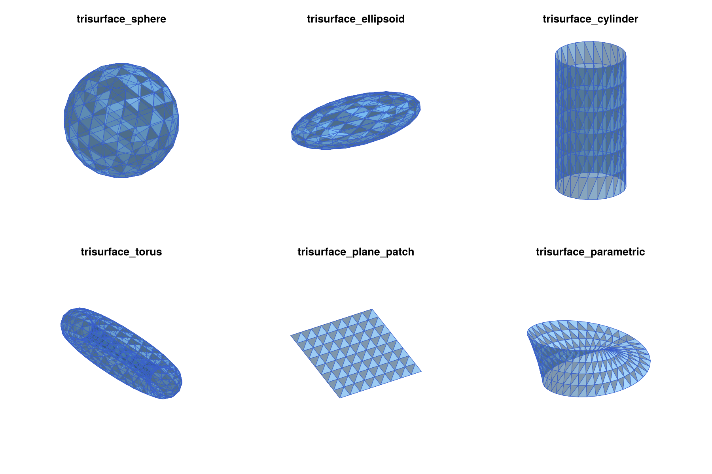
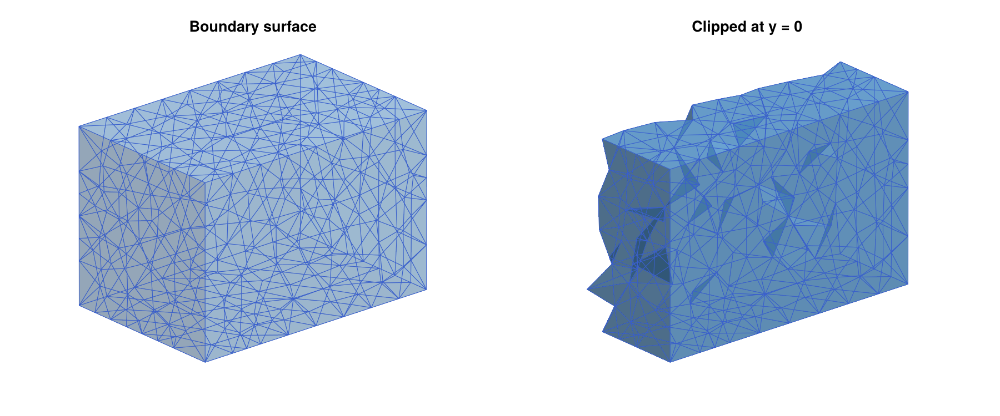
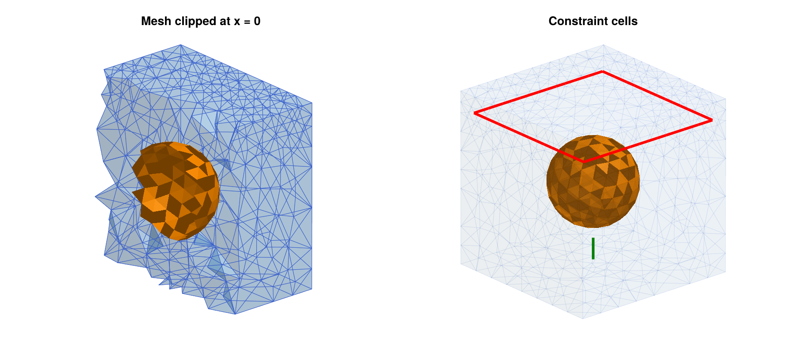
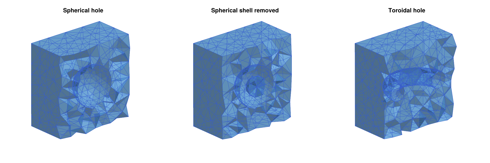
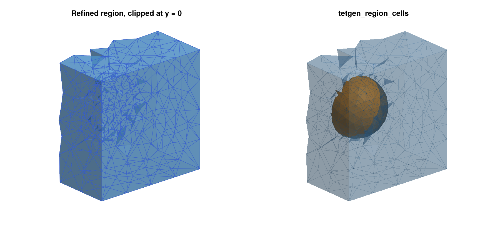
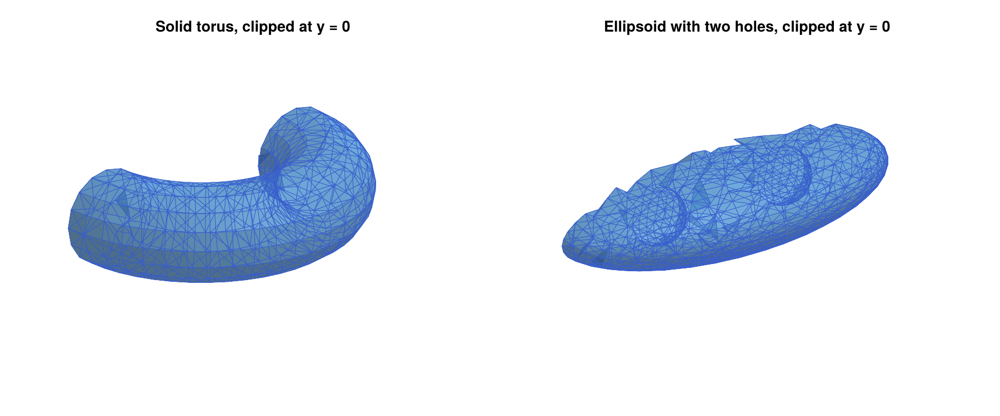
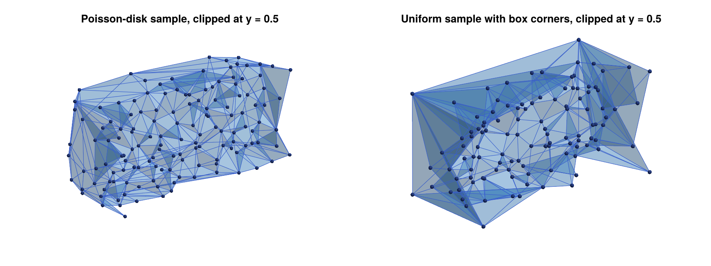
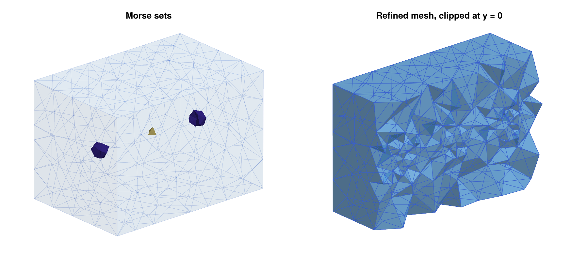
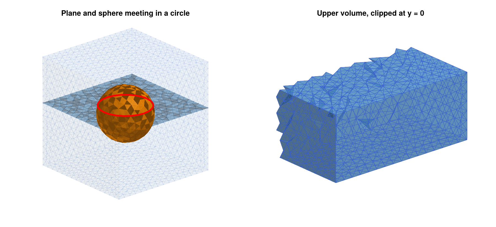
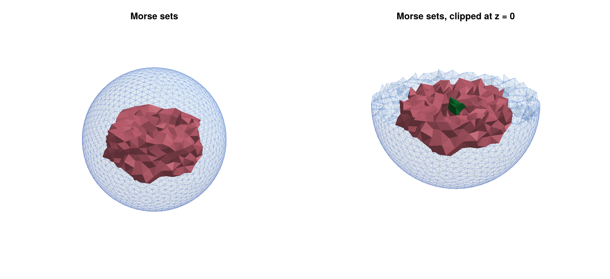

# Three-Dimensional Meshes

This chapter is concerned with complexes in three dimensions. The
analysis functions of
[ConleyDynamics.jl](https://almost6heads.github.io/ConleyDynamics.jl)
do not depend on the dimension of the underlying space. In particular,
[`create_spatial_mvf`](@ref) accepts tetrahedral meshes, and homology,
Morse decompositions, and connection matrices can be computed for any
[`EuclideanComplex`](@ref). What is needed in addition is a way to
*create* tetrahedral meshes of interesting domains, and a way to *look*
at them. The package provides three layers of functionality for the
first task:

* Core functions, which are available without loading any other package.
  They import meshes from arbitrary sources, create random point samples,
  and create triangulated surfaces such as spheres, cylinders, and tori,
  which can serve as building blocks of more complicated domains.
* The `TetGen.jl` extension, which creates quality tetrahedral meshes of
  domains bounded by triangulated surfaces, possibly with embedded
  constraint surfaces and curves, holes, and regions with different mesh
  sizes. It is the three-dimensional analogue of the
  `DelaunayTriangulation.jl` extension described in the
  [Two-Dimensional Meshes](@ref) chapter.
* The `Gmsh.jl` extension, which is the tool of choice for curved
  geometry described by computer-aided design (CAD) and, above all, for constraint surfaces which intersect each
  other.

The table below lists all functions involved. The column *Pkg* shows
the package that has to be loaded for them, where `core` means that the
function is part of the core package.

| Function | Pkg | Description |
|:---------|:---:|:------------|
| [`tetmesh_to_euclidean`](@ref) | `core` | Convert points and simplices into a complex |
| [`poisson_points_box`](@ref) | `core` | Random points with a minimum distance |
| [`trisurface_sphere`](@ref), [`trisurface_ellipsoid`](@ref) | `core` | Triangulated spheres and ellipsoids |
| [`trisurface_cylinder`](@ref), [`trisurface_torus`](@ref) | `core` | Triangulated cylinders and tori |
| [`trisurface_plane_patch`](@ref), [`trisurface_parametric`](@ref) | `core` | Planar and general parametric surfaces |
| [`TetDomain`](@ref), `tetgen_domain_*` | `core` | Description of a domain for `TetGen` |
| [`tetgen_to_simplicial`](@ref) | `core` | Convert a `TetGen` mesh into a complex |
| [`tetgen_marker_cells`](@ref), [`tetgen_region_cells`](@ref) | `core` | Cells on constraints and in regions |
| [`tetgen_mesh`](@ref) | `TetGen` | Create a constrained quality mesh |
| [`create_simplicial_delaunay3d`](@ref) | `TetGen` | Delaunay triangulation of random points |
| [`gmsh_to_simplicial`](@ref) | `Gmsh` | Convert the current `Gmsh` mesh |
| [`gmsh_file_to_simplicial`](@ref) | `Gmsh` | Read and convert a mesh or geometry file |
| [`gmsh_marker_cells`](@ref) | `Gmsh` | Cells of physical groups and entities |

The domain builders of `TetGen` and the conversion functions are part of
the core package, so that domains can be prepared and stored without
loading `TetGen.jl`. Only the actual mesh generation requires it. For the
visualization of three-dimensional complexes, see the section
[Three-Dimensional Plotting with Makie](@ref) in the
[Visualization](@ref) chapter. All figures in this chapter were created
with the functions described there, and the script which creates them
can be found in the file `docs/imgsrc/meshing3d.jl` of the package
repository.

## [Loading the Required Packages](@id meshing3d_loading)

The core geometry functions in the next section only require
[ConleyDynamics.jl](https://almost6heads.github.io/ConleyDynamics.jl)
itself, which is loaded as usual with `using ConleyDynamics`.

`TetGen.jl` and `Gmsh.jl`, on the other hand, are *weak dependencies*:
They are not installed together with
[ConleyDynamics.jl](https://almost6heads.github.io/ConleyDynamics.jl),
and the functions which need them only become available once they have
been loaded. Each of them has to be installed once in the active Julia
environment, using

```julia
import Pkg
Pkg.add("TetGen")      # for tetgen_mesh and create_simplicial_delaunay3d
Pkg.add("Gmsh")        # for gmsh_to_simplicial, gmsh_file_to_simplicial,
                       # and gmsh_marker_cells
```

Versions `3.x` of `TetGen.jl` and `0.3.x` of `Gmsh.jl` are supported.
Note that `Gmsh.jl` downloads large binary dependencies during the
installation, about 150 MB including the OpenCASCADE CAD kernel, while
`TetGen.jl` is small. Only the package which is actually used needs to
be installed. In every Julia session, the meshing package and
[ConleyDynamics.jl](https://almost6heads.github.io/ConleyDynamics.jl)
then have to be loaded. For `TetGen.jl`, this is done with

```julia
using TetGen
using ConleyDynamics
```

and for `Gmsh.jl` with

```julia
using Gmsh: gmsh
using ConleyDynamics
```

The second form makes the module `gmsh` available, which contains the
complete `Gmsh` API, such as `gmsh.initialize()` or
`gmsh.model.occ.addBox`. The command `using Gmsh` has the same effect.
Both meshing packages can of course be loaded in the same session. The
order of the commands does not matter, and `import` can be used instead
of `using`. As soon as a meshing package and
[ConleyDynamics.jl](https://almost6heads.github.io/ConleyDynamics.jl)
are both loaded, Julia automatically loads the corresponding extension
module, `ConleyDynamicsTetGenExt` or `ConleyDynamicsGmshExt`. Whether
this has happened can be checked with

```julia
Base.get_extension(ConleyDynamics, :ConleyDynamicsTetGenExt) !== nothing
```

If one of the extension functions is called without loading the
corresponding package, Julia reports that no matching method exists:

```julia
using ConleyDynamics
dom = tetgen_domain_box([0,0,0], [1,1,1])
tetgen_mesh(dom)
# ERROR: MethodError: no method matching tetgen_mesh(::TetDomain)
```

In that case, it suffices to load the package and to repeat the call.
Note that the domain builders `tetgen_domain_*`, as well as
[`tetgen_to_simplicial`](@ref), [`tetgen_marker_cells`](@ref), and
[`tetgen_region_cells`](@ref), are part of the core package, so that
only the mesh generation itself requires `TetGen.jl`. For the figures,
a Makie backend such as `CairoMakie` or `GLMakie` has to be installed
and loaded in the same way, see
[Three-Dimensional Plotting with Makie](@ref).

## [Basic Notions](@id meshing3d_notions)

This section collects the few notions from geometry and topology which
are used throughout the chapter. Readers who are familiar with meshes
and homology can skip it.

**Simplices and meshes.** The building blocks of all meshes in this
chapter are *simplices*: vertices (dimension `0`), edges (dimension
`1`), triangles (dimension `2`), and tetrahedra (dimension `3`). The
*faces* of a simplex are the simplices spanned by subsets of its
vertices. For example, a tetrahedron has four triangles, six edges,
and four vertices as faces. A *tetrahedral mesh* of a domain is a
collection of tetrahedra which fill the domain and which only meet in
common faces, i.e., two tetrahedra share either nothing, a vertex, an
edge, or a whole triangle. Since all faces are determined by the
tetrahedra, a mesh is described completely by the vertex coordinates
and the list of its *maximal simplices*, i.e., those which are not
faces of larger ones. This is exactly the input of
[`tetmesh_to_euclidean`](@ref). The resulting
[`EuclideanComplex`](@ref) contains all simplices of the mesh as its
*cells*, together with their coordinates, see the section
[Euclidean Complexes](@ref) in the chapter on Lefschetz complexes.

**Subcomplexes.** A set of cells is *closed* if it contains all faces
of its cells. Closed sets of cells are again simplicial complexes, the
*subcomplexes*, which can be created with
[`lefschetz_subcomplex`](@ref). The *closure* of a set of cells, which
is computed by [`lefschetz_closure`](@ref), is the smallest closed set
containing it. Many functions in this chapter return closed sets of
cells, for example all cells on a constraint surface, so that their
homology can be computed directly.

**Reading homology.** The function [`homology`](@ref) returns the Betti
numbers `[b0, b1, b2, b3]` of a complex, which were introduced in the
[Tutorial](@ref). In three dimensions, they have an intuitive meaning:
`b0` counts the connected components, `b1` the independent closed
loops which cannot be contracted, such as the loop around the hole of
a donut, and `b2` the enclosed cavities. For a complex in
three-dimensional space, `b3` is always zero. The following table lists
the homology of the spaces that occur most often in this chapter. Note
that the result depends on whether a solid or only its surface is
meshed:

| Space | Homology |
|:------|:---------|
| Solid ball or box | `[1, 0, 0, 0]` |
| Sphere (the surface of a ball) | `[1, 0, 1]` |
| Solid torus (a donut) | `[1, 1, 0, 0]` |
| Torus surface | `[1, 2, 1]` |
| Box with one spherical cavity | `[1, 0, 1, 0]` |
| Circle | `[1, 1]` |
| Open tube, annulus, or Möbius strip | `[1, 1, 0]` |

Computing the homology of a mesh is therefore a quick way to check that
it has the expected shape, and this check is used in almost every
example below.

**Delaunay tetrahedralizations.** For a given set of points, there are
many ways to connect them into tetrahedra. A tetrahedralization is
called *Delaunay* if no point lies inside the sphere through the four
vertices of any tetrahedron, the so-called *circumsphere*. Among all
tetrahedralizations, Delaunay tetrahedralizations tend to avoid long
and thin tetrahedra, and they are the basis of most mesh generators.
If certain triangles and edges are prescribed, for example because
they describe a surface which has to be contained in the mesh, the
Delaunay condition cannot always be satisfied. One then uses a
*constrained Delaunay tetrahedralization*, which contains the
prescribed triangles and edges, and which is as close to Delaunay as
possible otherwise.

**Mesh quality.** For the construction of multivector fields, the
tetrahedra should be well-shaped, i.e., not too flat or too thin. Two
standard measures of the shape of a tetrahedron are used below. The
*radius-edge ratio* is the radius of the circumsphere divided by the
length of the shortest edge. A regular tetrahedron, whose six edges
all have the same length, has the smallest possible ratio
`sqrt(6)/4 ≈ 0.61`, and the ratio becomes large for tetrahedra with a
very short edge. The *dihedral angles* of a tetrahedron are the six
angles between pairs of its faces, measured along their common edge.
For a regular tetrahedron, all of them equal `arccos(1/3) ≈ 70.5°`,
while a flat tetrahedron has dihedral angles close to `0°` or `180°`.

## Core Geometry Functions

The functions in this section are part of the core package, so they are
available without loading any extension.

### Importing Meshes

Every mesh generator describes a simplicial mesh in essentially the same
way: by a list of vertex coordinates and a list of maximal simplices,
each given by the indices of its vertices. The function
[`tetmesh_to_euclidean`](@ref) turns such a description into an
[`EuclideanComplex`](@ref), and it automatically adds all faces of the
given simplices. As a first example, consider two tetrahedra which share
a common triangle:

```julia
using ConleyDynamics

points = [[0.0,0.0,0.0], [1.0,0.0,0.0], [0.0,1.0,0.0],
          [0.0,0.0,1.0], [1.0,1.0,1.0]]
tets   = [[1,2,3,4], [2,3,4,5]]
ec     = tetmesh_to_euclidean(points, tets)

lefschetz_cell_count(ec)    # [5, 9, 7, 2]
homology(ec)                # [1, 0, 0, 0]
ec.labels
# 23-element Vector{String}:
#  "1", "2", "3", "4", "5", "12", "13", "14", "23", "24", "25", "34",
#  "35", "45", "123", "124", "134", "234", "235", "245", "345", "1234",
#  "2345"
```

The vertices are labeled by zero-padded decimal numbers, whose width
depends on the number of vertices. For example, a mesh with 532 vertices
uses the labels `"001"` through `"532"`. The label of a simplex is the
concatenation of the labels of its vertices, in increasing order. This is
the same convention as in [`create_simplicial_delaunay`](@ref) and
[`delaunay_to_simplicial`](@ref), so that all simplicial complexes created
from meshes look alike.

The coordinates can be given as vectors or tuples, and the dimension of
the space is arbitrary. Moreover, simplices of different dimensions can be
mixed. The following complex consists of a triangle, an edge attached to
one of its vertices, and an edge attached to another vertex:

```julia
mixed = tetmesh_to_euclidean([[0,0,0], [1,0,0], [0,1,0], [0,0,1], [2,0,0]],
                             [[1,2,3], [1,4], [2,5]])
lefschetz_cell_count(mixed)    # [5, 5, 1]
homology(mixed)                # [1, 0, 0]
```

In particular, [`tetmesh_to_euclidean`](@ref) can also be used for
triangulated surfaces in three dimensions, which leads to two-dimensional
complexes embedded in three-dimensional space. Examples of this can be
found in the next section.

Many mesh generators store the mesh in matrix form instead, with one
column per vertex and one column per simplex. This form is accepted as
well:

```julia
P = [0.0 1.0 0.0 0.0 1.0;
     0.0 0.0 1.0 0.0 1.0;
     0.0 0.0 0.0 1.0 1.0]
C = [1 2;
     2 3;
     3 4;
     4 5]
ec2 = tetmesh_to_euclidean(P, C)
ec2.labels == ec.labels        # true
```

Mesh generators frequently return vertices which do not belong to any
simplex, for example geometry points outside of the meshed region or
duplicate points. By default, such *orphaned* vertices are removed, and
the remaining vertices are renumbered in their original order. If the
optional argument `droporphans=false` is passed, they are kept as
isolated vertices instead:

```julia
pts6 = vcat(points, [[5.0,5.0,5.0]])                    # unused vertex
tetmesh_to_euclidean(pts6, tets).ncells                 # 23
ec6 = tetmesh_to_euclidean(pts6, tets; droporphans=false)
ec6.ncells                                              # 24
homology(ec6)                                           # [2, 0, 0, 0]
```

Finally, as for all complex creation functions in
[ConleyDynamics.jl](https://almost6heads.github.io/ConleyDynamics.jl),
the optional argument `p` determines the coefficient field. The default
`p=2` gives `GF(2)`, any other prime `p` gives `GF(p)`, and `p=0` gives
the rationals:

```julia
ecq = tetmesh_to_euclidean(points, tets; p=0)
lefschetz_field(ecq)           # "QQ"
```

### Random Point Samples

The planar function [`create_simplicial_delaunay`](@ref) is based on a
random sample of points with a prescribed minimum distance, a so-called
*Poisson-disk sample*. Such samples are useful in any dimension, and they
can be created with [`poisson_points_box`](@ref). Its first two arguments
are the lower and upper corners of a box, and the third argument is the
minimum distance between the points:

```julia
using Random

pts2 = poisson_points_box([0,0], [2,1], 0.1; rng=Xoshiro(1234))
length(pts2)                   # 132

pts3 = poisson_points_box([0,0,0], [2,1,1], 0.1; rng=Xoshiro(1234))
length(pts3)                   # 1265
```

The function uses Bridson's algorithm. Starting from a random point, it
repeatedly tries to place new points at distances between `pdist` and
`2*pdist` from already accepted points, and it gives up on an accepted
point after `attempts` unsuccessful tries. The default `attempts=20`
gives a good compromise between speed and density. Larger values fill
the box more densely:

```julia
pts3 = poisson_points_box([0,0,0], [2,1,1], 0.1; attempts=50, rng=Xoshiro(1234))
length(pts3)                   # 1353
```

In each case, all pairwise distances are at least `pdist`. The runtime is
proportional to the number of generated points, so even samples with
hundreds of thousands of points take only a few seconds. If the optional
argument `rng` is omitted, Julia's default random number generator is
used, and the result changes from call to call. Passing a seeded
generator as above makes the sample reproducible, which is recommended
for any computation which is to be published.

Poisson-disk samples are used by [`create_simplicial_delaunay3d`](@ref),
and they can be added as interior nodes to a `TetGen` domain, see
[Adding Interior Nodes](@ref tetgen_nodes) below.

### Triangulated Surfaces

Three-dimensional domains are usually described by their boundary
surfaces, and the constraints inside a domain are surfaces and curves.
The package therefore contains six functions which create triangulated
surfaces. Each of them returns a pair `(V, T)`, where `V` is a vector of
vertex coordinates and `T` is a vector of triangles, each given by three
indices into `V`. Vertices are never duplicated, even along the seams of
a parametrization, so that neighboring triangles share their vertices,
as required by the mesh generators. Moreover, all surfaces of
orientable parametrizations are consistently oriented, and closed
surfaces have outward normals. This is needed for surfaces which bound
holes or regions of a mesh. The figure of the six triangulated surface generators shows one
example for each function.



**Spheres and ellipsoids.** The function [`trisurface_sphere`](@ref)
creates an *icosphere*: An icosahedron whose triangles are subdivided `n`
times, with all new vertices projected onto the sphere. This gives
`10*4^n+2` vertices and `20*4^n` triangles of nearly equal size and
shape, which is much better than a triangulation based on spherical
coordinates with its crowded poles. The function
[`trisurface_ellipsoid`](@ref) scales such an icosphere along the
coordinate axes:

```julia
V, T = trisurface_sphere([0,0,0], 1.0, 2)           # center, radius, n
length(V), length(T)                                # (162, 320)

V, T = trisurface_ellipsoid([0,0,0], [2.0,1.0,0.5], 2)   # center, semi-axes, n
```

**Cylinders.** The function [`trisurface_cylinder`](@ref) creates a
cylinder of radius `r` around the segment from `p0` to `p1`, which can
have any direction. The lateral surface is divided into `ntheta` parts
around the axis and `nz` parts along it. By default, both ends are closed
by triangle fans, which gives a closed surface. With `capped=false`, the
result is an open tube, as in the figure of the six surface generators:

```julia
V, T = trisurface_cylinder([0,0,-1], [0,0,1], 0.5, 24, 6)                 # closed
V, T = trisurface_cylinder([0,0,-1], [0,0,1], 0.5, 24, 6; capped=false)   # tube
```

**Tori.** The function [`trisurface_torus`](@ref) expects the center, the
major radius `R` (the distance from the center to the center of the
tube), the minor radius `r` (the radius of the tube), and the numbers of
subdivisions `nu` around the axis and `nv` around the tube. The axis of
rotational symmetry is the `z`-axis by default, but it can be changed
with the optional argument `axis`. The torus in the figure of the six
surface generators was created with a tilted axis:

```julia
V, T = trisurface_torus([0,0,0], 2.0, 0.6, 32, 12; axis=[1,0,1])
```

**Plane patches.** The function [`trisurface_plane_patch`](@ref) creates
the parallelogram of all points `origin + s*u + t*v` with `s` and `t` in
the unit interval, subdivided into `nu` times `nv` small parallelograms,
each of which is split into two triangles. Its normal vector points in
the direction of the cross product of `u` and `v`. The following command
creates the patch in the figure of the six surface generators, which
is not parallel to any coordinate plane:

```julia
V, T = trisurface_plane_patch([-1,-1,0], [2,0,0], [0.5,2,0.5], 8, 8)
```

**General parametric surfaces.** The function
[`trisurface_parametric`](@ref) triangulates the image of an arbitrary
function `f(u,v)` over a parameter rectangle. The rectangle
`urange x vrange` is divided into `nu` times `nv` subrectangles, each
of which is split into two triangles. Periodic parametrizations are
handled with the optional arguments `uperiodic` and `vperiodic`, which
glue the corresponding edges of the parameter rectangle together. In
addition, all vertices which are closer than `tol` (default `1e-10`) are
merged, and triangles which become degenerate are removed. The value of
`tol` has to be positive, and since it is an absolute distance, it has
to be scaled with the size of the surface. For a surface of diameter
`1e10`, for example, rounding errors in the coordinates are of the order
`1e-6`, and the seams are only glued with a correspondingly larger
`tol`. As an example,
the following commands create a unit sphere in spherical coordinates:

```julia
fsph(u,v) = [cos(u)*sin(v), sin(u)*sin(v), cos(v)]
V, T = trisurface_parametric(fsph, (0,2*pi), (pi,0), 24, 12; uperiodic=true)
length(V), length(T)                  # (266, 528)
```

Here, `uperiodic=true` glues the seam at `u=0` and `u=2*pi`, and all
vertices at the two poles are merged automatically. The triangles are
oriented by the cross product of the partial derivatives of `f` with
respect to `u` and `v`, so the range `(pi,0)` for `v`, which runs from
the south pole to the north pole, gives outward normals. Merging close
vertices also handles orientation-reversing gluings. The Möbius strip
in the figure of the six surface generators was created with the
commands

```julia
fmoebius(u,v) = [(1+v/2*cos(u/2))*cos(u), (1+v/2*cos(u/2))*sin(u), v/2*sin(u/2)]
V, T = trisurface_parametric(fmoebius, (0,2*pi), (-1,1), 40, 4)
```

Since `fmoebius(2*pi,v) == fmoebius(0,-v)`, the two ends of the strip are
glued with a twist, even though `uperiodic` is not set.

!!! warning "Parametrizations have to be injective away from the seams"
    Since close vertices are merged, any self-intersection of the surface
    which passes through grid vertices is turned into an identification.
    For example, the usual figure-eight immersion of the Klein bottle in
    three dimensions intersects itself along a circle, and the resulting
    complex is *not* a Klein bottle. Moreover, a non-orientable surface
    such as the Möbius strip cannot be consistently oriented. It can be
    used as a constraint surface for the mesh generators, but it cannot
    bound a hole or a region.

**Surfaces as complexes.** Every triangulated surface can be turned into
a two-dimensional simplicial complex embedded in three dimensions with
[`tetmesh_to_euclidean`](@ref). This is a convenient way to check the
topology of a surface:

```julia
homology(tetmesh_to_euclidean(trisurface_sphere([0,0,0], 1.0, 2)...))
# [1, 0, 1]
homology(tetmesh_to_euclidean(trisurface_torus([0,0,0], 2.0, 0.6, 32, 12)...))
# [1, 2, 1]
homology(tetmesh_to_euclidean(trisurface_cylinder([0,0,-1], [0,0,1], 0.5, 16, 4)...))
# [1, 0, 1]
homology(tetmesh_to_euclidean(trisurface_cylinder([0,0,-1], [0,0,1], 0.5, 16, 4;
                                                  capped=false)...))
# [1, 1, 0]
homology(tetmesh_to_euclidean(trisurface_plane_patch([-1,-1,0], [2,0,0],
                                                     [0,2,0], 8, 8)...))
# [1, 0, 0]
homology(tetmesh_to_euclidean(trisurface_parametric(fmoebius, (0,2*pi),
                                                    (-1,1), 40, 4)...))
# [1, 1, 0]
```

## TetGen.jl: Tetrahedral Meshes

The [TetGen.jl](https://github.com/JuliaGeometry/TetGen.jl) package is a
Julia interface to Hang Si's mesh generator
[TetGen](https://wias-berlin.de/software/tetgen/). It creates
constrained Delaunay tetrahedralizations, see
[Basic Notions](@ref meshing3d_notions), and quality tetrahedral meshes
of three-dimensional domains. A domain is described as a *piecewise
linear complex*: A collection of points, together with planar polygons,
segments, and single points (the *facets*) which have to be contained in
the final mesh. The outer facets bound the domain, and facets inside the
domain are constraints. In addition, holes and regions can be specified
by points inside them. This data model maps directly onto the
`DelaunayTriangulation.jl` workflow in the plane described in the
[Two-Dimensional Meshes](@ref) chapter, and the extension follows the same
pattern:

1. Describe the domain by a [`TetDomain`](@ref). Such a domain is usually
   created with [`tetgen_domain_box`](@ref) or with
   [`tetgen_domain_from_surface`](@ref), and then extended with the other
   `tetgen_domain_*` functions.
2. Create the mesh with [`tetgen_mesh`](@ref), which returns a
   [`TetGenResult`](@ref).
3. Convert the mesh with [`tetgen_to_simplicial`](@ref), and find the
   cells on constraint surfaces and curves, or in regions, with
   [`tetgen_marker_cells`](@ref) and [`tetgen_region_cells`](@ref).

Only [`tetgen_mesh`](@ref) and [`create_simplicial_delaunay3d`](@ref)
require `TetGen.jl`, which has to be installed and loaded as described
in [Loading the Required Packages](@ref meshing3d_loading). Note that
`TetGen` is distributed under the GNU Affero General Public License, see
[Licences of the Meshing Backends](@ref) below.

### Describing a Domain

A [`TetDomain`](@ref) is a plain Julia struct with five fields:

* `points`: the vertices of the domain description, as tuples of three
  numbers,
* `facets`: the facets, each given by a vector of indices into `points`.
  A facet with at least three vertices is a planar polygon, a facet with
  two vertices is a segment, and a facet with one vertex is a single
  point,
* `markers`: an integer marker for every facet,
* `holes`: one point inside every hole, and
* `regions`: for every region, a point inside it, an integer attribute,
  and a maximal tetrahedron volume.

The markers identify the different parts of the domain description after
meshing. By convention, the outer boundary has marker `0`, and the
constraint surfaces and curves are numbered `1, 2, 3, ...` in the order
in which they are added. The `tetgen_domain_*` functions never change
their argument, but return a new `TetDomain`. A domain can therefore be
extended step by step, and intermediate versions can be reused.

The simplest domain is a box. The function [`tetgen_domain_box`](@ref)
expects the lower and upper corners, and it creates the eight corners and
the six faces of the box as quadrilateral facets with outward
orientation:

```julia
dom = tetgen_domain_box([-1.5,-1,-1], [1.5,1,1])
# TetDomain with 8 points, 6 facets, markers [0], 0 holes, 0 regions

dom.facets
# [[1, 4, 3, 2], [5, 6, 7, 8], [1, 2, 6, 5], [2, 3, 7, 6], [3, 4, 8, 7], [4, 1, 5, 8]]
dom.markers
# [0, 0, 0, 0, 0, 0]
```

The one-line summary shown above is printed whenever a `TetDomain` is
displayed in the REPL. It is a quick way to check that every added
constraint received the intended marker.

### Meshing a Box

The domain is meshed with [`tetgen_mesh`](@ref). Without any further
arguments, `TetGen` only performs a mild quality refinement, and since
the box contains no constraints, the result is the coarsest possible
tetrahedralization:

```julia
res = tetgen_mesh(dom)
length(res.points), length(res.tetrahedra)     # (8, 6)
```

The optional argument `maxvolume` bounds the volume of the tetrahedra,
and it is the main way of controlling the size of the mesh. The volume of
the box is `12`, so the following mesh has about two thousand tetrahedra:

```julia
res = tetgen_mesh(dom; maxvolume=0.01)
length(res.points), length(res.tetrahedra)     # (532, 2207)

ec = tetgen_to_simplicial(res)
lefschetz_cell_count(ec)                       # [532, 3051, 4727, 2207]
homology(ec)                                   # [1, 0, 0, 0]
```

The function [`tetgen_to_simplicial`](@ref) converts the mesh into an
[`EuclideanComplex`](@ref), using the labeling scheme of
[`tetmesh_to_euclidean`](@ref). As usual, the optional argument `p`
selects the coefficient field. The resulting mesh is shown in the
figure of the tetrahedral mesh of a box, both as a whole and clipped at
the plane `y = 0`, which reveals the tetrahedra in the interior.



The returned [`TetGenResult`](@ref) contains the raw mesh in its fields
`points` (the vertex coordinates, including all points inserted by
`TetGen`), `tetrahedra` (vectors of four indices into `points`),
`trifaces` and `trifacemarkers` (the triangles on all facets of the
domain, together with their markers), `tetattributes` (the region
attributes of the tetrahedra), and `curvesegments` (the constraint
curves). These fields are usually only accessed through the functions
described below, but they can be useful for exporting a mesh to other
software.

!!! note "Volume constraints are approximate"
    `TetGen` treats volume bounds as targets rather than strict limits.
    In typical meshes, about one percent of the tetrahedra exceed
    `maxvolume`, by up to about fifty percent. For the box mesh above, the
    largest tetrahedron has volume `0.0129`. If a strict bound is
    required, pass a correspondingly smaller value.

### Mesh Size and Quality

Besides `maxvolume`, the function [`tetgen_mesh`](@ref) accepts the
following optional arguments:

* `minratio`: an upper bound for the radius-edge ratio of the
  tetrahedra, see [Basic Notions](@ref meshing3d_notions). This ratio is
  the standard quality measure of `TetGen`, and well-shaped tetrahedra
  have small ratios. The default value `1.414` (approximately `sqrt(2)`)
  is the standard value of `TetGen`. Smaller values lead to more
  refinement. Even though a regular tetrahedron has the ratio `0.61`,
  the refinement algorithm of `TetGen` is only guaranteed to terminate
  for bounds which are not too small. Values below `1` are therefore
  rejected with an `ArgumentError` (with `minratio=0.8`, `TetGen` was
  still running after two minutes in our tests), and values close to
  `1` lead to very fine meshes.
* `mindihedral`: a lower bound for the dihedral angles of the
  tetrahedra, in degrees, strictly between `0` and `90`, see
  [Basic Notions](@ref meshing3d_notions). It is used in
  addition to `minratio`. If `minratio=nothing`, the ratio bound `2.0`
  is used together with it. Large values can make `TetGen` fail: on the
  box, `mindihedral=30` works, but `mindihedral=50` leads to an error.
* `steiner_on_boundary`: whether `TetGen` may insert additional points
  on the boundary and on constraint facets. Points which are added by
  the mesh generator, rather than given by the user, are called
  *Steiner points*. They are needed both to satisfy the quality bounds
  and to split long boundary edges. This is `true` by default.
* `quiet`: whether the output of `TetGen` is suppressed. Passing
  `quiet=false` prints the statistics of the mesh generation.
* `switches`: a complete `TetGen` command line switch string, which
  overrides all other optional arguments.

Passing `minratio=nothing` without `mindihedral` switches the quality
refinement off. The following table shows the effect of these options on
the box mesh from above, always with `maxvolume=0.01`. The last column
contains the smallest dihedral angle in the mesh:

| Optional arguments | Points | Tetrahedra | Smallest angle |
|:-------------------|-------:|-----------:|---------------:|
| `minratio=nothing` | 511 | 2159 | 5.86° |
| (defaults) | 532 | 2207 | 1.86° |
| `minratio=1.2` | 547 | 2243 | 4.61° |
| `mindihedral=15` | 608 | 2528 | 2.33° |
| `steiner_on_boundary=false` | 8 | 6 | 25.24° |

The table illustrates two points which are important in practice. First,
the quality bounds of `TetGen` remove most badly shaped tetrahedra, but
they do not guarantee the absence of *slivers*: Flat tetrahedra with four
nearly coplanar vertices, whose radius-edge ratio can be small even
though their dihedral angles are close to `0°` or `180°`. A few such
tetrahedra are harmless for the construction of multivector fields.
Second, disallowing Steiner points on the boundary is a strong
restriction. Since no
boundary triangle may be split, `TetGen` cannot insert any point whose
neighborhood reaches the boundary. In a coarse box, every tetrahedron
touches the boundary, and therefore *no* refinement takes place at all,
and even the volume constraint is ignored. This option is only useful if
the boundary is already fine, or together with interior nodes as in the
next section.

The switch string gives access to all options of `TetGen`. The default
optional arguments correspond to the switches `pq1.414a0.01Q`, where `p`
tells `TetGen` to respect the facets, `q` sets the quality bound, `a`
the volume bound, and `Q` suppresses the output. The command

```julia
res = tetgen_mesh(dom; switches="pq1.2a0.01Q")
```

gives the same mesh as `minratio=1.2`. The switch string should always
contain `p`, and it should never contain `f`, since otherwise interior
triangles are reported with marker `0`, which breaks
[`tetgen_marker_cells`](@ref). See the `TetGen` manual for a description
of all switches.

### [Adding Interior Nodes](@id tetgen_nodes)

The function [`tetgen_domain_add_nodes`](@ref) adds points which become
vertices of the final mesh. This gives direct control over the vertex
distribution. For example, a Poisson-disk sample gives a mesh whose
vertices are evenly spread throughout the domain:

```julia
using Random

nodes = poisson_points_box([-1.4,-0.9,-0.9], [1.4,0.9,0.9], 0.3;
                           rng=Xoshiro(1234))
length(nodes)                                  # 223
domn = tetgen_domain_add_nodes(dom, nodes)
# TetDomain with 231 points, 6 facets, markers [0], 0 holes, 0 regions

res = tetgen_mesh(domn; minratio=nothing)
length(res.points), length(res.tetrahedra)     # (231, 1374)
res = tetgen_mesh(domn)
length(res.points), length(res.tetrahedra)     # (409, 2129)
```

Without quality refinement, the mesh is the constrained Delaunay
tetrahedralization of exactly the given points. With the default quality
bound, `TetGen` adds further points, mostly close to the boundary, where
the sample is less regular. Note that the sample was taken in a slightly
smaller box, so that no node lies too close to the boundary. Nodes
outside of the domain or inside holes are ignored, and nodes which
coincide with existing vertices are merged with them. However, a node
must not lie exactly on a face or an edge of the boundary or of a
constraint, unless it is one of the vertices there, since `TetGen` then
reports a self-intersection and fails. Combined with
`steiner_on_boundary=false`, interior nodes do allow refinement, while
the boundary stays as coarse as it is:

```julia
res = tetgen_mesh(domn; steiner_on_boundary=false, maxvolume=0.01)
length(res.points), length(res.tetrahedra)     # (672, 3913)
length(res.trifaces)                           # 12
```

### Constraint Surfaces and Curves

The main reason for using a mesh generator rather than a regular grid is
the ability to adapt the mesh to geometric features. In the context of
dynamics, these are often invariant manifolds, isolating blocks, or
surfaces on which the vector field is known to be transverse. The
function [`tetgen_domain_add_surface`](@ref) adds a triangulated surface
whose triangles become facets of the domain, so that the final mesh
contains the surface as a union of its triangles. Similarly,
[`tetgen_domain_add_curve`](@ref) adds a polygonal curve whose segments
become edges of the final mesh. The following example embeds a sphere, a
closed square curve above it, and a short open segment below it into a
box:

```julia
dom2 = tetgen_domain_box([-2,-2,-2], [2,2,2])

V, T = trisurface_sphere([0,0,0], 1.0, 2)
dom2 = tetgen_domain_add_surface(dom2, V, T)                 # marker 1

square = [[-1.8,-1.8,1.5], [1.8,-1.8,1.5], [1.8,1.8,1.5],
          [-1.8,1.8,1.5], [-1.8,-1.8,1.5]]
dom2 = tetgen_domain_add_curve(dom2, square)                 # marker 2

spoke = [[0.0,0.0,-1.8], [0.0,0.0,-1.3]]
dom2 = tetgen_domain_add_curve(dom2, spoke; marker=7)        # marker 7
# TetDomain with 176 points, 331 facets, markers [0, 1, 2, 7], 0 holes, 0 regions

res2 = tetgen_mesh(dom2; maxvolume=0.05)
ec2  = tetgen_to_simplicial(res2)
lefschetz_cell_count(ec2)                      # [950, 5616, 8865, 4198]
```

A curve is closed if its first and last points agree, up to `1e-9`
times the size of the curve. In that case, the last point is not added a second time.
Repeated consecutive points and segments which occur more than once are
ignored. The
sphere and the square automatically received the markers `1` and `2`,
while the segment was given the marker `7` explicitly with the optional
argument `marker`. Explicit markers are useful if several surfaces or
curves form one geometric object: They can all be given the same marker,
and they are then treated as one constraint.

After meshing, the function [`tetgen_marker_cells`](@ref) returns the
indices of all cells of the complex which lie on the constraints with a
given marker. By default, the result is the closure of the triangles on
the constraint surfaces and the edges on the constraint curves, i.e., a
closed subcomplex. Extracting these subcomplexes shows that the mesh
contains a sphere, a circle, and an arc:

```julia
sphere_cells = tetgen_marker_cells(res2, ec2, 1)
square_cells = tetgen_marker_cells(res2, ec2, 2)
spoke_cells  = tetgen_marker_cells(res2, ec2, 7)

homology(lefschetz_subcomplex(ec2, sphere_cells))      # [1, 0, 1]
homology(lefschetz_subcomplex(ec2, square_cells))      # [1, 1]
homology(lefschetz_subcomplex(ec2, spoke_cells))       # [1, 0]
```

The mesh and the constraint cells are shown in the figure of the sphere
and the two curves embedded as constraints. The left panel shows the mesh
clipped at the plane `x = 0`, together with the part
of the sphere in the remaining half. The right panel shows only the
constraint cells. Note that `TetGen` subdivided the long edges of the
square, but the sphere triangles and the short segment remained intact,
since their size is comparable to the mesh size inside the box.



With the optional argument `closure=false`, only the cells of maximal
dimension on the constraint are returned, i.e., the triangles of the
constraint surfaces and the edges of the constraint curves:

```julia
sphere_tris = tetgen_marker_cells(res2, ec2, 1; closure=false)
length(sphere_tris), unique(ec2.dimensions[sphere_tris])   # (320, [2])
```

The marker `0` gives the outer boundary of the domain. This makes it easy
to work with exit sets or relative homology. Recall from the section
[Relative Homology](@ref) that the relative homology of a complex with
respect to a closed subcomplex measures the shape of the complex if the
subcomplex is collapsed to a single point. For the box mesh from the
beginning of this section, the boundary is a sphere, and collapsing the
boundary of a solid box to a point gives a three-dimensional sphere.
Accordingly, the relative homology has a single nonzero entry in
dimension three. The second argument of [`homology`](@ref) restricts
the computation to the given closed subcomplex:

```julia
resbox = tetgen_mesh(tetgen_domain_box([-1.5,-1,-1], [1.5,1,1]); maxvolume=0.01)
ecbox  = tetgen_to_simplicial(resbox)
bnd    = tetgen_marker_cells(resbox, ecbox, 0)
homology(ecbox, bnd)           # [1, 0, 1, 0], the homology of the boundary
relative_homology(ecbox, bnd)  # [0, 0, 0, 1]
```

The complex passed to [`tetgen_marker_cells`](@ref) has to be the one
created from the given mesh by [`tetgen_to_simplicial`](@ref). This is
checked by comparing the vertex coordinates, and an `ArgumentError` is
raised for a mismatch, such as a complex from a different mesh.

!!! warning "Constraints must not intersect"
    `TetGen` requires that all facets intersect only in common vertices
    and edges. Vertices of a new surface or curve which coincide *exactly*
    with existing points of the domain are identified with them, so
    surfaces can share boundary curves if they are created with the same
    vertex coordinates. Apart from this, constraint surfaces must not
    cross each other, and they must not touch the outer boundary. In
    particular, a surface whose boundary curve lies in a face of the box,
    such as an open cylinder whose ends are on two opposite faces, is
    rejected, since its boundary curve is not made of edges of the box
    facets. Similarly, a constraint curve cannot lie inside a face of the
    box, although it can run along an edge of the box. Curves outside of
    the domain are ignored by `TetGen`, and [`tetgen_mesh`](@ref) prints
    a warning in this case. For intersecting geometry, use `Gmsh.jl`
    instead, see
    [Gmsh.jl: Complex and Intersecting Geometry](@ref).

### Holes

A closed constraint surface can be turned into the boundary of a hole by
passing `hole=true` to [`tetgen_domain_add_surface`](@ref). The interior
of the surface is then not meshed:

```julia
dom3 = tetgen_domain_box([-2,-2,-2], [2,2,2])
dom3 = tetgen_domain_add_surface(dom3, V, T; hole=true)
ec3  = tetgen_to_simplicial(tetgen_mesh(dom3; maxvolume=0.05))
homology(ec3)                  # [1, 0, 1, 0]
```

`TetGen` identifies holes by a point inside them, which it then uses to
remove all tetrahedra that can be reached from this point without
crossing a facet. With `hole=true`, such a point is determined
automatically: Starting at the center of the largest triangle of the
surface, a ray is followed in the direction of the inward normal until
it hits the surface again, and the midpoint of this segment is used.
This requires a closed and consistently oriented surface, as created by
the `trisurface_*` functions, and both outward and inward normals are
fine. The point is stored in the field `holes` of the domain. Holes of
any topology are possible, such as the toroidal hole in the right panel
of the figure of the domains with holes:

```julia
Vh, Th = trisurface_torus([0,0,0], 1.2, 0.4, 32, 12)
dom5 = tetgen_domain_box([-2,-2,-2], [2,2,2])
dom5 = tetgen_domain_add_surface(dom5, Vh, Th; hole=true)
ec5  = tetgen_to_simplicial(tetgen_mesh(dom5; maxvolume=0.05))
homology(ec5)                  # [1, 1, 1, 0]
```

The automatically chosen point refers to the region enclosed by the
surface *at the time it is added*. The ray stops at all surfaces which
are already part of the domain, so a hole surface around a previously
added surface removes only the space between the two. If further
surfaces are placed inside a hole surface later, however, the hole
point might end up in the wrong region.
Consider two concentric spheres. Adding the outer sphere with
`hole=true` creates a hole point at the origin. After adding the inner
sphere, this point lies inside the inner ball, and only the inner ball
is removed:

```julia
V1, T1 = trisurface_sphere([0,0,0], 1.0, 2)
V2, T2 = trisurface_sphere([0,0,0], 0.5, 1)

domw = tetgen_domain_box([-2,-2,-2], [2,2,2])
domw = tetgen_domain_add_surface(domw, V1, T1; hole=true)
domw = tetgen_domain_add_surface(domw, V2, T2)
domw.holes                     # [(-1.1e-16, -2.8e-16, 0.0)]
homology(tetgen_to_simplicial(tetgen_mesh(domw; maxvolume=0.05)))
# [1, 0, 1, 0]
```

In such cases, the inner surface should be added first, or the hole
point should be given explicitly with
[`tetgen_domain_add_hole`](@ref). The following commands remove the
spherical shell between the two spheres, and adding `V2, T2` first and
then `V1, T1` with `hole=true` gives the same result. The result consists of two
components, namely the inner ball and the box with a spherical cavity, as
the middle panel of the figure of the domains with holes shows:

```julia
dom4 = tetgen_domain_box([-2,-2,-2], [2,2,2])
dom4 = tetgen_domain_add_surface(dom4, V1, T1)
dom4 = tetgen_domain_add_surface(dom4, V2, T2)
dom4 = tetgen_domain_add_hole(dom4, [0.75,0,0])
ec4  = tetgen_to_simplicial(tetgen_mesh(dom4; maxvolume=0.05))
homology(ec4)                  # [2, 0, 1, 0]
```



A hole point must lie in a region which is completely enclosed by facets.
Otherwise, `TetGen` removes everything that can be reached from it, which
is usually the whole domain. Holes and regions also require closed and
consistently oriented surfaces, which is checked when the surface is
added:

```julia
Vp, Tp = trisurface_plane_patch([-1,-1,0], [2,0,0], [0,2,0], 4, 4)
tetgen_domain_add_surface(dom3, Vp, Tp; hole=true)
# ERROR: ArgumentError: tetgen_domain_add_surface: holes and regions
#        require a closed surface

Tflip = deepcopy(T)
Tflip[1] = reverse(Tflip[1])          # one triangle with the wrong orientation
tetgen_domain_add_surface(dom3, V, Tflip; hole=true)
# ERROR: ArgumentError: tetgen_domain_add_surface: holes and regions
#        require a consistently oriented surface
```

A surface may consist of several connected components. In that case, a
hole point is determined for every component, so that all of them
become holes. For example, two disjoint spheres combined into a single
surface give two cavities:

```julia
Va, Ta = trisurface_sphere([ 1.0,0,0], 0.5, 2)
Vb, Tb = trisurface_sphere([-1.0,0,0], 0.5, 2)
VV = vcat(Va, Vb)
TT = vcat(Ta, [t .+ length(Va) for t in Tb])
dom8 = tetgen_domain_add_surface(tetgen_domain_box([-2,-2,-2], [2,2,2]),
                                 VV, TT; hole=true)
# TetDomain with 332 points, 646 facets, markers [0, 1], 2 holes, 0 regions
homology(tetgen_to_simplicial(tetgen_mesh(dom8; maxvolume=0.05)))
# [1, 0, 2, 0]
```

The same applies to regions. For nested components within one surface,
such as two concentric spheres, both the inner ball and the shell
between the spheres become holes. To remove only the shell, add the
spheres separately, as shown above.

### Regions and Local Refinement

Instead of removing the inside of a closed surface, one can declare it a
*region*. Every tetrahedron in a region receives an integer attribute,
and every region can have its own maximal tetrahedron volume. This is
the standard way of refining a mesh locally, for example close to the
equilibria of a vector field. With [`tetgen_domain_add_surface`](@ref),
a region is created by passing `region=(attr, maxvol)`:

```julia
dom6 = tetgen_domain_box([-2,-2,-2], [2,2,2])
dom6 = tetgen_domain_add_surface(dom6, V, T; region=(1, 0.002))
res6 = tetgen_mesh(dom6; maxvolume=0.1)
ec6  = tetgen_to_simplicial(res6)
lefschetz_cell_count(ec6)      # [1467, 10212, 17276, 8530]
unique(res6.tetattributes)     # [1, 2]
```

Inside the unit sphere, the tetrahedra have volume at most `0.002`, while
the global bound `0.1` applies everywhere else. Note that the second
attribute `2` was not specified by us. `TetGen` assigns new attributes,
larger than all given ones, to all parts of the domain which do not
contain a region point. Here, this is the part of the box outside of the
sphere. The function [`tetgen_region_cells`](@ref) returns the tetrahedra
with a given attribute, by default together with all their faces:

```julia
inner = tetgen_region_cells(res6, ec6, 1)
outer = tetgen_region_cells(res6, ec6, 2)
count(==(3), ec6.dimensions[inner])                   # 4048
count(==(3), ec6.dimensions[outer])                   # 4482
homology(lefschetz_subcomplex(ec6, inner))            # [1, 0, 0, 0]
homology(lefschetz_subcomplex(ec6, outer))            # [1, 0, 1, 0]
```

As before, `closure=false` returns only the tetrahedra. The left panel of
the figure of the refined region inside a sphere shows the refined mesh,
and the right panel shows the two regions in different colors.



Regions can also be specified by an explicit point with
[`tetgen_domain_add_region`](@ref). Its arguments are the domain, the
point, the attribute, and optionally the maximal volume. A nonpositive
maximal volume, which is the default, means that only the global bound
applies. The following domain gives the same mesh as above, but the
outer part now has the attribute `5`:

```julia
dom7 = tetgen_domain_box([-2,-2,-2], [2,2,2])
dom7 = tetgen_domain_add_surface(dom7, V, T)
dom7 = tetgen_domain_add_region(dom7, [0,0,0], 1, 0.002)
dom7 = tetgen_domain_add_region(dom7, [1.9,1.9,1.9], 5)
res7 = tetgen_mesh(dom7; maxvolume=0.1)
unique(res7.tetattributes)     # [1, 5]
```

### Domains Bounded by a Surface

Not every domain is a box. The function
[`tetgen_domain_from_surface`](@ref) creates a domain whose outer
boundary is a closed triangulated surface. All its facets get marker
`0`, and the domain can then be extended in the same way as before. The
following commands create a solid torus, and an ellipsoid with two
spherical holes:

```julia
Vt, Tt = trisurface_torus([0,0,0], 2.0, 0.8, 48, 16)
domt = tetgen_domain_from_surface(Vt, Tt)
# TetDomain with 768 points, 1536 facets, markers [0], 0 holes, 0 regions
ect  = tetgen_to_simplicial(tetgen_mesh(domt; maxvolume=0.02))
homology(ect)                  # [1, 1, 0, 0]

Ve, Te = trisurface_ellipsoid([0,0,0], [2.0,1.0,0.5], 3)
dome = tetgen_domain_from_surface(Ve, Te)
dome = tetgen_domain_add_surface(dome, trisurface_sphere([ 0.8,0,0], 0.3, 2)...;
                                 hole=true)
dome = tetgen_domain_add_surface(dome, trisurface_sphere([-0.8,0,0], 0.3, 2)...;
                                 hole=true)
ece  = tetgen_to_simplicial(tetgen_mesh(dome; maxvolume=0.01))
homology(ece)                  # [1, 0, 2, 0]
```



Note the splatting operator `...`, which passes the pair `(V, T)`
returned by [`trisurface_sphere`](@ref) as two separate arguments. The
boundary surface has to be closed, i.e., every edge has to belong to
exactly two triangles:

```julia
tetgen_domain_from_surface(trisurface_cylinder([0,0,-1], [0,0,1], 0.5, 16, 4;
                                               capped=false)...)
# ERROR: ArgumentError: tetgen_domain_from_surface: the surface is not closed
```

### Delaunay Triangulations of Random Points

The function [`create_simplicial_delaunay3d`](@ref) computes the
Delaunay tetrahedralization of a random point sample in a box, and it
returns it directly as an [`EuclideanComplex`](@ref). It is the
three-dimensional analogue of the planar function
[`create_simplicial_delaunay`](@ref). There are two methods. The first one uses a Poisson-disk sample with minimum
distance `pdist`, and the second one uses `npoints` uniformly distributed
points:

```julia
using Random

ecd1 = create_simplicial_delaunay3d([0,0,0], [2,1,1], 0.15, 20; rng=Xoshiro(1))
lefschetz_cell_count(ecd1)     # [393, 2733, 4622, 2281]

ecd2 = create_simplicial_delaunay3d([0,0,0], [2,1,1], 300; box_corners=true,
                                    rng=Xoshiro(1))
lefschetz_cell_count(ecd2)     # [308, 2239, 3858, 1926]
```

As in the planar case, the complex covers only the convex hull of the
points, and no quality refinement takes place. The convex hull of a
random sample does not fill the box, and the tetrahedra close to its
boundary are often very flat. The optional argument `box_corners=true`
adds the eight corners of the box to the sample, so that the convex hull
is the whole box, which explains the `308 = 300 + 8` vertices in the
second example. Both complexes are shown in the figure of the Delaunay
triangulations of random points, clipped at the plane `y = 0.5`. The
optional arguments `p` and `rng` have the same
meaning as before. If the minimum distance `pdist` is so large that the
sample contains fewer than four points, an `ArgumentError` is raised.



These triangulations are useful for experiments with unstructured
meshes, since they are easy to create. For computations on a box, a mesh
created by [`tetgen_mesh`](@ref) and [`tetgen_domain_box`](@ref) is
usually the better choice, since it fills the box and has well-shaped
tetrahedra.

### Error Messages

When `TetGen` cannot mesh a domain, [`tetgen_mesh`](@ref) raises an
`ArgumentError` with an explanation, instead of the internal error codes
of `TetGen`. The most common reason is a constraint which intersects
another constraint or the boundary. The following example adds a plane
patch which crosses the embedded sphere:

```julia
Vp, Tp = trisurface_plane_patch([-1.5,-1.5,0.2], [3,0,0], [0,3,0], 4, 4)
dombad = tetgen_domain_box([-2,-2,-2], [2,2,2])
dombad = tetgen_domain_add_surface(dombad, V, T)
dombad = tetgen_domain_add_surface(dombad, Vp, Tp)
tetgen_mesh(dombad)
# ERROR: ArgumentError: tetgen_mesh: TetGen failed (TetGen error 3: a
#   self-intersection was detected. ...). Possible causes are constraint
#   surfaces or curves which intersect each other or the boundary (for
#   intersecting geometry, use Gmsh.jl instead), or quality bounds which
#   are too strict, such as minratio close to 1 or a large mindihedral.
```

Without the sphere, the same plane patch is a valid constraint, since it
lies completely inside the box. Depending on the configuration, `TetGen`
can also report an internal error (error code 2) for intersecting
constraints, and the same internal error occurs for quality bounds which
`TetGen` cannot achieve, such as `mindihedral=50`. When `TetGen` detects
intersecting facets, it writes the debugging files
`tetgen-tmpfile_skipped.node` and `tetgen-tmpfile_skipped.face` into the
current directory. Since they are of no use without the `TetGen` command
line tools, [`tetgen_mesh`](@ref) removes them again; files with these
names which existed before the call are not touched. The second typical
failure is a mesh without any
tetrahedra, which happens if the outer boundary is not closed, or if a
hole point does not lie in an enclosed region:

```julia
tetgen_mesh(tetgen_domain_add_hole(tetgen_domain_box([-2,-2,-2], [2,2,2]),
                                   [0,0,0]))
# ERROR: ArgumentError: tetgen_mesh: the mesh contains no tetrahedra. Is the
#   outer boundary closed, and does every hole point lie inside a closed
#   constraint surface?
```

### Complete Example: Conley Indices on a TetGen Mesh

We close this section with a complete example, which combines a domain
with refined regions, the construction of a multivector field, and a
connection matrix computation. The vector field

```math
\dot{x}_1 = x_1 (1 - x_1^2) , \qquad
\dot{x}_2 = -x_2 , \qquad
\dot{x}_3 = -x_3
```

has three equilibria at `(-1,0,0)`, `(0,0,0)`, and `(1,0,0)`. The outer
two are stable, and the one at the origin has a one-dimensional unstable
manifold, which connects it to the two stable equilibria. The box
`[-1.5,1.5] x [-1,1] x [-1,1]` is a *trapping region*, i.e., the
vector field points into the box everywhere on its boundary, so that no
solution leaves the box in forward time. Since the
interesting dynamics is concentrated close to the equilibria, we refine
the mesh in small balls around them, and keep the mesh coarse
everywhere else:

```julia
using TetGen
using ConleyDynamics

function samplevf(x::Vector{Float64})
    x1, x2, x3 = x
    return [x1 * (1.0 - x1*x1), -x2, -x3]
end

domc = tetgen_domain_box([-1.5,-1,-1], [1.5,1,1])
for (k, c) in enumerate([[-1.0,0,0], [0.0,0,0], [1.0,0,0]])
    Vk, Tk = trisurface_sphere(c, 0.25, 1)
    global domc = tetgen_domain_add_surface(domc, Vk, Tk; region=(k, 0.0005))
end

resc = tetgen_mesh(domc; maxvolume=0.02)
ecc  = tetgen_to_simplicial(resc)
ecc.ncells                     # 13607

mvfc = create_spatial_mvf(ecc, samplevf)
cmc  = connection_matrix(ecc, mvfc)
cmc.conley
# 3-element Vector{Vector{Int64}}:
#  [1, 0, 0, 0]
#  [1, 0, 0, 0]
#  [0, 1, 0, 0]
full_from_sparse(cmc.matrix)
# 3×3 Matrix{Int64}:
#  0  0  1
#  0  0  1
#  0  0  0
```

The `global` keyword is only needed when this loop is run in the REPL or
in a script, since `domc` is reassigned inside the loop. The connection
matrix computation finds three Morse sets. Their Conley indices are
given as vectors of Betti numbers, just like homology. For a hyperbolic
equilibrium with a `k`-dimensional unstable manifold, the Conley index
has a single nonzero entry `1` in dimension `k`, i.e., at position
`k+1` of the vector. Two of the Morse sets therefore have the Conley
index `[1, 0, 0, 0]` of an attracting equilibrium (`k = 0`), and the
third one has the Conley index `[0, 1, 0, 0]` of a saddle with a
one-dimensional unstable manifold (`k = 1`). The rows and columns of
the connection matrix correspond to the nonzero entries of the Conley
indices, in the order of the Morse sets. Its nonzero entries in the
third column show the two connecting orbits from the saddle to the
two attractors. The Morse sets are shown in the left
panel of the figure of the Morse sets on a locally refined TetGen mesh,
colored by their Conley indices. The right panel shows the mesh clipped at
the plane
`y = 0`, which reveals the three refined balls.



This figure was created with the following commands, using the plotting
functions described in [Three-Dimensional Plotting with Makie](@ref):

```julia
using CairoMakie

fig = Figure(size=(1200,550))
ax1 = Axis3(fig[1,1]; aspect=:data, title="Morse sets")
plot_simplicial3d_morse!(ax1, ecc, cmc.morse; ci=true)
ax2 = Axis3(fig[1,2]; aspect=:data, title="Refined mesh, clipped at y = 0")
plot_simplicial3d!(ax2, ecc; clip=([0,1,0], 0.0), alpha=0.6)
for ax in (ax1, ax2)
    hidedecorations!(ax)
    hidespines!(ax)
end
save("meshing3d_conley.png", fig; px_per_unit=1.5)
```

## Gmsh.jl: Complex and Intersecting Geometry

[Gmsh](https://gmsh.info) is a finite element mesh generator with a
built-in CAD engine, and the [Gmsh.jl](https://github.com/JuliaFEM/Gmsh.jl)
package makes its complete API available in Julia. Compared to `TetGen`,
it offers two important advantages. First, geometry is described by CAD
entities such as boxes, spheres, cylinders, and arbitrary curved
surfaces, rather than by triangulations. Second, and more importantly in
our context, it can compute *boolean operations* on such entities. In
particular, it can handle constraint surfaces which intersect each other.

To see why this matters, consider a box which contains a plane at height
`z = 0.3` and a sphere around the origin. The plane and the sphere
intersect in a circle. A conforming mesh which contains both surfaces
has to contain this circle as a union of edges, and the triangles of the
plane and the sphere have to be split along it. `TetGen` cannot do this,
since it requires non-intersecting facets, see the
[Error Messages](@ref) above. Computing such an intersection by hand is
a difficult problem in computational geometry. `Gmsh`, on the other hand,
computes it with a single `fragment` operation, which splits all entities
along their mutual intersections.

The extension provides three functions: [`gmsh_to_simplicial`](@ref)
converts the mesh of the current `Gmsh` model into an
[`EuclideanComplex`](@ref), [`gmsh_marker_cells`](@ref) finds the cells
of physical groups and entities, and [`gmsh_file_to_simplicial`](@ref)
reads mesh and geometry files. Everything else, i.e., the construction
of the geometry and the meshing itself, is done with the `Gmsh` API. Its
documentation can be found on the [Gmsh](https://gmsh.info) web page,
and the examples below cover the most important commands. All of them
assume that `Gmsh.jl` has been installed and loaded with
`using Gmsh: gmsh` and `using ConleyDynamics`, as described in
[Loading the Required Packages](@ref meshing3d_loading). Note that
`Gmsh` is distributed under the GNU General Public License, see
[Licences of the Meshing Backends](@ref) below.

### Basic Usage

A `Gmsh` session is started with `gmsh.initialize()` and ended with
`gmsh.finalize()`. In between, one or more *models* can be created. A
model consists of geometric *entities* of dimensions 0 to 3 (points,
curves, surfaces, and volumes), each identified by its dimension and an
integer tag. `Gmsh` contains two geometry engines, its own built-in
one and the CAD library OpenCASCADE, whose functions are collected in
the module `gmsh.model.occ`. We always use OpenCASCADE, since only it
supports boolean operations. The following commands create a box with
`gmsh.model.occ.addBox`, mesh it with a maximal element size of `0.2`, and convert
the mesh into a complex:

```julia
gmsh.initialize()
gmsh.option.setNumber("General.Terminal", 0)     # no output

gmsh.model.add("box")
gmsh.model.occ.addBox(0, 0, 0, 2, 1, 1)          # corner and side lengths
gmsh.model.occ.synchronize()
gmsh.option.setNumber("Mesh.MeshSizeMax", 0.2)
gmsh.model.mesh.generate(3)

ec  = gmsh_to_simplicial()
lefschetz_cell_count(ec)       # [407, 2111, 3089, 1384]
homology(ec)                   # [1, 0, 0, 0]
```

The call to `gmsh.model.occ.synchronize()` transfers the CAD geometry to
the model, and it is needed after every change of the geometry. The
command `gmsh.model.mesh.generate(3)` creates a tetrahedral mesh, which
also contains triangles on all surfaces, edges on all curves, and
vertices at all points. The function [`gmsh_to_simplicial`](@ref) only
reads the current model. It neither initializes nor finalizes `Gmsh`, so
that the model is still available afterwards. By default, it converts the
tetrahedra. With the optional argument `dim=2`, it converts the
triangles instead, which gives the boundary surface of the box as a
two-dimensional complex (and `dim=1` converts the edges on the curves of
the model, which gives a graph):

```julia
ecs = gmsh_to_simplicial(dim=2)
lefschetz_cell_count(ecs)      # [323, 963, 642]
homology(ecs)                  # [1, 0, 1]
```

The optional argument `p` selects the coefficient field as usual. The
`Gmsh` node numbering can have gaps, and nodes which do not belong to the
converted elements are dropped, so the vertex labels are always
`"001"`, `"002"`, and so on. Only linear simplices are supported. If the
mesh contains hexahedra, prisms, or pyramids, for example because of
recombination options, or second order elements created by
`gmsh.model.mesh.setOrder(2)`, an `ArgumentError` is raised.

### Physical Groups and Entities

After meshing, one usually needs the cells on particular surfaces or in
particular volumes. `Gmsh` provides two mechanisms for this. Every mesh
element belongs to exactly one geometric entity, and entities can be
collected into *physical groups*, which are again identified by a
dimension and a tag. The function [`gmsh_marker_cells`](@ref) returns
the cells of the complex which belong to a physical group or an entity.
For the box above, the six faces are the surface entities with tags `1`
through `6`:

```julia
gmsh.model.getEntities(2)
# [(2, 1), (2, 2), (2, 3), (2, 4), (2, 5), (2, 6)]
[gmsh.model.occ.getCenterOfMass(2, t) for (d, t) in gmsh.model.getEntities(2)]
# [(0.0, 0.5, 0.5), (2.0, 0.5, 0.5), (1.0, 0.0, 0.5), (1.0, 1.0, 0.5),
#  (1.0, 0.5, 0.0), (1.0, 0.5, 1.0)]

face1 = gmsh_marker_cells(ec, 2, 1; physical=false)      # the face x = 0
homology(lefschetz_subcomplex(ec, face1))                # [1, 0, 0]

pg  = gmsh.model.addPhysicalGroup(2, [1, 2, 3, 4, 5, 6])
bnd = gmsh_marker_cells(ec, 2, pg)                       # all six faces
homology(lefschetz_subcomplex(ec, bnd))                  # [1, 0, 1]

gmsh.finalize()
```

The second and third arguments of [`gmsh_marker_cells`](@ref) are the
dimension and the tag. By default, they refer to a physical group. With
`physical=false`, they refer to a geometric entity instead. As for
[`tetgen_marker_cells`](@ref), the result is a closed subcomplex, and
`closure=false` returns only the cells of dimension `dim`. Physical groups
can be added after meshing, as in this example. The cells are identified
by the coordinates of their vertices, so the numbering of the `Gmsh`
nodes does not matter.

### Intersecting Constraint Surfaces

We now return to the example from the introduction of this section: A
box `[-2,2]^3` which contains the plane `z = 0.3` and the unit sphere,
both as constraint surfaces. The geometry is constructed as follows:

```julia
using Gmsh: gmsh
using ConleyDynamics

gmsh.initialize()
gmsh.option.setNumber("General.Terminal", 0)
gmsh.model.add("intersecting")

# 1. Geometry as CAD entities. Each call returns the tag of the entity.

box    = gmsh.model.occ.addBox(-2, -2, -2, 4, 4, 4)
sphere = gmsh.model.occ.addSphere(0, 0, 0, 1.0)
plane  = gmsh.model.occ.addRectangle(-2, -2, 0.3, 4, 4)
gmsh.model.occ.synchronize()

# 2. We only need the sphere as a surface: take its boundary surface
#    and delete the volume itself.

sphsurf = gmsh.model.getBoundary([(3, sphere)], false, false)
gmsh.model.occ.remove([(3, sphere)])

# 3. Fragment the box (the object) with the plane and the sphere surface
#    (the tools). This splits all entities along their intersections.

out, outmap = gmsh.model.occ.fragment([(3, box)], vcat([(2, plane)], sphsurf))
gmsh.model.occ.synchronize()
```

The fragment operation returns two values. The vector `out` contains all
resulting entities, and `outmap[k]` contains the pieces of the `k`-th
input entity, in the order object first, then tools. In our case, the
box was split into four volumes (above and below the plane, each inside
and outside the sphere), the plane was split into a disk inside the
sphere and the rest, and the sphere surface was split into two caps:

```julia
out
# [(3, 1), (3, 2), (3, 3), (3, 4)]
outmap
# [[(3, 1), (3, 2), (3, 3), (3, 4)],     # pieces of the box
#  [(2, 3), (2, 14)],                    # pieces of the plane
#  [(2, 13), (2, 7)]]                    # pieces of the sphere surface
```

The tags of the pieces depend on the internal bookkeeping of
OpenCASCADE, and they should never be hard-coded. Instead, the pieces are
collected into physical groups directly from `outmap`. In addition, we
create a physical group for the part of the box above the plane, which
is identified by the centers of mass of the volume pieces:

```julia
plane_pieces  = [tag for (d, tag) in outmap[2] if d == 2]
sphere_pieces = [tag for m in outmap[3:end] for (d, tag) in m if d == 2]
volumes       = [tag for (d, tag) in outmap[1] if d == 3]
upper = [v for v in volumes if gmsh.model.occ.getCenterOfMass(3, v)[3] > 0.3]

pg_plane  = gmsh.model.addPhysicalGroup(2, plane_pieces)
pg_sphere = gmsh.model.addPhysicalGroup(2, sphere_pieces)
pg_upper  = gmsh.model.addPhysicalGroup(3, upper)
gmsh.model.setPhysicalName(2, pg_sphere, "sphere")      # optional
```

The expression `outmap[3:end]` collects the pieces of all tools after the
plane, which makes the code independent of the number of surfaces that
form the sphere boundary. Physical groups can also be given names, which
are stored in mesh files. Now the model is meshed and converted:

```julia
gmsh.option.setNumber("Mesh.MeshSizeMax", 0.25)
gmsh.model.mesh.generate(3)

ec = gmsh_to_simplicial()
lefschetz_cell_count(ec)       # [4335, 26847, 43139, 20626]
homology(ec)                   # [1, 0, 0, 0]

plane_cells  = gmsh_marker_cells(ec, 2, pg_plane)
sphere_cells = gmsh_marker_cells(ec, 2, pg_sphere)
circle_cells = intersect(plane_cells, sphere_cells)

homology(lefschetz_subcomplex(ec, plane_cells))      # [1, 0, 0]
homology(lefschetz_subcomplex(ec, sphere_cells))     # [1, 0, 1]
homology(lefschetz_subcomplex(ec, circle_cells))     # [1, 1]
```

Even though the four volumes are separate entities in `Gmsh`, their
meshes match along the common surfaces, and the complex is a single
contractible tetrahedral mesh of the box. This is a consequence of the
fragment operation. The plane and the sphere are
both subcomplexes, and their intersection is a circle made of edges of
the mesh. This is exactly the kind of mesh that `TetGen` cannot create.
The plane, the sphere, and the circle are shown in the left panel of the
figure of the plane and the sphere intersecting in a circle.

!!! warning "Touching or intersecting entities have to be fragmented"
    If entities which touch or intersect are meshed without a fragment
    operation, `Gmsh` meshes them independently. The resulting mesh
    contains distinct nodes at the same positions, and the complex falls
    apart along them. For example, two boxes `[0,1]^3` and `[1,2] x [0,1]
    x [0,1]` created with `addBox` and meshed directly give a complex with
    homology `[2, 0, 0, 0]`, i.e., two separate cubes, and cells on the
    common face are not found reliably by [`gmsh_marker_cells`](@ref). In
    such cases, [`gmsh_to_simplicial`](@ref) prints a warning. Calling
    `gmsh.model.occ.fragment([(3, b1)], [(3, b2)])` before meshing gives
    one connected mesh with homology `[1, 0, 0, 0]`.



Individual pieces can be accessed through their entities. For example,
the upper cap of the sphere is the sphere piece whose center of mass lies
above the plane:

```julia
caps   = sphere_pieces
topcap = [t for t in caps if gmsh.model.occ.getCenterOfMass(2, t)[3] > 0.3][1]
top    = gmsh_marker_cells(ec, 2, topcap; physical=false)
homology(lefschetz_subcomplex(ec, top))              # [1, 0, 0]

toptri = gmsh_marker_cells(ec, 2, topcap; physical=false, closure=false)
unique(ec.dimensions[toptri]), length(toptri)        # ([2], 206)
```

Finding the intersection circle as an entity is slightly more involved,
since the OpenCASCADE sphere has a *seam*: a meridian curve along which
the parametrization of the sphere is glued. Its pieces belong to the
boundary of the caps as well. The intersection circle is the curve which
the two caps have in common:

```julia
capcurves(t) = Set(abs(c) for (d, c) in gmsh.model.getBoundary([(2, t)], false, false))
circle_tags  = collect(intersect(capcurves(caps[1]), capcurves(caps[2])))
circle2 = gmsh_marker_cells(ec, 1, circle_tags[1]; physical=false)
sort(circle2) == sort(circle_cells)                  # true
```

The `abs` is needed since `getBoundary` returns oriented curves, whose tag
is negative if the orientation is reversed.

### Restricting the Mesh to Parts of the Model

The optional argument `physical=(pdim, ptag)` of
[`gmsh_to_simplicial`](@ref) converts only the elements of a physical
group. Its dimension has to agree with `dim`. Continuing the example
above, the following commands extract the mesh of the upper part of the
box, which is shown in the right panel of the figure of the plane and
the sphere intersecting in a circle, and the sphere as a surface complex:

```julia
ecu = gmsh_to_simplicial(physical=(3, pg_upper))
lefschetz_cell_count(ecu)      # [2032, 11917, 18621, 8735]
homology(ecu)                  # [1, 0, 0, 0]

ecsph = gmsh_to_simplicial(dim=2, physical=(2, pg_sphere))
homology(ecsph)                # [1, 0, 1]

gmsh_to_simplicial(physical=(2, pg_sphere))
# ERROR: ArgumentError: gmsh_to_simplicial: the physical group needs to
#        have dimension dim
```

Of course, the cells of the upper part could also be found within the
complete complex `ec` with `gmsh_marker_cells(ec, 3, pg_upper)`. The
difference is that [`gmsh_to_simplicial`](@ref) creates a new complex
with its own labels, while [`gmsh_marker_cells`](@ref) returns cell
indices in the given complex.

We finish the example by saving the mesh to a file, which is used again
in the next section, and by ending the `Gmsh` session:

```julia
gmsh.option.setNumber("Mesh.SaveAll", 1)
gmsh.write("intersecting.msh")
gmsh.finalize()
```

The option `Mesh.SaveAll` is explained at the end of the next section.

### Reading Files

`Gmsh` reads geometry files in its own `.geo` scripting language, CAD
files such as STEP or IGES, and mesh files in the `.msh` format and many
others. The function [`gmsh_file_to_simplicial`](@ref) opens any such
file, generates a mesh if the file does not contain elements of the
requested dimension, and converts the mesh. For example, the following
`.geo` file describes a ball of radius `2`, together with a mesh size:

```
SetFactory("OpenCASCADE");
Sphere(1) = {0, 0, 0, 2};
Mesh.MeshSizeMax = 0.3;
```

If it is saved as `ball.geo`, then

```julia
ecb = gmsh_file_to_simplicial("ball.geo")
lefschetz_cell_count(ecb)      # [1344, 8079, 12777, 6041]
homology(ecb)                  # [1, 0, 0, 0]

homology(gmsh_file_to_simplicial("ball.geo"; dim=2))     # [1, 0, 1]
```

creates a tetrahedral mesh of the ball, and a triangulation of its
boundary sphere. Since `Gmsh` is not running at this point, the function
initializes it and finalizes it at the end, so no other `Gmsh` commands
are needed.

If `Gmsh` is already running, the file is opened in the running session.
This creates a new model, which becomes the current model, while the
previous models remain available, see `gmsh.model.list()` and
`gmsh.model.setCurrent`. The new model also remains available after the
conversion, including the physical groups stored in a mesh file. This
allows the use of [`gmsh_marker_cells`](@ref) after reading a file. For
example, the mesh of the intersecting surfaces which was saved at the
end of the previous section can be read and analyzed as follows:

```julia
gmsh.initialize()
ecm = gmsh_file_to_simplicial("intersecting.msh")
lefschetz_cell_count(ecm)            # [4335, 26847, 43139, 20626]
gmsh.model.getPhysicalGroups()       # [(2, 1), (2, 2), (3, 3)]
gmsh.model.getPhysicalName(2, 2)     # "sphere"
homology(lefschetz_subcomplex(ecm, gmsh_marker_cells(ecm, 2, 2)))   # [1, 0, 1]
gmsh.finalize()
```

!!! warning "Saving meshes with physical groups"
    As soon as a model contains physical groups, `Gmsh` by default only
    saves the elements which belong to some physical group. In the
    example above, without the option `Mesh.SaveAll`, the file would only
    contain the tetrahedra of the upper part of the box, since this is
    the only three-dimensional physical group. Either set
    `Mesh.SaveAll` to `1` as above, or define physical groups for all
    volumes.

### Mesh Sizes and Other Options

The size of a `Gmsh` mesh is controlled by options, which are set with
`gmsh.option.setNumber` before calling `gmsh.model.mesh.generate`. The
most important ones are `Mesh.MeshSizeMax` and `Mesh.MeshSizeMin`, which
bound the edge lengths of the mesh, and `Mesh.MeshSizeFromCurvature`,
which sets the number of elements per `2*pi` of curvature on curved
surfaces. Local refinement is possible with mesh size fields, which are
described in the `Gmsh` documentation. Unlike `TetGen`, `Gmsh` controls
edge lengths rather than volumes. In the examples of this section, a
mesh with maximal edge length `h` has roughly `5/h^3` tetrahedra per
unit volume, and about five times as many cells in total. This is useful
for estimating the size of a complex before creating it.

### Complete Example: A Periodic Orbit in a Ball

As a final example, we analyze a vector field with an attracting periodic
orbit on a curved domain. The vector field

```math
\dot{x}_1 = x_1 - \tfrac{1}{2} x_2 - x_1 (x_1^2 + x_2^2) , \qquad
\dot{x}_2 = \tfrac{1}{2} x_1 + x_2 - x_2 (x_1^2 + x_2^2) , \qquad
\dot{x}_3 = -x_3
```

has an attracting periodic orbit, the unit circle in the plane `x_3 = 0`,
and an equilibrium at the origin with a two-dimensional unstable
manifold, which is the open unit disk in the same plane. The ball of
radius `2` is a trapping region. We mesh it with `Gmsh` and compute the
connection matrix:

```julia
using Gmsh: gmsh
using ConleyDynamics

function cyclevf(x::Vector{Float64})
    x1, x2, x3 = x
    r2 = x1*x1 + x2*x2
    return [x1 - 0.5*x2 - x1*r2, 0.5*x1 + x2 - x2*r2, -x3]
end

gmsh.initialize()
gmsh.option.setNumber("General.Terminal", 0)
gmsh.model.occ.addSphere(0, 0, 0, 2.0)
gmsh.model.occ.synchronize()
gmsh.option.setNumber("Mesh.MeshSizeMax", 0.2)
gmsh.model.mesh.generate(3)
ecb = gmsh_to_simplicial()
gmsh.finalize()

ecb.ncells                     # 92169
mvfb = create_spatial_mvf(ecb, cyclevf)
cmb  = connection_matrix(ecb, mvfb)
cmb.conley
# 2-element Vector{Vector{Int64}}:
#  [1, 1, 0, 0]
#  [0, 0, 1, 0]
full_from_sparse(cmb.matrix)
# 3×3 Matrix{Int64}:
#  0  0  0
#  0  0  1
#  0  0  0
```

The Morse decomposition consists of two Morse sets. The first one has
the Conley index `[1, 1, 0, 0]` of an attracting periodic orbit, which
agrees with the homology of a circle, and the second one has the
Conley index `[0, 0, 1, 0]` of an equilibrium with a two-dimensional
unstable manifold. The connection matrix has three rows and columns,
one for each nonzero entry of the two Conley indices. Its nonzero entry
in row `2` and column `3` connects the two-dimensional entry of the
equilibrium with the one-dimensional entry of the periodic orbit, and
records the connection from the equilibrium to the periodic orbit. The computation takes a few seconds.
The Morse sets are shown in the figure of the Morse sets of the vector
field with a periodic orbit in a ball. The clipped view in the right
panel reveals the small Morse set of the equilibrium inside the
much larger isolating neighborhood of the periodic orbit. With a coarser
mesh size of `0.3`, the multivector field is not fine enough to separate
the two invariant sets, and one obtains a single Morse set with the
Conley index of an attractor.



## Licences of the Meshing Backends

[ConleyDynamics.jl](https://almost6heads.github.io/ConleyDynamics.jl)
itself is distributed under the MIT licence. The meshing backends
`TetGen.jl` and `Gmsh.jl` are optional weak dependencies, which have to
be installed and loaded separately by the user, and they are distributed
under different licences:

* [TetGen](https://wias-berlin.de/software/tetgen/) is distributed under
  the GNU Affero General Public License, version 3 (AGPLv3). Commercial
  licences are available from its author.
* [Gmsh](https://gmsh.info) is distributed under the GNU General Public
  License, version 2 or later, with some exceptions described on its web
  page.

For computations and publications based on the generated meshes, these
licences place no restrictions on the user. However, anyone who
redistributes software which includes or links to `TetGen` or `Gmsh`
should check the respective licence terms.
