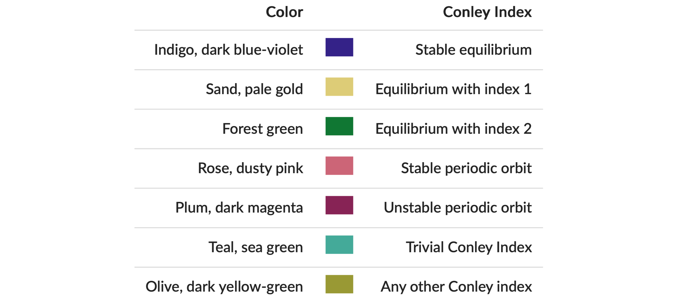
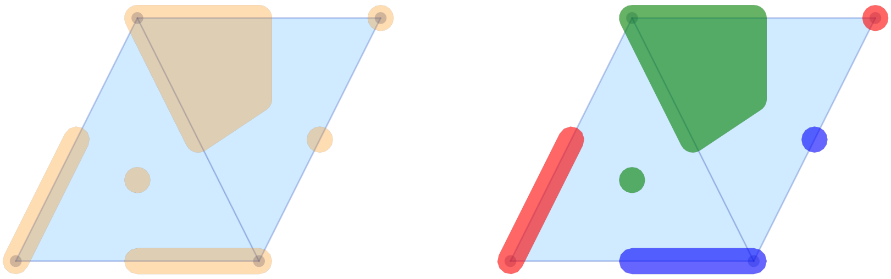
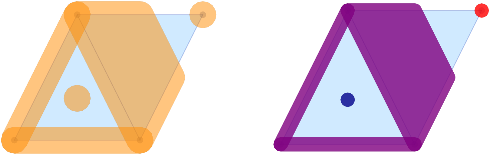
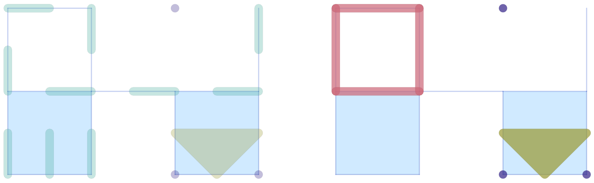
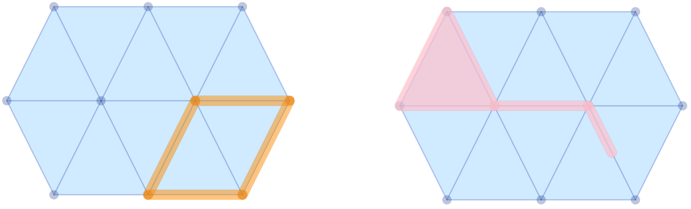
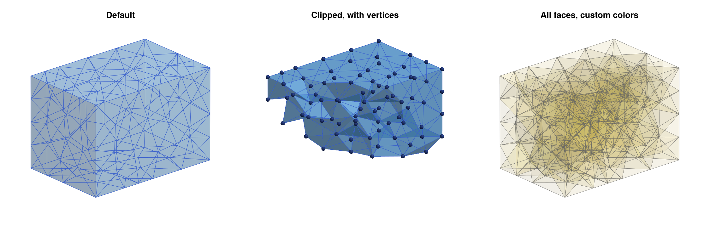
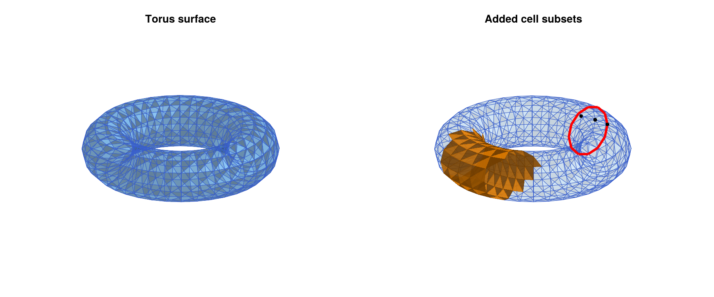
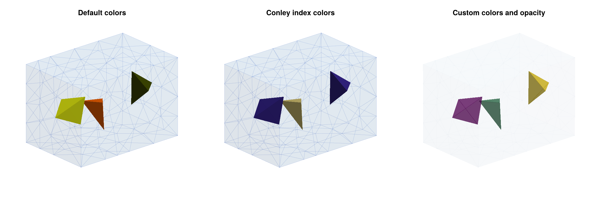
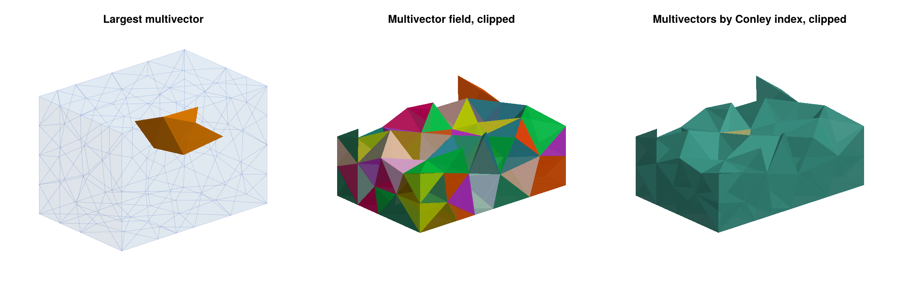
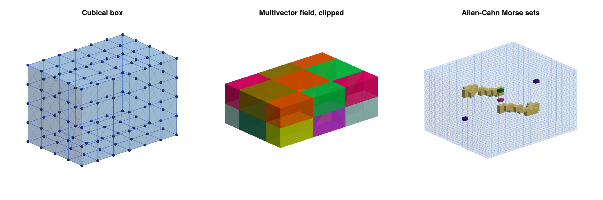

# Visualization

[ConleyDynamics.jl](https://almost6heads.github.io/ConleyDynamics.jl)
provides two independent visualization backends for planar complexes:
a *Luxor.jl-based* backend that produces PDF, PNG, or SVG files directly,
and a *Plots.jl-based* backend that integrates with the Julia plotting
ecosystem. In addition, complexes embedded in three dimensions, such as
tetrahedral meshes, cubical complexes in space, and triangulated
surfaces, can be visualized with a *Makie.jl-based* backend. The three
backends are described in separate sections below.

## Luxor-Based Plotting

The functions
* [`plot_planar_simplicial`](@ref),
* [`plot_planar_simplicial_morse`](@ref),
* [`plot_planar_cubical`](@ref), and
* [`plot_planar_cubical_morse`](@ref)
produce publication-quality plots by writing directly to a PDF, PNG,
or SVG file via the [Luxor.jl](https://github.com/JuliaGraphics/Luxor.jl)
package. They require an explicit output filename and a separate
coordinate vector for the vertices of the complex. The type of the
image file is indicated by the filename ending.

As a simple example, the following commands create a PDF image of a
small simplicial complex together with its Morse sets:

```julia
using ConleyDynamics

lc, mvf = example_forman2d()
cm = connection_matrix(lc, mvf)
coords = [[50,200],[150,200],[250,200],[0,100],[100,100],
          [200,100],[300,100],[50,0],[150,0],[250,0]]
fname  = "forman2d_morse.pdf"
plot_planar_simplicial_morse(lc, coords, fname, cm.morse)
```

For cubical complexes the workflow is analogous. The function
[`get_cubical_coords`](@ref) extracts vertex coordinates from the
cube labels, so no separate coordinate vector needs to be specified
manually:

```julia
using ConleyDynamics

cc, coords = create_cubical_rectangle(4, 3)
fname = "cubical_rectangle.pdf"
plot_planar_cubical(cc, coords, fname)
```

Both families of Luxor functions also accept a [`EuclideanComplex`](@ref)
as their first argument. In that case the coordinate vector can be omitted
entirely. For example, the first of the above two plots can alternatively
be created using the following commands:

```julia
using ConleyDynamics

ec, mvf = example_forman2d(euclidean=true)
cm = connection_matrix(ec, mvf)
fname  = "forman2d_morse.pdf"
plot_planar_simplicial_morse(ec, fname, cm.morse)
```

## Plots-Based Plotting

The [Plots.jl](https://github.com/JuliaPlots/Plots.jl) backend provides
eight convenience functions:

| Function | Description |
|----------|-------------|
| [`plot_simplicial`](@ref) | Simplicial complex with optional Forman overlay |
| [`plot_cubical`](@ref) | Cubical complex with optional Forman overlay |
| [`plot_simplicial_morse`](@ref) | Simplicial complex with colored Morse sets |
| [`plot_cubical_morse`](@ref) | Cubical complex with colored Morse sets |
| [`plot_simplicial_mvf`](@ref) | Simplicial complex with multivector field regions |
| [`plot_cubical_mvf`](@ref) | Cubical complex with multivector field regions |
| [`plot_simplicial_mv`](@ref) | Single multivector on a simplicial complex |
| [`plot_cubical_mv`](@ref) | Single multivector on a cubical complex |

All of these functions are described with short examples in the remainder
of this section.

### Weak Dependency

[Plots.jl](https://github.com/JuliaPlots/Plots.jl) is a *weak
dependency* of
[ConleyDynamics.jl](https://almost6heads.github.io/ConleyDynamics.jl).
This means it is not loaded automatically when you do `using ConleyDynamics`,
and it does not need to be installed unless you want to use the
[Plots.jl](https://github.com/JuliaPlots/Plots.jl) backend. The eight
functions above are stub definitions that become active only after
[Plots.jl](https://github.com/JuliaPlots/Plots.jl) has been loaded.
The required loading order is:

```julia
using Plots
using ConleyDynamics
```

If ConleyDynamics is loaded *before*
[Plots.jl](https://github.com/JuliaPlots/Plots.jl), the plotting
functions will still work because Julia activates package extensions
lazily. However, loading Plots first is the recommended order.

All eight functions return a `Plots.Plot` object, so the full
[Plots.jl](https://github.com/JuliaPlots/Plots.jl)
interface applies: the result can be displayed with `display(p)`,
saved with `savefig(p, "output.png")`, or composed with other plots.
In particular, several plots can be combined in one plot, and it
is possible to increase the plot resolution to generate high-quality
images. Some of this functionality is included in the examples below.

### EuclideanComplex as Input Requirement

The [Plots.jl](https://github.com/JuliaPlots/Plots.jl) backend works
exclusively with [`EuclideanComplex`](@ref) objects, which carry
embedded vertex coordinates. The simplest way to obtain such a
complex is to pass `euclidean=true` when creating a complex:

```julia
ec, mvf = example_forman2d(euclidean=true)
cc = create_cubical_rectangle(4, 3, euclidean=true)
```

Alternatively, [`lefschetz_to_euclidean`](@ref) converts any
`LefschetzComplex` together with a coordinate vector into a
`EuclideanComplex`.

### Plotting a Complex and Forman Vector Fields

The functions [`plot_simplicial`](@ref) and [`plot_cubical`](@ref)
are the main functions for displaying a planar simplicial or 
cubical complex. In addition, both of them accept an optional `mvf`
keyword argument that overlays the Forman part of a multivector 
field on the complex. More precisely, two-element multivectors are
drawn as red arrows from the lower-dimensional cell's barycenter to
the higher-dimensional one. Explicitly critical cells (singletons)
and cells absent from the multivector field are rendered as red
dots at their barycenters. Multivectors of size larger than two are
not visualized. Thus, the functions [`plot_simplicial`](@ref) and
[`plot_cubical`](@ref) will mainly be used for pure complex 
visualization, as well as for Forman vector fields on such
complexes.


As a first example, the following commands are used to create the
simplicial complex and associated Forman vector field shown in the
left panel of the figure with the sample Forman vector field plots:

```julia
using Plots
using ConleyDynamics

sc, smvf = example_forman2d(euclidean=true)
sp = plot_simplicial(sc, mvf=smvf)
display(sp)
```

For the cubical case, the proceeding is similar. In order to generate
the right panel of this figure, we used the commands

```julia
using Plots
using ConleyDynamics

cubes = ["00.11", "01.01", "02.10", "11.10",
         "11.01", "22.00", "20.11", "31.01"]
cc = create_cubical_complex(cubes, euclidean=true)
cmvf = [["01.00","01.01"], ["02.00","02.10"], ["12.00","11.01"],
        ["11.00","01.10"], ["00.00","00.01"], ["00.10","00.11"],
        ["10.00","10.01"], ["20.00","20.01"], ["32.00","31.01"],
        ["30.00","30.01"], ["31.00","21.10"]]
cp = plot_cubical(cc, mvf=cmvf)
display(cp)
```

Note that the figure with the sample Forman vector field plots
contains both plots side-by-side. This
was achieved directly using the
[Plots.jl](https://github.com/JuliaPlots/Plots.jl) framework.
One can combine both plots in a single one, change the resolution to
`dpi = 300`, and then save the figure using the following commands:

```julia
pcombined = plot(sp, cp, layout=(1,2))
plot!(pcombined, dpi=300)
savefig(pcombined, "plots_forman.png")
```

In the above examples, the vertices, edges, and two-dimensional cells
are drawn separately using different shades of blue. In both functions,
the keyword argument `pdim::Vector{Bool}` controls which dimensions
of the simplicial or cubical complex are drawn. The three entries
correspond to vertices (dimension 0), edges (dimension 1), and
faces (dimension 2), respectively. For example, `pdim = [false,true,true]`
suppresses vertices:

```julia
p = plot_cubical(create_cubical_rectangle(4, 3, euclidean=true),
                 pdim=[false,true,true])
display(p)
```

Both plots in the figure with the sample Forman vector field plots were
created using `pdim = [true,true,true]`,
which is also the default if the argument is not specified.

### Plotting Morse Sets for Planar Dynamics

The functions [`plot_simplicial_morse`](@ref) and
[`plot_cubical_morse`](@ref) are used to visualize Morse sets
of multivector fields on planar simplicial or cubical complexes.
In addition to an argument of type `EuclideanComplex`, they expect
a `CellSubsets` argument which contains a list of locally closed
sets, usually the Morse sets associated with a multivector field.

To keep the visualization simple, the vertices, edges, and faces
in a Morse set are all colored with the same color. While by default
all cells are highlighted, both functions accept the optional 
argument `pdim::Vector{Bool}`, which allows the user to select the
dimensions that should be drawn. In the case of large complexes, the
choice `pdim = [false, false, true]` is most appropriate, since then
only the two-dimensional cells are highlighted.

The Morse plot functions color each Morse set in a distinct,
automatically chosen color. By default only the explicitly listed
Morse sets are rendered. Passing the optional argument `addcritical = true`
additionally draws cells absent from any Morse set as implicit singletons
in separate colors. Since this is mostly used when visualizing complete 
multivector fields in the above way, and since the focus of the functions
[`plot_simplicial_morse`](@ref) and [`plot_cubical_morse`](@ref) is on
plotting Morse sets, the default value of this optional argument
is `addcritical = false`.

To demonstrate both functions, we return to an earlier example.

```julia
using Plots
using ConleyDynamics

function planarvf(x::Vector{Float64})
    #
    # Sample planar vector field with nontrivial Morse decomposition
    #
    x1, x2 = x
    y1 = x1 * (1.0 - x1*x1 - 3.0*x2*x2)
    y2 = x2 * (1.0 - 3.0*x1*x1 - x2*x2)
    return [y1, y2]
end

sc  = create_simplicial_delaunay(300, 300, 12, 30, euclidean=true);
sc  = rescale_coords(sc, -1.5, 1.5);
svf = create_planar_mvf(sc, planarvf);
scm = connection_matrix(sc, svf);
pls = plot_simplicial_morse(sc, scm.morse);
display(pls)
```

The above commands define a vector field in the plane, create a Delaunay
triangulation of the region of interest, and then associate a multivector
field to these choices. Finally, the connection matrix is computed, which
gives the Morse sets in `scm.morse`. Note that the plot command only
colors the Morse sets, but in randomly chosen colors. We would like to 
point out that all vertices, edges, and faces of the Morse sets are
emphasized, see the left panel of the figure with the sample Morse
plots. Moreover, the vertices and
edges of the underlying simplicial complex are highlighted as well.


The same vector field can also be analyzed using a cubical complex with
randomly perturbed vertex locations:

```julia
cc  = create_cubical_rectangle(40, 40, randomize=0.4, euclidean=true);
cc  = rescale_coords(cc, -1.5, 1.5);
cvf = create_planar_mvf(cc, planarvf);
ccm = connection_matrix(cc, cvf);
plc = plot_cubical_morse(cc, ccm.morse, ci=true, pdim=[false,false,true]);
display(plc)
```

The resulting plot is shown in the right panel of the figure with the
sample Morse plots. Note that due to
the optional argument `pdim`, only the faces of the simplicial complex
and the Morse sets are highlighted. In addition, this command passes
the argument `ci = true`, which forces that the Morse set colors correspond
to the Conley index of the respective Morse set as explained in the
figure of the color palette for Conley indices.



All of these colors are taken from *Paul Tol's qualitative palette*,
which is designed for colorblind-friendly data visualization.

As before, both plots `pls` and `plc` where combined side-by-side,
and then printed:

```julia
pcombined = plot(pls, plc, layout=(1,2))
plot!(pcombined, dpi=300)
savefig(pcombined, "plots_morse.png")
```

We would like to point out that the argument `ci=true` can be passed
to both [`plot_simplicial_morse`](@ref) and [`plot_cubical_morse`](@ref).

### Plotting Multivector Field Regions

While the above-introduced functions are suitable for the visualization
of Forman vector fields and Morse sets, they often are not adequate in
the setting of multivector fields, especially when the focus is on the
depiction of individual multivectors. This is due to the fact that a 
multivector and its behavior relies crucially on which parts of its 
boundary are in the mouth. Thus, simply rendering the top-dimensional
cell often buries the important information.

In view of this,
[ConleyDynamics.jl](https://almost6heads.github.io/ConleyDynamics.jl)
provides both [`plot_simplicial_mvf`](@ref) and
[`plot_cubical_mvf`](@ref). Both of these functions render each
multivector as a single colored region. The region geometry is
computed as an inflated convex hull of the cell barycenters, so
adjacent multivectors are visually separated by a visible gap.

As a first example, consider the following code snippet:

```julia
using Plots
using ConleyDynamics

lc, mvf = example_julia_logo()
coords = [[0,0], [1,2], [2,0], [3,2]]
ec = lefschetz_to_euclidean(lc, coords)

p1 = plot_simplicial_mvf(ec, mvf)
p2 = plot_simplicial_mvf(ec, mvf, mvfalpha=0.6,
                         mvfcolor=["red", "blue", "green"])

pcombined12 = plot(p1, p2, layout=(1,2))
plot!(pcombined12, dpi=300)
savefig(pcombined12, "plots_mvf_vectors.png")
```



The left panel of the figure of the multivector field visualizations
shows the multivectors from the logo example in the above-described
form. In the default
call, all multivectors are plotted in the same color and with 
high opacity. It is possible to change these choices, as the 
second panel demonstrates. The optional argument `mvfalpha` allows
one to change the opacity, with values closer to 1 being more solid.
In addition, the vector of strings `mvfcolor` can be used to specify
different colors for the multivectors. As the multivectors are drawn,
the function cycles through the provided colors.

While their main purpose is the visualization of complete multivector
fields, the above two functions can, however, also be used for the
depiction of Morse decompositions. For the logo example, this can be
achieved as follows.

```julia
cm = connection_matrix(ec, mvf)
p3 = plot_simplicial_mvf(ec, cm.morse, mvfalpha=0.5,
                         tubefac=0.1)
p4 = plot_simplicial_mvf(ec, cm.morse,
                         mvfcolor=["red","purple","darkblue"],
                         mvfalpha=0.8)

pcombined34 = plot(p3, p4, layout=(1,2))
plot!(pcombined34, dpi=300)
savefig(pcombined34, "plots_mvf_morsesets.png")
```



In this example, the Morse decomposition consists of two critical
cells, as well as one large locally closed invariant set, which is
shown in purple in the right panel of the figure of the multivector
field Morse set visualizations. Note that the
`tubefac` parameter controls the inflation radius as a fraction
of the average edge length (default `0.05`). As mentioned before,
the `mvfalpha` parameter sets the fill opacity (default `0.3`), 
and distinct colors can be assigned to individual Morse sets by
passing a vector `mvfcolor` of color names.

Since the main application of the
functions [`plot_simplicial_mvf`](@ref) and [`plot_cubical_mvf`](@ref)
is the visualization of multivector fields, by default, cells absent
from the multivector field are shown as implicit singleton regions.
One can pass `addcritical=false` to suppress this and display only
the explicitly listed multivectors. This is particularly useful for
displaying Morse sets.

The treatment of multivector fields on cubical complexes is
completely analogous, as the following example demonstrates.

```julia
using Plots
using ConleyDynamics

cubes = ["00.11", "01.01", "02.10", "11.10",
         "11.01", "22.00", "20.11", "31.01"]
cc  = create_cubical_complex(cubes, euclidean=true)
mvf = [["01.00","01.01"], ["02.00","02.10"], ["12.00","11.01"],
       ["11.00","01.10"], ["00.00","00.01"], ["00.10","00.11"],
       ["10.00","10.01"], ["21.00","11.10"], ["32.00","31.01"],
       ["31.00","21.10"], ["20.11","20.01","30.01","20.10"]]
cm  = connection_matrix(cc, mvf)

c1 = plot_cubical_mvf(cc, mvf, ci=true,
                      pdim=[false,true,true])
display(c1)

c2 = plot_cubical_mvf(cc, cm.morse, addcritical=false,
                      ci=true, mvfalpha=0.7,
                      pdim=[false,true,true])
display(c2)

pc12 = plot(c1, c2, layout=(1,2))
plot!(pc12, dpi=300)
savefig(pc12, "plots_mvf_cubical.png")
```

We would like to emphasize that in this case it is essential to
pass the optional argument `addcritical = false` in the Morse set
visualization, since only the singletons listed in `cm.morse` are
actually Morse sets. In fact, one can see that in this example there
are five Morse sets, three of which are singletons.



As with the Morse plot functions, passing `ci=true` to
[`plot_simplicial_mvf`](@ref) or [`plot_cubical_mvf`](@ref) colors
each multivector (or Morse set) by its Conley index instead of using
the `mvfcolor` palette.

### Plotting a Single Multivector

The [`plot_simplicial_mv`](@ref) and [`plot_cubical_mv`](@ref)
functions highlight a single multivector on the complex background:

```julia
using Plots
using ConleyDynamics

lc, mvf = example_forman2d(euclidean=true)
cm = connection_matrix(lc, mvf)
msmax = argmax(length.(cm.morse))
mv = cm.morse[msmax]      # largest Morse set
p1 = plot_simplicial_mv(lc, mv, mvfalpha=0.5)
title!(p1, "periodic orbit")
display(p1)
```



Cell labels (strings) are also accepted in place of integer indices:

```julia
lcset = ["ADE", "AE", "DE", "E", "EF", "FJ", "F"]
p2 = plot_simplicial_mv(lc, lcset,
                        mvfcolor="pink", mvfalpha=0.7,
                        pdim=[false,true,true])
title!(p2, "locally closed set")
display(p2)
pcombined12 = plot(p1, p2, layout=(1,2))
plot!(pcombined12, dpi=300)
savefig(pcombined12, "plots_single_mv.png")
```

## Three-Dimensional Plotting with Makie

Complexes embedded in three dimensions, such as the tetrahedral meshes
described in the chapter [Three-Dimensional Meshes](@ref), cubical complexes created by
[`create_cubical_box`](@ref), or triangulated surfaces, are visualized
with the [Makie.jl](https://docs.makie.org) plotting ecosystem. Makie
supports hardware-accelerated interactive three-dimensional graphics
with correct depth ordering and transparency, which the planar backends
above cannot provide. The table below lists the available functions:

| Function | Description |
|:---------|:------------|
| [`plot_simplicial3d`](@ref) | Simplicial complex in three dimensions |
| [`plot_cubical3d`](@ref) | Cubical complex in three dimensions |
| [`plot_simplicial3d_morse`](@ref) | Simplicial complex with colored Morse sets |
| [`plot_cubical3d_morse`](@ref) | Cubical complex with colored Morse sets |
| [`plot_simplicial3d_mv`](@ref) | Single multivector on a simplicial complex |
| [`plot_cubical3d_mv`](@ref) | Single multivector on a cubical complex |
| [`plot_simplicial3d_mvf`](@ref) | Multivector field on a simplicial complex |
| [`plot_cubical3d_mvf`](@ref) | Multivector field on a cubical complex |
| [`plot_cells3d!`](@ref) | Add an arbitrary cell subset to a plot |

Every function except [`plot_cells3d!`](@ref) comes in two variants. The
plain variant, such as [`plot_simplicial3d`](@ref), creates a new figure
and returns it. The variant with a trailing exclamation mark, such as
[`plot_simplicial3d!`](@ref), draws into an existing Makie axis, which
allows several plots to be combined in one figure or one axis. The
simplicial and cubical functions accept the same arguments. They differ
only in the way two-dimensional cells are drawn: Triangles are drawn as
they are, while squares are split into two triangles.

### Makie Backends

Makie itself only describes plots. To display or save them, one of its
*backends* has to be loaded:

* [GLMakie](https://docs.makie.org/stable/explanations/backends/glmakie)
  opens interactive windows, in which plots can be rotated with the
  mouse (left button), moved (right button), and zoomed (scroll wheel).
  It uses OpenGL, and it handles overlapping transparent surfaces much
  better than CairoMakie, since it blends them independently of the
  drawing order. This is the recommended backend for exploring
  three-dimensional complexes.
* [CairoMakie](https://docs.makie.org/stable/explanations/backends/cairomakie)
  creates static, publication-quality images in the PNG, PDF, and SVG
  formats. It does not need a graphics card, so it also works on remote
  servers. All figures in this section were created with CairoMakie.
* [WGLMakie](https://docs.makie.org/stable/explanations/backends/wglmakie)
  renders interactive plots in a web browser or a Jupyter notebook.

All three backends load `Makie.jl`, which is a weak dependency of
[ConleyDynamics.jl](https://almost6heads.github.io/ConleyDynamics.jl),
and the plotting functions become available as soon as one of them has
been loaded:

```julia
using GLMakie          # or CairoMakie, or WGLMakie
using ConleyDynamics
```

In the REPL, a figure `fig` returned by one of the plotting functions is
displayed automatically. In a script, it can be displayed with
`display(fig)`. With GLMakie, `display(GLMakie.Screen(), fig)` opens an
additional window, so that several figures can be compared side by
side. Figures are saved with `save`, for example

```julia
save("complex.png", fig; px_per_unit=2)
```

where `px_per_unit` scales the resolution of the image. With GLMakie, the
saved image shows the current view, after any interactive rotation. Both
GLMakie and CairoMakie can be loaded in the same session, and
`CairoMakie.activate!()` and `GLMakie.activate!()` switch between them.

Since only the boundary surface of the tetrahedra is drawn by default,
even large tetrahedral meshes can be plotted quickly. For example, a
TetGen mesh of a box with about 950,000 cells has 13,500 boundary
triangles, and plotting it and saving the result as a PNG file with
CairoMakie takes about half a second. Plots which draw many more
triangles, such as those with `hull_only=false` or multivector field
plots of large complexes, are much slower, in particular with
CairoMakie, and the resulting PDF and SVG files can become very large.
PNG files are therefore recommended for large complexes.

### Plotting a Complex

The function [`plot_simplicial3d`](@ref) draws a complex embedded in
three dimensions. For a tetrahedral mesh, it shows the boundary surface
of the union of all tetrahedra, semi-transparent, together with its
edges. The following commands create a mesh of a box with
[`tetgen_mesh`](@ref) and plot it:

```julia
using TetGen
using GLMakie
using ConleyDynamics

ec  = tetgen_to_simplicial(tetgen_mesh(tetgen_domain_box([-1.5,-1,-1], [1.5,1,1]);
                                       maxvolume=0.05))
fig = plot_simplicial3d(ec)
```

The result is shown in the left panel of the figure with three plots
of a tetrahedral mesh. The
appearance can be changed with a number of optional arguments:

* `pdim::Vector{Bool}`: which cell dimensions are drawn. The four
  entries correspond to vertices, edges, two-dimensional cells which are
  not faces of tetrahedra, and the faces of tetrahedra. The default
  `[false,true,true,true]` omits the vertices, which are drawn as small
  spheres if the first entry is `true`. Note that, unlike for the planar
  plotting functions, `pdim` has four entries, and a vector of a
  different length raises an `ArgumentError`.
* `hull_only::Bool`: if `true` (default), only the boundary surface of
  the tetrahedra is drawn. If `false`, all faces and edges are drawn,
  including the ones in the interior of the mesh.
* `clip`: a pair `(n, offset)` which removes part of the complex, see
  the next section.
* `alpha`: the opacity of the faces, between `0` (invisible) and `1`
  (opaque). The default is `0.3`.
* `facecolor`, `edgecolor`, `vertexcolor`: the colors of the cells,
  which can be given in any form that Makie accepts, such as `:gold`,
  `"gold"`, or `colorant"gold"`.
* `linewidth` and `linealpha`: the width and the opacity of the edges.
* `markersize`: the radius of the vertex spheres, in the units of the
  coordinates. By default, it is a fraction of the typical edge length
  of the complex.

The plain variants additionally accept the following arguments, which
determine the figure:

* `axis`: the type of the axis. The default `:scene` creates an
  `LScene`, a plain three-dimensional scene without axis decorations,
  which can be freely rotated. The value `:axis3` creates an `Axis3`,
  which has ticks, labels, and a fixed vertical direction, and which
  uses equal scales on all three axes.
* `size`: the size of the figure in pixels, by default `(800,600)`.

The middle and right panels of the same figure illustrate some of these
options:

```julia
fig2 = plot_simplicial3d(ec; clip=([1,1,1], 0.0), pdim=[true,true,true,true],
                         alpha=0.6)
fig3 = plot_simplicial3d(ec; hull_only=false, alpha=0.05,
                         facecolor=:gold, edgecolor=:gray40, linewidth=0.5)
```



With `hull_only=false`, all interior faces and edges are drawn, which
gives an impression of the density of the mesh, but which is only
readable for small meshes and small values of `alpha`.

If a complex is not embedded in three dimensions, the plotting functions
raise an `ArgumentError`. Planar complexes should be plotted with the
functions in the previous sections. Note also that all two-dimensional
complexes in three dimensions, such as triangulated surfaces, can be
plotted in the same way. Their triangles are drawn individually, see the
torus in [Highlighting Cell Subsets](@ref) below.

### Clipping

Most interesting features of a tetrahedral mesh, such as Morse sets or
refined regions, are hidden in its interior. The optional argument
`clip=(n, offset)` removes all tetrahedra whose centroid `c` lies on the
far side of the plane `n⋅c = offset`, i.e., which satisfy
`n⋅c > offset`. Lower-dimensional cells are kept if and only if they are
faces of a kept cell, so that the visible part is again a closed
subcomplex, and its boundary surface is drawn as usual. For example,

* `clip=([0,1,0], 0.0)` keeps the half `y <= 0` of the complex,
* `clip=([0,0,-1], -0.5)` keeps the part with `z >= 0.5`, and
* `clip=([1,1,1], 0.0)` cuts the complex diagonally, as in the middle
  panel of the figure with three plots of a tetrahedral mesh.

Since whole tetrahedra are removed, the cut surface is jagged rather
than planar, and it shows the actual tetrahedra at the cut. The `clip`
argument is accepted by all plotting functions, and it applies to the
background complex as well as to the highlighted cell subsets. To show
the same section in several overlaid plots, pass the same `clip` value
to each of them.

### Combining Plots

The variants with an exclamation mark draw into an existing axis, which
is passed as the first argument. This makes it possible to arrange
several plots in one figure, as in all the figures of this section, or
to overlay several plots in one axis. The figure with three plots of a
tetrahedral mesh was created with the following commands:

```julia
using CairoMakie

fig = Figure(size=(1500,500))

ax1 = Axis3(fig[1,1]; aspect=:data, title="Default")
plot_simplicial3d!(ax1, ec)

ax2 = Axis3(fig[1,2]; aspect=:data, title="Clipped, with vertices")
plot_simplicial3d!(ax2, ec; clip=([1,1,1], 0.0), pdim=[true,true,true,true],
                   alpha=0.6)

ax3 = Axis3(fig[1,3]; aspect=:data, title="All faces, custom colors")
plot_simplicial3d!(ax3, ec; hull_only=false, alpha=0.05,
                   facecolor=:gold, edgecolor=:gray40, linewidth=0.5)

for ax in (ax1, ax2, ax3)
    hidedecorations!(ax)
    hidespines!(ax)
end
save("makie3d_basic.png", fig; px_per_unit=1.5)
```

The argument `aspect=:data` gives all three axes the same scale, which
is essential for judging the shape of tetrahedra, and `hidedecorations!`
and `hidespines!` remove ticks, labels, and the bounding box. Instead of
an `Axis3`, one can also use `LScene(fig[1,1]; show_axis=false)`, which
is what the plain variants do by default. An `LScene` can be rotated
freely in GLMakie, while an `Axis3` keeps the `z`-axis vertical. The
viewing direction of an `Axis3` is determined by its attributes
`azimuth` and `elevation`, in radians, which can be passed to the
constructor or changed later, for example with `ax1.azimuth = 0.3*pi`.

The plain variants return the figure, and the axis they created can be
retrieved with `content(fig[1,1])`. This allows the plain variants to be
combined with the other functions as well:

```julia
fig = plot_simplicial3d(ec; axis=:axis3)
ax  = content(fig[1,1])
plot_cells3d!(ax, ec, [1, 2, 3]; color=:red)
```

### Highlighting Cell Subsets

The function [`plot_cells3d!`](@ref) draws an arbitrary collection of
cells, given by their indices or labels, into an existing axis. It is
the basic building block of all the plotting functions of this section,
and it is the tool of choice for constraint surfaces, exit sets, or the
result of any computation that returns cells. Cells are drawn according
to their dimension:

* Three-dimensional cells are drawn by the boundary surface of their
  union (or by all their faces if `hull_only=false`).
* Two-dimensional cells are drawn as triangles or squares, unless they
  are faces of three-dimensional cells in the collection.
* Edges are drawn as thick lines, unless they are faces of
  higher-dimensional cells in the collection.
* Vertices are drawn as spheres, unless they are faces of
  higher-dimensional cells in the collection.

The optional arguments are `color` (default `:darkorange`), `alpha`
(default `1.0`), `pdim` (by default all dimensions are drawn),
`hull_only`, `clip`, `linewidth` (default `4`), and `markersize`. As an
example, the following commands plot a triangulated torus surface and
three cell subsets on it: the edges of a meridian circle, a band of
triangles, and the first three cells of the complex, which are vertices
selected by their labels:

```julia
Vt, Tt = trisurface_torus([0,0,0], 2.0, 0.7, 36, 12)
ecs = tetmesh_to_euclidean(Vt, Tt)

meridian = [k for k in 1:ecs.ncells if ecs.dimensions[k] == 1 &&
            all(abs(c[2]) < 1e-12 && c[1] > 0 for c in ecs.coords[k])]
band = [k for k in 1:ecs.ncells if ecs.dimensions[k] == 2 &&
        all(c[1] < -0.5 && abs(c[2]) < 1.2 for c in ecs.coords[k])]

fig = Figure(size=(1200,500))
ax1 = Axis3(fig[1,1]; aspect=:data, title="Torus surface")
plot_simplicial3d!(ax1, ecs; alpha=0.5)
ax2 = Axis3(fig[1,2]; aspect=:data, title="Added cell subsets")
plot_simplicial3d!(ax2, ecs; alpha=0.15)
plot_cells3d!(ax2, ecs, meridian; color=:red)
plot_cells3d!(ax2, ecs, band; color=:darkorange, alpha=0.9)
plot_cells3d!(ax2, ecs, ecs.labels[1:3]; color=:black)
```

The cell subsets are selected geometrically, using the vertex
coordinates which every [`EuclideanComplex`](@ref) stores in its field
`coords`. For each cell, `ecs.coords[k]` is the vector of the
coordinates of its vertices. The two panels are shown in the figure of
the torus surface with highlighted cell subsets.



Further examples of [`plot_cells3d!`](@ref) can be found in the
chapter [Three-Dimensional Meshes](@ref), where it is used to show the constraint
surfaces and curves found by [`tetgen_marker_cells`](@ref) and
[`gmsh_marker_cells`](@ref).

### Plotting Morse Sets

The functions [`plot_simplicial3d_morse`](@ref) and
[`plot_cubical3d_morse`](@ref) draw the complex faintly in the
background, and every Morse set in its own color on top of it. Each
Morse set is drawn as described for [`plot_cells3d!`](@ref) above. The
following example uses the vector field from the documentation of
[`create_spatial_mvf`](@ref):

```julia
function samplevf(x::Vector{Float64})
    x1, x2, x3 = x
    return [x1 * (1.0 - x1*x1), -x2, -x3]
end

mvf = create_spatial_mvf(ec, samplevf)
ms  = morse_sets(ec, mvf)
[conley_index(ec, m) for m in ms]     # [[1,0,0,0], [1,0,0,0], [0,1,0,0]]

fig1 = plot_simplicial3d_morse(ec, ms)
fig2 = plot_simplicial3d_morse(ec, ms; ci=true)
fig3 = plot_simplicial3d_morse(ec, ms; colors=[:purple, :gold, :seagreen],
                               alpha=0.5, bgalpha=0.02,
                               pdim=[false,false,false,true])
```

The three plots are shown in the figure of the Morse sets of a vector
field on a tetrahedral mesh. On this coarse mesh, each Morse set
contains a single tetrahedron. For the two attractors, the Morse set
consists of this tetrahedron and all its faces, while the Morse set
of the saddle contains only six of its fourteen faces.



The optional arguments are:

* `ci::Bool`: if `true`, the Morse sets are colored by their Conley
  index, with the same colors as in the planar plots, see the
  [color palette for Conley indices](@ref "Plotting Morse Sets for Planar Dynamics")
  above. In addition, the indices `[0,0,0,1]` and `[0,0,1,1]` of
  dimension three have their own colors (purple and light blue), and all
  remaining indices are shown in olive.
* `colors`: a vector of colors for the Morse sets, which is cycled
  through if there are more Morse sets than colors. By default, the same
  distinguishable colors as in the planar plots are used.
* `addcritical::Bool`: if `true`, all cells which do not belong to any of
  the given sets are added as singleton sets. The default is `false`.
* `alpha`: the opacity of the Morse sets, by default `0.9`.
* `bgalpha`: the opacity of the background faces, by default `0.08`.
* `pdim`: the cell dimensions which are drawn in the background. In the
  third panel, `pdim=[false,false,false,true]` suppresses the edges of
  the background.
* `hull_only`, `clip`, `linewidth`, and `markersize`, as before. Here,
  `linewidth` (default `4`) refers to the edges of the Morse sets.

The Morse sets can be given as cell indices or as labels, i.e., as a
`Vector{Vector{Int}}` or a `Vector{Vector{String}}`, and in particular
the field `morse` of the result of [`connection_matrix`](@ref) can be
passed directly. The functions are not restricted to Morse sets: Any
collection of cell subsets can be plotted, such as isolated invariant
sets or isolating blocks.

### Plotting Multivectors and Multivector Fields

The functions [`plot_simplicial3d_mv`](@ref) and
[`plot_cubical3d_mv`](@ref) highlight a single multivector, or any
other single cell subset, on the faint background complex. The color is
set with the optional argument `color`, and all other optional arguments
are as for the Morse set plots. The functions
[`plot_simplicial3d_mvf`](@ref) and [`plot_cubical3d_mvf`](@ref) draw a
complete multivector field. Every multivector with at least two cells is
drawn in its own color, and singletons are omitted. The colors are
chosen by a greedy coloring, so that adjacent multivectors receive
different colors whenever possible. Since the multivectors cover the
whole complex, these plots are mostly useful together with clipping:

```julia
mvlargest = mvf[argmax(length.(mvf))]
length(mvf), length(mvlargest)        # (325, 38)

fig1 = plot_simplicial3d_mv(ec, mvlargest)
fig2 = plot_simplicial3d_mvf(ec, mvf; clip=([0,0,1], 0.0))
fig3 = plot_simplicial3d_mvf(ec, mvf; ci=true, clip=([0,0,1], 0.0))
```

The three plots are shown in the figure of the multivector and the
multivector field on a tetrahedral mesh.



The optional arguments of the multivector field plots are the same as
for the Morse set plots, with the following differences. The argument
`colors` specifies the palette for the greedy coloring, which by default
consists of twelve light colors. The default opacity is `alpha=0.8`.
With `ci=true`, every multivector is colored by its Conley index. Since
most multivectors of a typical multivector field are regular, i.e., have
trivial Conley index, such a plot is dominated by one color, and the few
critical multivectors stand out, as the small yellow multivector in the
right panel of the figure of the multivector and the multivector field
on a tetrahedral mesh shows. With `addcritical=true`, the singleton multivectors
and all cells that are not covered by the multivector field are drawn as
well.

### Plotting Cubical Complexes

The cubical functions work in exactly the same way, and they accept the
same optional arguments. Cubical complexes are usually created with
[`create_cubical_box`](@ref), whose integer vertex coordinates are then
mapped to the region of interest with
[`convert_spatial_coordinates`](@ref). The following commands plot a
small cubical complex with its vertices, and the multivector field of
the sample vector field from above, clipped at the plane `z = 0`:

```julia
lc, coords = create_cubical_box(6, 4, 4)
ecq = lefschetz_to_euclidean(lc, convert_spatial_coordinates(coords,
                                     [-1.5,-1,-1], [1.5,1,1]))
mvfq = create_spatial_mvf(ecq, samplevf)

fig1 = plot_cubical3d(ecq; pdim=[true,true,true,true])
fig2 = plot_cubical3d_mvf(ecq, mvfq; clip=([0,0,1], 0.0))
```

The squares of a cubical complex are drawn as two triangles each. The
diagonal along which a square is split is not drawn, since it is not an
edge of the complex, but it can be visible in the shading of
semi-transparent squares. For a larger example, we return to the
three-dimensional projection of the Allen-Cahn equation discussed in the
section [Analysis of a Spatial System](@ref):

```julia
function allencahn3d(x::Vector{Float64})
    lambda = 3.0 * pi
    c      = lambda / pi
    x1, x2, x3 = x
    y1 = (lambda-1)*x1 - 1.5*c * (x1*x1*x1-x1*x1*x3+x2*x2*x3+2*x1*(x2*x2+x3*x3))
    y2 = (lambda-4)*x2 - 1.5*c * x2 * (2*x1*x1+x2*x2+2*x1*x3+2*x3*x3)
    y3 = (lambda-9)*x3 + 0.5*c * (x1*(x1*x1-3*x2*x2)-3*x3*(2*x1*x1+2*x2*x2+x3*x3))
    return [y1, y2, y3]
end

bmax = [1.8, 1.5, 1.0]
lca, ca = create_cubical_box(25, 25, 25)
eca  = lefschetz_to_euclidean(lca, convert_spatial_coordinates(ca, -bmax, bmax))
mvfa = create_spatial_mvf(eca, allencahn3d)
msa  = morse_sets(eca, mvfa)
[conley_index(eca, m) for m in msa]
# [[1,0,0,0], [1,0,0,0], [0,1,0,0], [0,1,0,0], [0,0,1,0], [0,0,1,0], [0,0,0,1]]

fig3 = plot_cubical3d_morse(eca, msa; ci=true)
```

The Morse decomposition consists of seven Morse sets: two attracting
equilibria, two equilibria with one-dimensional unstable manifolds, two
equilibria with two-dimensional unstable manifolds, and the trivial
equilibrium, whose unstable manifold is
three-dimensional. The three plots are shown in the figure of the
cubical complexes in three dimensions. In the right panel, the colors of
the Conley indices immediately identify the
index of each equilibrium: the attractors are dark blue, the Morse sets
with index `[0,1,0,0]` are sand-colored, the ones with index `[0,0,1,0]`
are green, and the trivial equilibrium is purple. Note that one of the
two green Morse sets is hidden behind a sand-colored one in this view.
In such cases, an interactive GLMakie window, or the `clip` argument,
helps to see all Morse sets.



### Practical Tips

The following remarks summarize the experience gained with the figures
in this manual:

* **Transparency.** CairoMakie sorts the triangles of a single plot
  object by depth, but it draws different plot objects in the order in
  which they were created. All colored triangles of a Morse set or
  multivector field plot are therefore combined into one plot object,
  which is rendered correctly. When several plots are overlaid with
  [`plot_cells3d!`](@ref), draw the inner objects first, and use opaque
  colors for objects which should hide others. GLMakie uses
  order-independent transparency, which handles such overlays much
  better, although it is also only an approximation.
* **Lines and surfaces.** Edges and curves remain clearly visible
  through semi-transparent surfaces, and with CairoMakie, lines which
  are drawn after a surface even appear in front of opaque parts of it.
  This is usually desirable for constraint curves, but it can be
  confusing for the edges of large complexes. In such cases, reduce
  `linealpha` or omit the edges with `pdim`.
* **Large complexes.** For tetrahedral meshes with hundreds of thousands
  of tetrahedra, the default plot is still fast, since only the boundary
  surface is drawn. Avoid `hull_only=false` and vertex spheres for such
  meshes, and use clipping to look inside. Multivector field plots are
  only readable for small complexes.
* **Reproducible views.** The default view of an `LScene` depends on the
  bounding box of the plot. For figures which are to be published, an
  `Axis3` with explicitly set `azimuth` and `elevation` gives
  reproducible views.
