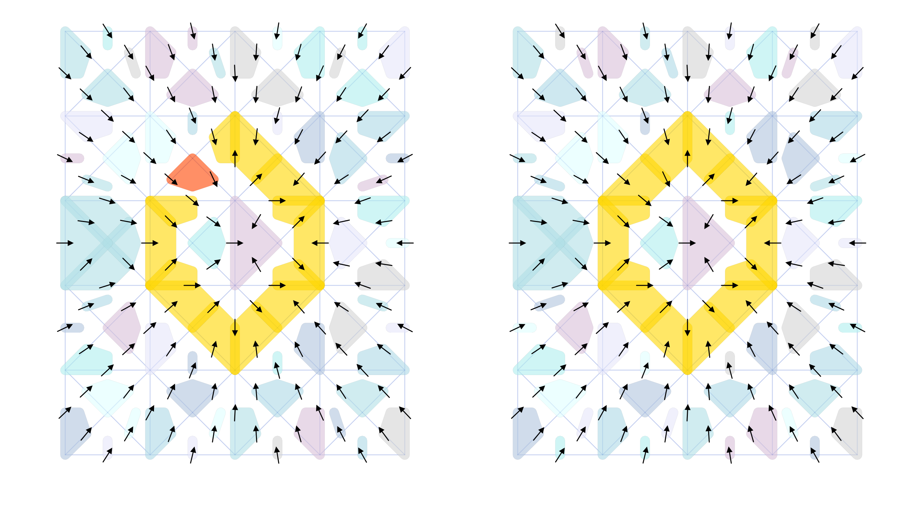

# Strong Isolation and Periodicity

The functions [`create_planar_mvf`](@ref) and [`create_spatial_mvf`](@ref)
turn a classical vector field into a multivector field, and the closures
of the Morse sets of this multivector field are isolating blocks for the
flow. For many purposes this is all one needs. In order to prove the
existence of a *periodic orbit*, however, one needs more: The isolating
blocks have to be *strong* isolating blocks, i.e., both their exit sets
and their entry sets have to be closed, and they have to fit together
like the bricks of a wall around the orbit. This section of the manual
describes the tools of
[ConleyDynamics.jl](https://almost6heads.github.io/ConleyDynamics.jl)
for this purpose. More precisely, we discuss the following topics:

* The computation of the dynamical transitions of a vector field, which
  are the raw material for all multivector fields induced by flows.
* The *Ouroboros example*, which shows that the closure of a multivector
  need not be a strong isolating block.
* *Dual multivector fields* and the *finest strongly accumulating
  multivector field*, whose multivectors are always strong isolating
  blocks, together with functions for checking these properties.
* Prescribed *merge sets*, which can be used to remove combinatorial
  artifacts of a mesh.
* A combinatorial *criterion for the existence of periodic orbits*, and
  the functions which check its hypotheses.

The mathematical background can be found in the paper
[thorpe:wanner:p25a](@cite). Many of the underlying ideas were developed
by Justin Thorpe in his dissertation [thorpe:26a](@cite), and his code
contributions to the package were the starting point for the functions
described below. In contrast to most other sections of this manual, the
code examples in this section are not executed when the manual is
created, since some of them take a while. Instead, the output of every
command is shown as a comment below it, as it was obtained with the
current version of the package.

## [Dynamical Transitions](@id strongmvf_transitions)

Let ``\varphi`` be a flow on a compact region ``\mathbf{X}`` in phase
space, and let ``\mathcal{X}`` be a cellular decomposition of
``\mathbf{X}``, such as a triangulation. For a point ``x``, let
``\mathrm{fti}(x)`` denote the collection of all cells whose interiors
are visited by the solution through ``x`` at arbitrarily small positive
times. For every cell ``\sigma`` through which the flow does not leave
the region, the *immediate future* of ``\sigma`` is then defined as

```math
   \mathrm{Ift}(\sigma) \; = \;
     \bigcup_{x \in \mathring{\sigma}} \;
     \bigcup_{\tau \in \mathrm{fti}(x)} \mathrm{Star}\,\tau ,
```

where ``\mathring{\sigma}`` denotes the interior of the cell ``\sigma``.
In other words, the immediate future is the union of the stars of all
cells which solutions starting in ``\sigma`` enter at arbitrarily small
positive times, i.e., the smallest open collection of cells which contains
all of these cells. The set
``D_\sigma = \{\sigma\} \cup \mathrm{Ift}(\sigma)`` is called the
*dynamical transition* of ``\sigma``. It describes in a set-valued way
where the flow can go from the cell ``\sigma`` in short forward time. For
example, if an edge of a planar triangulation is crossed transversally by
the flow, then its immediate future consists of the triangle into which
the flow enters, while the immediate future of an edge at which the flow
is tangent can contain both adjacent triangles.

A multivector field is called *accumulating*, if every multivector
contains the immediate futures of all of its cells. Thus, in an
accumulating multivector field, every cell together with all cells that
can be reached from it in short forward time lie in a single multivector.
The flow-induced multivector field, i.e., the smallest multivector field
which contains every dynamical transition in a single multivector, is the
finest accumulating multivector field, and it can be constructed with the
function [`create_mvf_hull`](@ref). This is exactly what
[`create_planar_mvf`](@ref) and [`create_spatial_mvf`](@ref) do
internally. For the constructions of this section, however, we need the
dynamical transitions themselves, and they are available through the
following two functions:

* [`planar_transitions`](@ref) computes the dynamical transitions of a
  planar vector field on a planar Lefschetz complex. Its arguments are the
  same as for [`create_planar_mvf`](@ref), i.e., either a Lefschetz complex
  together with a vector of vertex coordinates and the vector field, or an
  [`EuclideanComplex`](@ref) and the vector field. The optional keyword
  `npts` (default `10`) determines the number of sample points in the
  interior of every edge, and `nontransverse=true` activates a stricter test
  for tangencies, which also samples the vertices of the edges.
* [`spatial_transitions`](@ref) is the analogous function for vector fields
  in three dimensions, on tetrahedral or cubical complexes. Here the
  keyword `npts` (default `3`) gives the number of sample points in the
  interior of every edge, and every face is sampled on a grid of the same
  spacing.

Both functions return a vector of integer vectors, in which every entry
has the form `[c; targets]`. Here `c` is the index of a vertex, edge, or
face, and `targets` are the indices of the toplexes, i.e., the
top-dimensional cells, into which the flow can enter from `c`. Cells
through which the flow leaves the region do not appear in the list, and
the trivial transitions of the toplexes are omitted as well. It suffices
to list the toplexes, since every cell of ``\mathrm{Ift}(c)`` lies between
`c` and one of the toplexes in ``\mathrm{Ift}(c)``. Thus, these cells are
added automatically when the transitions are turned into locally closed
multivectors. The dynamical transitions of the *reversed* flow, which approximate the *immediate past*
``\mathrm{Ipt}(\sigma)`` of the cells, are obtained by passing the
negative vector field `x -> -vf(x)`. Since both computations use the same
sample points, the forward and backward transitions are consistent with
each other.

We illustrate these functions with an example which is included in the
package. The function [`example_ouroboros`](@ref) returns a small
triangulation of the rectangle ``[0,4] \times [0,5]``, together with a
planar vector field which points toward the center of the rectangle,
except near a few edges, where it has been modified. The forward and
backward transitions are computed via

```julia
ec, vf = example_ouroboros()
lc  = euclidean_to_lefschetz(ec)
fwd = planar_transitions(ec, vf)
bwd = planar_transitions(ec, x -> -vf(x))
length(fwd), length(bwd)
# (179, 143)
fwd[1:3]
# 3-element Vector{Vector{Int64}}:
#  [1, 180]
#  [2, 200]
#  [3, 220]
lc.labels[fwd[1]]
# 2-element Vector{String}:
#  "00b"
#  "00b00c01b"
```

The first transition, for example, states that the flow starting at the
vertex with label `00b` enters the triangle `00b00c01b`. There are fewer
backward than forward transitions, since the flow enters the rectangle
through its whole boundary. The boundary cells therefore have forward
transitions, but no backward transitions. The finest accumulating
multivector field is obtained via

```julia
mvf = create_mvf_hull(lc, fwd);
length(mvf)
# 65
```

and it coincides with the result of `create_planar_mvf(ec, vf)`. As usual,
only the multivectors with at least two cells are listed.

The closure of every locally closed union of multivectors of an
accumulating multivector field is an isolating block for the flow, whose
exit set is the support of the mouth of the union, and whose Conley index
agrees with the combinatorial Conley index. The entry set of such a block,
however, need not be closed. This was observed by Justin Thorpe, who
constructed the following example, see [thorpe:26a](@cite). It is named
after the Ouroboros, the ancient symbol of a snake which eats its own
tail.



The left panel of the image shows the complete accumulating multivector
field `mvf` from above, including all singletons, and the arrows indicate
the direction of the vector field at the midpoints of the edges. The large
multivector in gold is a curved strip which winds around the center of
the rectangle, and its head touches its tail at a single vertex. The small
multivector in red lies just in front of its head. Outside of the strip,
the vector field is directed toward the center, so that the flow leaves
the closure of the gold multivector through its inner boundary, and
enters it through its outer boundary. However, the vertex at which the
head touches the tail is not an entry point, since its backward solution
immediately enters the head. Thus, the entry set of the isolating block is
not closed, and the block is not a strong isolating block. Since this
defect is caused by the global shape of the multivector, it cannot be
detected by looking at the dynamical transitions of individual cells.

Both panels were created with the function [`plot_simplicial_mvf`](@ref),
see [Plotting Multivector Field Regions](@ref), and the vector `mvfcolor`
of colors was used to highlight the two multivectors. The complete script
can be found in the file `misc/examples/strong_mvf/ouroboros_figure.jl` of
the package repository.

## Strong Accumulation

The remedy for the defect of the Ouroboros example is to impose the
analogous condition for the reversed flow, and to couple the two resulting
multivector fields via their toplexes. A multivector field on the cells
which are not entrance cells is called *backward accumulating*, if every
multivector contains the immediate pasts of all of its cells. An
accumulating multivector field ``\mathcal{V}`` is called *strongly
accumulating*, if there exists a backward accumulating multivector field
``\mathcal{V}^*``, the *dual* multivector field, such that the
multivectors of ``\mathcal{V}`` and of ``\mathcal{V}^*`` contain exactly
the same groups of toplexes. In this case, the dual multivector field is
uniquely determined, and the dual of a multivector ``V`` is given by

```math
   V^* \; = \; \left\{ \sigma \; \mid \;
     \mathrm{Ipt}(\sigma) \cap V \neq \emptyset \right\} ,
```

i.e., it consists of all cells whose immediate past reaches into ``V``.
The multivector ``V`` and its dual ``V^*`` have the same closure, and they
differ only along the boundary of this closure: ``V`` contains the boundary
cells through which the flow enters, and ``V^*`` the ones through which
it leaves. The most important consequence is that for every multivector
of a strongly accumulating multivector field, the closure of ``V`` is a
strong isolating block, whose exit set is given by the mouth of ``V``,
and whose entry set is given by the mouth of ``V^*``.

The duals can be computed with the following two functions:

* [`mvf_dual_set`](@ref) computes the dual of a single set of cells with
  respect to given backward transitions, i.e., all cells whose immediate
  past intersects the set. This set was introduced by Justin Thorpe in
  [thorpe:26a](@cite).
* [`mvf_dual`](@ref) computes the duals of all multivectors of a
  multivector field in a single pass over the transitions. If the
  multivector field is strongly accumulating, then the result is its dual
  multivector field. If, on the other hand, a cell lies in two of the
  computed duals, then the corresponding multivectors have to be merged in
  every strongly accumulating multivector field.

For the Ouroboros example, the duals of the accumulating multivector field
are computed by

```julia
duals = mvf_dual(lc, mvf, bwd);
```

and we will see below that the dual of the gold multivector is not
locally closed. This is precisely the combinatorial reflection of the
missing vertex in the entry set.

Every flow which satisfies the standing assumptions on the boundary of the
region, see the next paragraph, gives rise to a unique *finest* strongly
accumulating multivector field. It is constructed by an iteration which
alternates between the two time directions: Starting with the partition of
the toplexes into singletons, one computes the smallest accumulating
multivector field and the smallest backward accumulating multivector
field which contain the dynamical transitions and the current groups of
toplexes. Then the groups of toplexes are replaced by the finest
partition of the toplexes in which the toplexes of every multivector of
either field lie in a single group, and this is repeated until nothing
changes. The result is strongly
accumulating, and every strongly accumulating multivector field is a
coarsening of it. In addition, all of its multivectors are connected.
This construction formalizes the iterative merging procedure of Justin
Thorpe [thorpe:26a](@cite).

The boundary of the region has to be compatible with the flow. More
precisely, every boundary point has to be a *strong exit point*, through
which the flow leaves the region immediately, a *strong entrance point*,
through which it enters immediately, or a point of *external tangency*,
at which the flow touches the region from outside. The boundary cells which
consist of exit or tangency points are the *exit cells*, and the ones which
consist of entrance or tangency points are the *entrance cells*. Both
families have to be closed. The multivector field is defined on all cells
except the exit cells, and its dual on all cells except the entrance cells.

The finest strongly accumulating multivector field is computed by the
following functions:

* [`create_strong_mvf`](@ref) expects a Lefschetz complex, the forward
  transitions, and the backward transitions, as computed above. It returns
  the finest strongly accumulating multivector field `mvf` and its dual
  `dualmvf`. As usual, only multivectors with at least two cells are
  listed. With the keyword `details=true`, the function returns in
  addition a dictionary `info`, whose entries are described below.
* [`create_planar_strong_mvf`](@ref) and [`create_spatial_strong_mvf`](@ref)
  are convenience functions which compute the forward and backward
  transitions with [`planar_transitions`](@ref) or
  [`spatial_transitions`](@ref), and then call [`create_strong_mvf`](@ref).
  They accept the same arguments as [`create_planar_mvf`](@ref) and
  [`create_spatial_mvf`](@ref), together with the keywords of the
  transition functions and of [`create_strong_mvf`](@ref), including
  `details`.

The dictionary `info`, which is returned by these functions if
`details=true`, has the following entries:

* `"exit cells"` and `"entrance cells"` are the sorted vectors of the exit
  cells and of the entrance cells, which were defined above. The next
  paragraph explains how they are determined.
* `"mvf to dual"` is a vector of the same length as `mvf`, whose `k`-th
  entry is the index of the multivector in `dualmvf` with the same
  toplexes as `mvf[k]`. The entry is zero if this dual multivector is a
  singleton, i.e., a single toplex which is not listed in `dualmvf`, or if
  `mvf[k]` contains no toplex. Analogously, `"dual to mvf"` is a vector of
  the same length as `dualmvf`, which contains the indices of the
  corresponding multivectors in `mvf`.
* `"forward merges"` and `"backward merges"` are the numbers of merges of
  two blocks in the union-find structures of `mvf` and of `dualmvf`,
  respectively, see below. They include the merges caused by the
  transitions, by restoring local closedness, and by couplings.
* `"couplings"` is the number of merges in one of the two fields which
  joined two blocks containing toplexes, and which therefore had to be
  transferred to the other field.
* `"time"` is the computation time in seconds.

The exit cells and the entrance cells are usually inferred automatically
from the transitions of the boundary faces of codimension one, i.e., of
the faces which belong to exactly one toplex: A boundary face is an exit
face if only its backward transition enters the adjacent toplex, an
entrance face if only its forward transition does, and both if neither
does. The exit cells are then the closure of the exit faces, and the
entrance cells are the closure of the entrance faces. In this way, the
boundary cells of higher codimension, i.e., the boundary vertices of a
planar complex, and the boundary edges and vertices of a complex in three
dimensions, are classified as well. Their own transitions are not used
for this purpose. In particular, a boundary cell which lies in the
closure of both an exit face and an entrance face, such as a vertex
shared by an exit face and an entrance face, is both an exit cell and an
entrance cell. If a boundary face has transitions into its toplex in both
directions, then the flow crosses the boundary in both directions within
this face, the assumptions are violated, and an error is raised. In this
case one can refine the mesh near the boundary, or one can specify the two
families explicitly with the keywords `exitcells` and `entrancecells`. In
addition, the function raises an error if a cell which is not an exit cell
has no forward transition, or if a cell which is not an entrance cell has
no backward transition, since this would mean that the flow cannot leave
the cell in one of the time directions.

For the Ouroboros example we obtain

```julia
smvf, sdual, info = create_strong_mvf(lc, fwd, bwd; details=true);
length(smvf)
# 64
info["exit cells"], length(info["entrance cells"])
# (Int64[], 36)
info["couplings"]
# 32
```

There are no exit cells, since the flow enters the rectangle everywhere,
and the 36 entrance cells form its boundary. Compared to the accumulating
multivector field, there is one multivector less: The gold and the red
multivectors in the left panel of the Ouroboros image in [Dynamical
Transitions](@ref strongmvf_transitions) have been merged into the single
gold multivector shown in its right panel, and the closure of this
multivector is a strong isolating block. The number of *couplings* counts
how often the merging of two groups of toplexes in one of the two
multivector fields had to be transferred to the other one.

The implementation keeps one union-find structure for each of the two
multivector fields, and it restores local closedness incrementally after
every merge. Its cost is roughly proportional to the size of the complex,
and for meshes with millions of cells the computation of the transitions
is usually more expensive than the construction itself.

Since the construction above relies on a fairly intricate algorithm,
[ConleyDynamics.jl](https://almost6heads.github.io/ConleyDynamics.jl)
also provides independent checks:

* [`mvf_is_strongly_accumulating`](@ref) checks whether a multivector
  field is strongly accumulating with a given dual, with respect to given
  forward and backward transitions. It verifies that both fields consist
  of disjoint locally closed sets which avoid the exit cells and the
  entrance cells, respectively, that every transition lies in a single
  multivector, that both fields induce the same partition of the
  toplexes, that the multivectors and their duals are related as in the
  formula for ``V^*`` above, where the duals are recomputed independently
  with [`mvf_dual`](@ref), and that every multivector has the same closure
  as its dual. The function returns `true` or `false`. With the keyword
  `details=true`, it returns in addition a dictionary `report` which lists
  the violations of every condition, together with the multivectors which
  are not connected. Its entries are described in detail below.
* [`strong_isoblock_sets`](@ref) expects a locally closed union `U` of
  multivectors of a strongly accumulating multivector field, such as a
  Morse set, together with the field and its dual. It returns the mouth of
  `U`, which describes the exit set of the isolating block given by the
  closure of `U`, the dual of `U`, i.e., the union of the duals of its
  multivectors, the mouth of the dual, which describes the entry set, and
  a boolean which indicates whether the dual is locally closed. In the
  latter case, the closure of `U` is a strong isolating block. For a
  single multivector this is always the case, but for unions of several
  multivectors it can fail.

Every entry of the dictionary `report` returned by
[`mvf_is_strongly_accumulating`](@ref) is a vector, which is empty if and
only if the corresponding condition is satisfied. The result `ok` is
`true` if and only if all entries except the last two in the following
list are empty. Cells and multivectors are given by their indices, where
multivector indices refer to the positions in the multivector field `mvf`
or in its dual `dualmvf`, respectively. The dictionary has the following
keys:

* `"overlapping cells"` and `"dual overlapping cells"` contain the cells
  which lie in more than one multivector of `mvf` or `dualmvf`,
  respectively.
* `"not locally closed"` and `"dual not locally closed"` contain the
  multivectors of `mvf` or `dualmvf`, respectively, which are not locally
  closed.
* `"exit cells in mvf"` contains the exit cells which lie in a multivector
  of `mvf`, and `"entrance cells in dual"` contains the entrance cells
  which lie in a multivector of `dualmvf`.
* `"split forward transitions"` contains the cells which are not exit
  cells, and whose forward transition does not lie in a single multivector
  of `mvf`. This includes singletons of `mvf` which have a nontrivial
  forward transition. The entry `"split backward transitions"` is the
  analogous list for the backward transitions, the entrance cells, and
  `dualmvf`.
* `"missing forward transitions"` contains the cells which are neither
  toplexes nor exit cells, and which have no forward transition at all.
  Similarly, `"missing backward transitions"` contains the cells which are
  neither toplexes nor entrance cells, and which have no backward
  transition.
* `"split merge sets"` contains the indices of the sets in `merge` which
  contain an exit cell, or which do not lie in a single multivector of
  `mvf`. Without the keyword `merge`, this entry is always empty.
* `"toplexes with different partitions"` contains the toplexes at which
  the partitions of the toplexes induced by `mvf` and `dualmvf` differ.
* `"duals not given by immediate pasts"` contains the multivectors ``V``
  for which the dual ``V^*`` computed with [`mvf_dual`](@ref) differs from
  the multivector of `dualmvf` with the same toplexes. Since singletons
  which are toplexes have to be compared as well, the indices in this
  entry refer to the list which consists of `mvf`, followed by the
  toplexes which are singletons of `mvf`, in increasing order. The entry
  `"multivectors not given by immediate futures"` is the analogous check
  in the reverse direction, where the indices refer to `dualmvf`, followed
  by the toplexes which are singletons of `dualmvf`. If the multivectors
  of one of the fields overlap, then these two checks are skipped, and
  both entries contain the string `"not checked, since the multivectors
  overlap"` instead.
* `"closures differ"` contains the multivectors of `mvf` which contain a
  toplex, and whose closure differs from the closure of the corresponding
  multivector of `dualmvf`.
* `"disconnected"` and `"dual disconnected"` contain the multivectors of
  `mvf` or `dualmvf`, respectively, which are not connected. They are only
  reported as a diagnostic and do not affect `ok`, since the theory
  guarantees connectedness only if the transitions over-approximate the
  immediate futures and pasts, which sampling cannot guarantee.

For the Ouroboros example, the accumulating multivector field fails the
test, and the report pinpoints the reason:

```julia
ok, report = mvf_is_strongly_accumulating(lc, mvf, duals, fwd, bwd; details=true);
ok
# false
report["dual not locally closed"]
# 1-element Vector{Int64}:
#  8
mvf_is_strongly_accumulating(lc, smvf, sdual, fwd, bwd)
# true
```

The eighth multivector of `mvf` is the gold Ouroboros multivector, and
its dual is not locally closed. Applying [`strong_isoblock_sets`](@ref)
to this multivector, viewed as a set of the accumulating multivector field
with the duals computed above, leads to the same conclusion:

```julia
mouth, dualset, dualmouth, islc = strong_isoblock_sets(lc, mvf[8], mvf, duals);
islc
# false
```

The finest strongly accumulating multivector field, on the other hand,
passes all tests. Finally, the internal function
[`ConleyDynamics.strong_mvf_dual_merging`](@ref) implements the original
merging procedure of Justin Thorpe, in which multivectors are merged until
their duals are disjoint and locally closed. For planar complexes it leads
to the same result as [`create_strong_mvf`](@ref), and it is used as an
independent cross-check in the tests of the package.

Every coarsening of a strongly accumulating multivector field which is
again strongly accumulating has the same good properties, and in some
situations a coarser multivector field is in fact preferable. A typical
example is a small cycle in the multivector digraph which is an artifact
of the mesh, rather than a feature of the flow, see the discussion of
periodic orbits below. For this purpose, [`create_strong_mvf`](@ref) and
its planar and spatial variants accept the keyword `merge`, which is a
list of sets of cells. The function then returns the finest strongly
accumulating multivector field in which every one of these sets lies in a
single multivector. The merge sets must not contain exit cells, and they
are only imposed on the multivector field itself, i.e., the dual field
contains the toplexes of each merge set in a single multivector, but not
necessarily its other cells. If every merge set is connected, then all
multivectors of the result are again connected, up to the effects of
sampling.

We illustrate this with a planar vector field which has an attracting
periodic orbit, the circle of radius one around the point ``(2,2)``, as
well as an unstable focus at its center:

```julia
function cyclevf(x::Vector{Float64})
    u, v = x .- 2.0
    r2 = u^2 + v^2
    return [-v - u * (r2 - 1.0), u - v * (r2 - 1.0)]
end

ec  = create_simplicial_rectangle(30, 30, euclidean=true)
ec  = rescale_coords(ec, [0.0, 0.0], [4.0, 4.0])
fwd = planar_transitions(ec, cyclevf)
bwd = planar_transitions(ec, x -> -cyclevf(x))
mvf, dual = create_strong_mvf(ec, fwd, bwd);
length(mvf)
# 3441
```

Suppose that we want to merge two neighboring multivectors with indices
`199` and `200`, each of which contains four cells. Then we pass their
union as a merge set:

```julia
merge = [vcat(mvf[199], mvf[200])]
mvf2, dual2 = create_strong_mvf(ec, fwd, bwd; merge=merge);
length(mvf2)
# 3438
```

The number of multivectors decreases by three rather than one. Merging
the two multivectors forces further merges, since the result has to be
strongly accumulating again, and the function automatically finds the
smallest such coarsening. The function [`mvf_is_strongly_accumulating`](@ref)
accepts the same keyword `merge`, and then also checks that every merge
set lies in a single multivector:

```julia
ok, report = mvf_is_strongly_accumulating(ec, mvf2, dual2, fwd, bwd;
                                          merge=merge, details=true);
ok, report["disconnected"]
# (true, Int64[])
mvf_is_strongly_accumulating(ec, mvf, dual, fwd, bwd; merge=merge)
# false
```

As expected, the original multivector field does not satisfy the
additional requirement. Since the merge set is connected, all multivectors
of the result are connected as well.

## Periodic Orbits

Strongly accumulating multivector fields lead to a criterion for the
existence of periodic orbits, which is based on the brick decompositions
of [mrozek:etal:22a](@cite). Let ``\mathcal{V}`` be a strongly
accumulating multivector field, let ``\mathcal{U}`` be a locally closed
union of multivectors, for example a Morse set, and let ``\mathcal{C}`` be
the collection of multivectors in ``\mathcal{U}``. For every multivector
``V`` in ``\mathcal{C}``, let ``B_V`` denote the closure of ``V``, which
is a strong isolating block. Finally, suppose that ``\mathcal{C}`` is
split into ``p`` subcollections ``\mathcal{C}_1, \ldots, \mathcal{C}_p``,
which are numbered cyclically, i.e., the subcollection after
``\mathcal{C}_p`` is ``\mathcal{C}_1``. Then the closure of
``\mathcal{U}`` contains a periodic orbit of the flow, if the following
hypotheses are satisfied:

* **(D)** No solution of the flow stays in one of the sets ``B_V`` for
  all times.
* **(L)** The Lefschetz homology of ``\mathcal{U}`` over the rationals,
  i.e., its Conley index, is not trivial, and for either ``r = 0`` or
  ``r = 1`` it satisfies
  ``\dim H_{2n+r}(\mathcal{U}) = \dim H_{2n+1+r}(\mathcal{U})`` for all
  integers ``n``. In other words, the dimensions agree in pairs of
  consecutive degrees, either in the pairs ``(0,1), (2,3), \ldots`` or in
  the pairs ``(1,2), (3,4), \ldots``. This is for example the case for
  the Conley index of an attracting periodic orbit, which has dimensions
  ``1, 1, 0, \ldots``, and for the index of a repelling periodic orbit in
  the plane, which has dimensions ``0, 1, 1``.
* **(C1)** The number of subcollections satisfies ``p \ge 3``.
* **(C2)** The closures of the unions of consecutive subcollections
  intersect.
* **(C3)** The closures of the unions of non-consecutive subcollections
  are disjoint, and for ``p = 3`` the closures of all three unions have
  no common cell.
* **(C4)** Every path in the multivector digraph which starts in a
  subcollection ``\mathcal{C}_i`` and stays in ``\mathcal{C}``, and which
  cannot be extended, eventually either reaches a multivector whose mouth
  lies in the mouth of ``\mathcal{U}``, or it reaches the next subcollection
  ``\mathcal{C}_{i+1}`` without passing through ``\mathcal{C}_{i+2}``
  before.

Intuitively, the subcollections form the stones of a ring-shaped wall,
and condition (C4) says that the flow moves from every stone to the next
one around the ring, unless it leaves the wall altogether. All hypotheses
except (D) are purely combinatorial, and they can be checked by finite
computations. Hypothesis (D) has to be verified separately. A simple
sufficient condition is the existence of a direction ``v`` with
``v \cdot f(x) > 0`` on ``B_V``, where ``f`` denotes the vector field,
since then the function ``x \mapsto v \cdot x`` increases along all
solutions in ``B_V``.

**The multivector digraph.** The combinatorial hypotheses are formulated
in terms of the *multivector digraph*, whose vertices are the
multivectors, and which contains an edge from ``V`` to ``W`` if the mouth
of ``V`` intersects ``W``. Since the only way to leave a multivector is
through its mouth, this digraph describes the dynamics of the multivector
field at the level of multivectors. The following functions are
available:

* [`mvf_with_singletons`](@ref) adds the omitted singletons to a
  multivector field. The order of the original multivectors is preserved,
  and the singletons are appended at the end. The complete multivector
  field is needed for the digraph and for the checks below.
* [`mvf_digraph`](@ref) computes the multivector digraph of a complete
  multivector field. It returns the adjacency lists `out`, where `out[k]`
  lists the targets of all edges starting at the `k`-th multivector, the
  vector `cell2mv`, which gives for every cell the index of its
  multivector, and the vector `mouths`, where `mouths[k]` contains the
  cells in the mouth of the `k`-th multivector. The lists in `out` contain
  no repetitions and no loops. The function checks that every cell lies in
  exactly one multivector, and it raises an error otherwise. Thus,
  forgetting to add the singletons with [`mvf_with_singletons`](@ref)
  leads to an error, rather than to a digraph with missing edges. The same
  check is performed by [`check_cyclic_conditions`](@ref).

For the periodic orbit of `cyclevf` from above, we first determine the
Morse decomposition:

```julia
ms = morse_sets(ec, mvf);
[conley_index(ec, M) for M in ms]
# 4-element Vector{Vector{Int64}}:
#  [1, 1, 0]
#  [0, 0, 0]
#  [0, 0, 0]
#  [0, 0, 1]
```

The first Morse set has the Conley index of an attracting periodic orbit,
and the last one the Conley index of the unstable focus at the center. The
two Morse sets with trivial Conley index are artifacts of the fairly
coarse mesh, which do not affect the following discussion. The collection
``\mathcal{C}`` of the multivectors in the first Morse set is obtained
from the digraph of the complete multivector field:

```julia
full = mvf_with_singletons(ec, mvf);
out, cell2mv, mouths = mvf_digraph(ec, full);
C = sort(unique(cell2mv[ms[1]]));
length(C)
# 644
```

Hypothesis (L) requires the Lefschetz homology over the rationals, while
the complex above uses the default field ``GF(2)``. Since the cells of a
complex and their order do not depend on the field, the same complex over
the rationals can be used to compute it. The vertex coordinates play no
role in this computation, and they therefore do not have to be rescaled:

```julia
ecQ = create_simplicial_rectangle(30, 30, euclidean=true, p=0)
conley_index(ecQ, ms[1])
# 3-element Vector{Int64}:
#  1
#  1
#  0
```

Moreover, the mouth of the Morse set is empty, since it is an attractor,
and [`strong_isoblock_sets`](@ref) confirms that its closure is a strong
isolating block whose entry set is described by the mouth of its dual:

```julia
mouth, dualset, dualmouth, islc = strong_isoblock_sets(ec, ms[1], mvf, dual);
length(mouth), length(dualmouth), islc
# (0, 224, true)
```

**Splitting into subcollections.** There are several ways to split the
collection ``\mathcal{C}`` into subcollections. All of them return a
vector `labels` with `labels[k]` between `1` and `p`, which gives the
subcollection of the multivector `C[k]`:

* [`cyclic_partition_angular`](@ref) uses the geometry of the plane. For
  every multivector, it computes the barycenter of its vertices, and it
  assigns the multivector to one of `p` angular sectors of equal size
  around a given center. The sectors are numbered counterclockwise, or
  clockwise if `clockwise=true`, and the numbering has to follow the
  direction of the flow.
* [`cyclic_partition_bfs`](@ref) uses only the digraph. Starting from a
  list of seed multivectors, it performs simultaneous breadth-first
  searches along the edges of the digraph, and it assigns every
  multivector to the seed from which it is reached first. This function
  is based on the function `digraph_propagate` of Justin Thorpe. It does
  not require any geometric information, but the resulting subcollections
  may be interleaved if some edges of the digraph point backward along the
  orbit, and in that case (C3) and (C4) can fail.
* For more complicated orbits, for example in three dimensions, the labels
  can be computed from any parameter along the orbit, as shown in the
  three-dimensional example at the end of this section.

**Checking the hypotheses.** The combinatorial hypotheses (C2), (C3),
and (C4), as well as hypothesis (D) up to sampling, can be checked with
the following two functions:

* [`check_cyclic_conditions`](@ref) checks the hypotheses (C2), (C3), and
  (C4). It expects the Lefschetz complex, the complete multivector field,
  the collection `C`, the labels, and the number `p >= 3`. The digraph and
  the mouths can be passed with the keywords `out` and `mouths`, if they
  have been computed already. The function returns a named tuple with the
  boolean entries `C2`, `C3`, and `C4`, the vector `fails`, which contains
  for every subcollection the number of start multivectors for which (C4)
  fails, and the vector `sizes` of the numbers of multivectors in the
  subcollections. The algorithm for (C4) is described below.
* [`check_brick_lyapunov`](@ref) is a sampled test for hypothesis (D). For
  every multivector in `C`, it evaluates the vector field at the points of
  a barycentric grid of order `order` (default `2`) on all cells of the
  multivector, and it determines a unit vector ``v`` together with the
  smallest value of ``v \cdot f(x) / |f(x)|`` over the samples. With
  `method=:mean`, the vector ``v`` is the normalized mean of the normalized
  samples, and with `method=:optimal` (default) it is the direction which
  maximizes the smallest value, i.e., the direction of the point of
  smallest norm in the convex hull of the normalized samples. The function
  returns these smallest values, where a positive value indicates that
  (D) holds up to the sampling, and the diameters of the sets ``B_V``. The
  test is not rigorous, since the vector field is only evaluated at
  finitely many points.

Hypothesis (C4) is a statement about all maximal paths in the
multivector digraph, and since the digraph usually contains cycles, some
of these paths are infinite. Thus, the paths cannot be checked one by one.
Instead, [`check_cyclic_conditions`](@ref) uses a *backward fixed-point
iteration*, which determines for every subcollection ``\mathcal{C}_i``
at once all multivectors from which every maximal path satisfies the
requirement of (C4).

Whether a path satisfies this requirement when it arrives in
``\mathcal{C}_{i+1}`` depends on its history, namely on whether it has
skipped ahead through ``\mathcal{C}_{i+2}`` before. A single multivector
does not carry this information, since the same multivector can be
reached both by good and by bad paths. Therefore, the iteration attaches
a flag ``f \in \{0, 1\}`` to every multivector, which serves as a
memory of the path. It works with pairs ``(V, f)``, where ``V`` is a
multivector in ``\mathcal{C}``, and ``f = 1`` means that the path has
already visited ``\mathcal{C}_{i+2}`` since its start, while ``f = 0``
means that it has not. Every path starts with ``f = 0``. When the path
moves along an edge from ``V`` to the next multivector ``W``, the flag is
updated by the following rule: If ``W`` belongs to
``\mathcal{C}_{i+2}``, then the flag is switched on, and otherwise it
keeps its previous value. In particular, once the flag has been switched
on, it stays on for the rest of the path. For example, if ``V`` lies in
``\mathcal{C}_i``, ``W`` in ``\mathcal{C}_{i+2}``, and ``X`` in
``\mathcal{C}_{i+1}``, then the path ``(V, W, X)`` corresponds to the
pairs ``(V, 0)``, ``(W, 1)``, and ``(X, 1)``. The flag ``1`` at ``X``
records that this path has reached ``\mathcal{C}_{i+1}`` only after
passing through ``\mathcal{C}_{i+2}``, which violates (C4). In contrast,
a direct edge from ``V`` to ``X`` leads from ``(V, 0)`` to ``(X, 0)``.

A pair ``(V, f)`` is a *goal* if either the mouth of ``V`` lies in the mouth of
``\mathcal{U}``, or if ``V \in \mathcal{C}_{i+1}`` and ``f = 0``.
Finally, a pair is called *safe* if every maximal path starting at it
reaches a goal. The safe pairs are characterized by the following
recursive rule: A pair is safe if and only if it is a goal, or if it has
at least one successor and all of its successors are safe. Note that a
pair without successors corresponds to the end of a maximal path, and it
is therefore only safe if it is a goal.

For a fixed index ``i``, the iteration considers all ``2 |\mathcal{C}|``
pairs ``(V, f)`` with ``V \in \mathcal{C}``, i.e., two copies of every
multivector, and all edges of the multivector digraph between
multivectors in ``\mathcal{C}``. Every such edge from ``V`` to ``W``
gives one edge starting at ``(V, 0)`` and one edge starting at
``(V, 1)``, whose targets are determined by the flag rule above. The
computation then proceeds in the following steps:

* *Initialization.* Every goal is marked as safe and put on a to-do list.
  Every other pair is marked as not yet safe, and it receives a counter,
  which is initially the number of its successors. The counter always
  equals the number of successors which are not yet known to be safe. In
  this sense, the iteration *starts with the goals*, since they are the
  first pairs which are known to be safe.
* *Propagation.* A pair is taken from the to-do list, and all of its
  predecessors are visited, i.e., all pairs which have an edge leading
  into it. For every predecessor which is not yet safe, the counter is
  decreased by one. If the counter reaches zero, then all successors of
  this predecessor are safe, and therefore it is marked as safe and put
  on the to-do list as well. The information thus travels against the
  direction of the edges, which explains the term *backward*.
* *Termination.* The propagation is repeated until the to-do list is
  empty. At this point, applying the recursive rule does not mark any new
  pair as safe, i.e., a fixed point has been reached, and all pairs which
  have not been marked are not safe.

The order in which the pairs are taken from the to-do list does not
affect the result, since a pair is marked as safe exactly when all of its
successors have been marked, regardless of the order in which this
happens. Every pair enters the to-do list at most once, and every edge is
processed at most once, so that the cost of the iteration is linear in
the size of the digraph. Pairs on a cycle which never reaches a goal wait
for each other, their counters never reach zero, and they are correctly
classified as not safe. Similarly, a pair without successors which is not
a goal starts with the counter zero, but since it never enters the to-do
list, it is not marked as safe. This is correct, since a maximal path
ends at such a pair without reaching a goal.

Hypothesis (C4) holds for ``\mathcal{C}_i`` if and only if the pair
``(V, 0)`` is safe for every ``V \in \mathcal{C}_i``, and the entry
`fails[i]` of the result counts the multivectors for which this is not
the case. This is the standard algorithm for deciding whether all paths
in a finite digraph eventually reach a given set, which is also known as
the attractor computation in reachability games.

For the periodic orbit of `cyclevf`, the angular partition works for all
tested values of `p`. Since the orbit is traversed counterclockwise, we use
the default numbering:

```julia
labels = cyclic_partition_angular(ec, full, C, 4; center=[2.0, 2.0]);
check_cyclic_conditions(ec, full, C, labels, 4; out=out, mouths=mouths)
# (C2 = true, C3 = true, C4 = true, fails = [0, 0, 0, 0],
#  sizes = [161, 161, 161, 161])
```

If the subcollections are numbered against the direction of the flow,
then (C4) fails for every start multivector, as it should:

```julia
labels = cyclic_partition_angular(ec, full, C, 4; center=[2.0, 2.0],
                                  clockwise=true);
check_cyclic_conditions(ec, full, C, labels, 4; out=out, mouths=mouths)
# (C2 = true, C3 = true, C4 = false, fails = [161, 161, 161, 161],
#  sizes = [161, 161, 161, 161])
```

Finally, the direction test for (D) succeeds for every multivector, with
a comfortable margin:

```julia
values, diameters = check_brick_lyapunov(ec, full, C, cyclevf);
minimum(values), maximum(diameters)
# (0.9816471772870682, 0.1885618083164128)
values, diameters = check_brick_lyapunov(ec, full, C, cyclevf; method=:mean);
minimum(values)
# 0.9731221554208447
```

Thus, up to the sampling in the computation of the transitions and in the
direction test, all hypotheses are satisfied, and the closure of the first
Morse set contains a periodic orbit.

**Removing small cycles.** On coarse or unstructured meshes, the
multivector digraph sometimes contains small cycles along which the flow
does not actually advance, and such a cycle makes (C4) fail. The function
[`cyclic_local_cycles`](@ref) finds them. It expects the adjacency lists
of the digraph, the collection `C`, and a parameter `param[k]` in
``[0,1)`` for every multivector `C[k]`, for example the relative position
along the orbit. For each of `nwindows` windows of length `width`, it
determines the strongly connected components of the subgraph induced by
the multivectors in the window, and it returns those with more than one
multivector. Every such cycle is returned as a sorted vector of
multivector indices, i.e., of elements of `C`, and not of positions in
`C`. If such a cycle is an artifact of the mesh, then the union of
its multivectors can be passed to [`create_strong_mvf`](@ref) as a merge
set, and the checks can be repeated for the resulting coarser multivector
field. Since the result is again strongly accumulating, the criterion for
periodic orbits applies to it as well. The price for the merging is that
the merged multivectors are larger, so that hypothesis (D) has to be
checked for them again. In the example above, no such cycles exist:

```julia
theta = zeros(length(C))
for (k, v) in enumerate(C)
    verts = lefschetz_skeleton(ec, full[v], 0)
    b = sum(ec.coords[w][1] for w in verts) / length(verts) .- 2.0
    theta[k] = mod(atan(b[2], b[1]) / (2pi), 1.0)
end
cycles = cyclic_local_cycles(out, C, theta; width=0.05)
# Vector{Int64}[]
```

If `cycles` were not empty, the corrected multivector field would be
computed via

```julia
merge = [reduce(vcat, full[cyc]) for cyc in cycles]
mvf2, dual2 = create_strong_mvf(ec, fwd, bwd; merge=merge);
```

**A periodic orbit in three dimensions.** The same tools work for vector
fields in three dimensions. As an example, we consider a system with an
attracting periodic orbit in the plane ``x_3 = 0``, given by

```julia
function cyclevf3d(x::Vector{Float64})
    x1, x2, x3 = x
    r2 = x1^2 + x2^2
    return [-x2 - 4.0 * x1 * (r2 - 1.0), x1 - 4.0 * x2 * (r2 - 1.0), -x3]
end
```

The periodic orbit is the unit circle in the plane ``x_3 = 0``, and the
origin is an unstable focus. We use a tetrahedral mesh of the box
``[-2,2]^2 \times [-1,1]``, see [Meshing in 3D](@ref meshing3d_loading)
for the package `TetGen.jl`:

```julia
using TetGen
using ConleyDynamics

dom = tetgen_domain_box([-2.0,-2.0,-1.0], [2.0,2.0,1.0])
res = tetgen_mesh(dom; maxvolume=0.005)
ec  = tetgen_to_simplicial(res)
lefschetz_cell_count(ec)
# 4-element Vector{Int64}:
#   2381
#  14851
#  23949
#  11478
mvf, dual = create_spatial_strong_mvf(ec, cyclevf3d);
ms = morse_sets(ec, mvf);
[conley_index(ec, M) for M in ms]
# 2-element Vector{Vector{Int64}}:
#  [1, 1, 0, 0]
#  [0, 0, 1, 0]
```

The first Morse set contains the periodic orbit, and the second one the
unstable focus. The angular partition of the previous example is only
available in the plane. We therefore compute the angle of the barycenter
of every multivector directly, and we use it both for the labels and for
the search for small cycles:

```julia
full = mvf_with_singletons(ec, mvf);
out, cell2mv, mouths = mvf_digraph(ec, full);
C = sort(unique(cell2mv[ms[1]]));
theta = zeros(length(C))
for (k, v) in enumerate(C)
    verts = lefschetz_skeleton(ec, full[v], 0)
    b = sum(ec.coords[w][1] for w in verts) / length(verts)
    theta[k] = mod(atan(b[2], b[1]) / (2pi), 1.0)
end
p = 6
labels = 1 .+ min.(p - 1, floor.(Int, p .* theta));
check_cyclic_conditions(ec, full, C, labels, p; out=out, mouths=mouths)
# (C2 = true, C3 = true, C4 = true, fails = [0, 0, 0, 0, 0, 0],
#  sizes = [181, 170, 194, 146, 160, 192])
cyclic_local_cycles(out, C, theta; width=0.05)
# Vector{Int64}[]
values, diameters = check_brick_lyapunov(ec, full, C, cyclevf3d);
minimum(values), count(<=(0), values)
# (0.29924759805640333, 0)
```

All hypotheses are satisfied, up to sampling. We would like to point out
that the factor `4.0` in the vector field is important for this example.
Without it, the rotation rate of the unstable focus at the origin equals
its expansion rate, and on this mesh the finest strongly accumulating
multivector field then consists of a single Morse set which contains both
the focus and the periodic orbit. Near such *strongly rotating foci*, the
merging of multivectors propagates around the equilibrium, and one has to
use meshes which are adapted to the flow, see [thorpe:wanner:p25a](@cite)
for a detailed discussion and for examples.

## [References](@id refstrongmvf)

See the [full bibliography](@ref References) for a complete list
of references cited throughout this documentation. This section cites
the following references:

```@bibliography
Pages = ["strongmvf.md"]
Canonical = false
```
